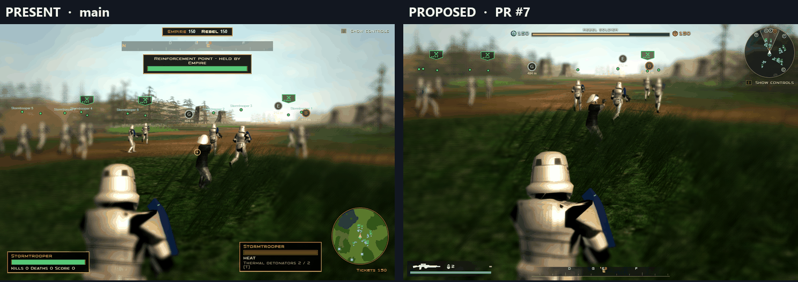
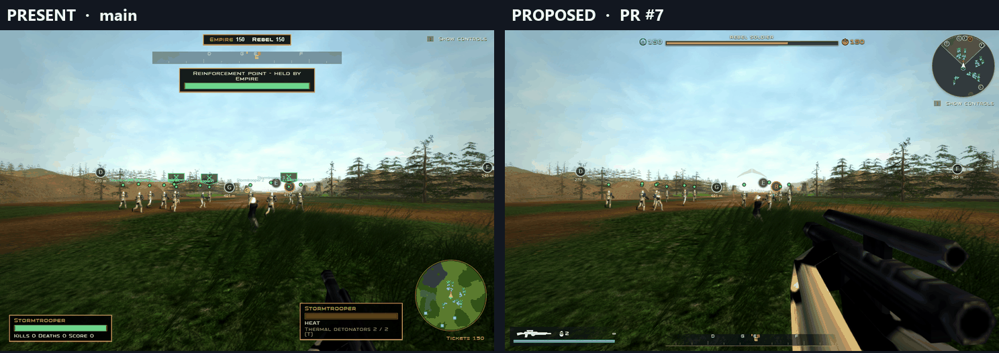
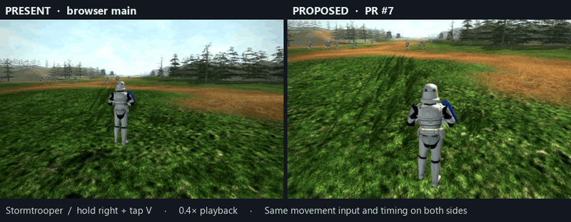
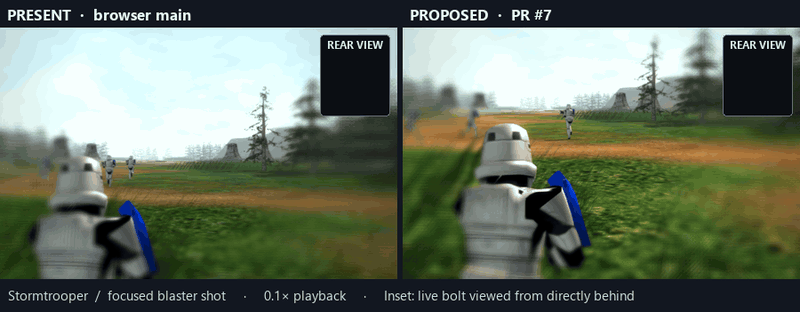

<p align="center">
  
</p>

<p align="center">
  <b><a href="https://playeaw.com">Play now at playeaw.com</a></b>
  &nbsp;·&nbsp;
  <a href="https://github.com/Glenn332/Empire-At-War-Browser-Edition/releases/latest/download/EmpireAtWarBrowserEdition-setup.exe">Windows app</a>
  &nbsp;·&nbsp;
  <a href="https://github.com/Glenn332/Empire-At-War-Browser-Edition/blob/main/progression.md">Progress</a>
  &nbsp;·&nbsp;
  <a href="https://discord.gg/tAaZEVFmn">Discord</a>
</p>

<p align="center">
  <a href="https://ko-fi.com/Z4S429CUIG"></a>
  <a href="https://discord.gg/tAaZEVFmn"></a>
</p>

# Empire at War: Browser Edition

*Star Wars: Empire at War* came out in 2006, and *Forces of Corruption* followed it. Nearly twenty years on, people
still play them, and the modding community keeps them alive with huge total-conversion mods. The original engine has
not kept up. It is 32-bit and single-threaded, and it was built for the hardware of its day. Large mod battles can
bring a modern PC to its knees.

This project brings the game back on a new engine that runs in your browser. It reads your own copy of the game, so
you get the same units, maps, models, sounds, scripts and AI, and it is built to keep big battles running smoothly.

## Where to play

- **In the browser:** go to [playeaw.com](https://playeaw.com). Use Chrome, Edge, Brave or Firefox on a computer.
- **As a Windows app:** [download the installer](https://github.com/Glenn332/Empire-At-War-Browser-Edition/releases/latest/download/EmpireAtWarBrowserEdition-setup.exe).
  The app finds your Steam install and your Workshop mods by itself, and it updates itself.

You need your own copy of *Star Wars: Empire at War - Gold Pack* (the base game and *Forces of Corruption*), for
example from Steam. Nothing of the game is hosted or shipped here. On first start, you point the game at your
installed game folder. You can also import the folder once as a single archive, which works in every browser and
lets you play offline afterwards. The start page walks you through both options.

## What you can play

- **Space skirmish:** the original maps, factions, units, heroes, abilities and HUD, against the computer or
  friends.
- **Land skirmish:** ground battles with reinforcement points, buildings, garrisons and turrets.
- **Galactic conquest:** the campaigns and the galaxy map, with invasions that lead into real space and land
  battles. This mode is still in progress.
- **Multiplayer:** internet and LAN games through the original lobby screens, including saving a multiplayer game.
- **Mods:** Steam Workshop and local mods load the way the original loads them, and you can stack several in your
  own order. Fixes are made in the engine, never for one particular mod.

[progression.md](progression.md) shows exactly what is finished, what is partial and what is still missing.

## Built for big battles

The point is to play battles the original engine struggles with:

- Hundreds of ships and fighters at once. The built-in benchmark starts at 100 against 100 and goes up to 400 ships
  per side.
- Hot paths such as route planning and the soldiers' animation run in WebAssembly. The space battle can step on a
  thread of its own, apart from the drawing.
- Rendering uses WebGL or WebGPU, with instancing and batching, so dense mod battles stay fluid.
- Press **F2** in any battle or on the galaxy map to see frame times live.

## Faithful to the original

The engine is new code, not a port of the original executable. It behaves like the original because it reads the
same files and follows the same rules: the XML unit database, the `.meg` archives, the models and animations,
particles, maps, the Lua story and AI scripts, the audio events and the game's own dialogs. Where the original's
behaviour is not obvious from its data, it is worked out from how the original engine does it. Where something is
still our own approximation, the progress list says so.

## Controls

The controls are the same as the original:

| | |
|---|---|
| Left click / drag | select, box-select (Shift adds, double click selects the same type) |
| Right click | move, or attack what is under the cursor |
| Ctrl + right click | attack-move |
| M / T / F / G / X | move, attack, attack-move, guard, stop |
| WASD / arrows / screen edge / middle-drag | pan |
| Wheel / Q, E | zoom / rotate |
| Ctrl+1…9, 1…9 | set / recall a control group |
| P, + / - | pause, game speed |
| Esc | cancel, deselect, menu |

In land and space strategy views or on the galaxy map, park the mouse at an edge of the battlefield to scroll; move inward to stop. Edge scrolling is on by default and can be disabled with **Pan the camera at the screen edges** in Game Options. It does not steer a possessed soldier or vehicle.

## Battlefront land battles: present and proposed

Each pair shows the **present** browser edition ([`main` at `d69de4b`](https://github.com/Glenn332/Empire-At-War-Browser-Edition/commit/d69de4b)) on the left and the **proposed** [PR #7](https://github.com/Glenn332/Empire-At-War-Browser-Edition/pull/7) on the right. The gameplay stills use *Forces of Corruption*, Endor, the same units and a 1200 × 780 viewport. The two slow-motion GIFs use matched input and simulation time on the same map. These are separate local runs, not mockups. Click a comparison to enlarge it, or jump to the [player-facing change list](#player-facing-change-list).

**1. Choose where to spawn — menu proposed in [PR #6](https://github.com/Glenn332/Empire-At-War-Browser-Edition/pull/6), shown integrated in #7.** The present screen puts a rectangular map and class statistics in a modal. The [deployment-only PR](https://github.com/Glenn332/Empire-At-War-Browser-Edition/pull/6) keeps the battlefield visible: choose a class on the left, a friendly spawn on the command-post disc, then **Spawn** beneath the selected unit. The original layout is still available under **O → Deployment screen**.

[](docs/battlefront/deploy.png)

**2. Aim at a trooper.** The proposed right-shoulder view keeps one faint dot just above and left of center. Press and release focus without moving the mouse: the same point on the target stays under the dot. Faction emblems flank the ticket counts; the center meter shows **only the unit you aim at**. Hits briefly mark only the health just lost. Look away and both name and meter clear. The upper-right radar shows local contacts and pins distant command posts by bearing.

[](docs/battlefront/shoulder.png)

**3. Look down the blaster.** In the proposed first-person view the carried weapon is visible at the lower right, stays attached through turns, and swings across the bottom when sprinting. The 20%-opacity sight is grey over terrain, blue over allies and red over enemies (orange with colourblind-safe markers). Outside dot-only focus, blaster heat grows outward along the lower arc. Ammo weapons retain their count and reload indicator.

[](docs/battlefront/first.png)

**Watch the third-person dodge.** Hold right and tap **V**. On `main`, the trooper dashes sideways with their torso upright. In #7 the trooper tucks, turns all the way over, and lands upright after travelling the same distance in this run. Both halves play at 0.4× speed.

[](docs/battlefront/infantry-roll.gif)

**4. Drive onto a command post.** The proposed chase camera frames the T4-B’s hull below the sight. The same lower-left equipment panel used on foot now shows vehicle name, weapon, hull and remaining shields without a speedometer or ammo count. The capture ring around the emblem drains to neutral white, then fills blue for allies or red for enemies.

[](docs/battlefront/vehicle.png)

**5. Follow a bolt.** These are renderer captures of the same stock red blaster shot at the same scale, isolated from the muzzle flash. On `main` the strip disappears when viewed exactly from the rear or front. In the proposal both ends remain visibly circular. Local focused shots leave the animated barrel and converge on the sight; recoil still applies. Ordinary RTS and space projectiles keep their original presentation.

[](docs/battlefront/bolt.png)

**Watch a shot leave the rifle.** Both Stormtroopers fire one focused red blaster shot, played at 0.1× speed. Follow it from the barrel into the clearing. Each inset isolates its build’s live bolt at a fixed distance from directly behind: the strip disappears from that angle on `main`, while #7 shows a glowing tail.

[](docs/battlefront/blaster-firing.gif)

| In a Battlefront land battle | Control |
|---|---|
| Switch infantry first/third person **or** vehicle chase/driver/gunner | **B / Y / Triangle**. Infantry and vehicle choices are saved separately; **E** exits without changing the on-foot view. |
| Focus | **Right mouse / left trigger**. Choose hold or toggle in **O → Zoom input**. |
| Roll | **V / RB** with a movement direction, including diagonals; stationary rolls go forward. Disable **Head bob** to remove the first-person camera bank. |
| Open the full map / show combat stats | **M** / hold **Tab** |

The views use each unit’s own model, weapon and hull rather than an Endor-specific list. Melee heroes keep third person, deployed artillery keeps its overhead sight, and missiles and model/particle weapons keep their own effects. Modded rigs, textures and loadouts can differ; see [coverage and how to test](docs/battlefront/README.md).

### Player-facing change list

Baseline: **the browser edition’s `main` at `d69de4b`**, not the 2005 Battlefront game or the original EaW executable. The existing view key, dodge, zoom, capture system, radar, full map and scoreboard are not new game modes or controls.

<details>
<summary><strong>Deployment and defense maps — proposed in #6, integrated in #7</strong></summary>

- **Layout and choice:** the default changes from the framed map-and-stats dialog to class cards, a live battlefield backdrop, a centered unit above **Spawn**, a circular map, objective text and a live unit count. Switch between **Battlefront 2005** and **Browser original** in **O** without restarting the battle; `deployUI=2005` or `original` also selects the layout in a link.
- **Class selection:** duplicate infantry, hero and vehicle choices are grouped by kind and displayed name. A card still selects a real eligible seat or reserve, preferring an existing hero or cheaper source. If that source vanishes, Spawn rechecks eligibility instead of silently deploying a different class. Cards show the loadout, numerical health, primary DPS, range and speed, with labels, costs or hero requirements where relevant. A locked hero can show starting stats without being spawned.
- **Portrait:** a team-coloured model sized to its visible silhouette replaces the static icon in the 2005 layout. Infantry and vehicles stay framed across screen sizes. The preview uses available idle clips, breathing and small gestures; reduced-motion users get a still pose. Missing model art or an unavailable preview renderer falls back to the unit icon where available.
- **Spawn map and spectating:** a north-up floor plan drawn from the actual terrain shows obstacles, contours, numbered command posts, squad spawns and selection rings. It fits live markers and their labels. Click a friendly unit to follow it without replacing the selected class; spectating does not make an ineligible squad a spawn point. Select a friendly post, or cycle positions with the post button or left/right arrows. The UI distinguishes watching, locked, waiting and ready states.
- **Input and sound:** choose classes/posts with the mouse or controller; focused buttons support keyboard activation. Spawn ignores repeated submissions. Class selection, post selection and spawning have distinct mechanical click sounds that respect the existing volume settings.
- **Defense markers:** deployment, radar and battlefield maps distinguish actual guns and garrison firing ports from scenery. A filled gun is ready; an outlined gun is inactive or vacant. Ownership changes its colour. A firing gun pulses, and mobile unit arrows briefly flash white. Hover a defense on the deployment disc for owner, type and state. These markers report existing weapons; they do not place new turrets.

</details>

<details>
<summary><strong>Infantry, vehicles, aiming and blasters — #7</strong></summary>

- **View controls:** **B / Y / Triangle** already switched perspective. It now saves **Infantry view** (third by default) and **Vehicle view** (chase by default) independently. Entering, switching seats, leaving with **E**, and reloading no longer overwrite the other preference. Controls help and prompts name the applicable view. Fixed garrisons keep their external view; melee heroes keep third person; deployed artillery keeps its overhead sight.
- **Vehicle camera:** chase distance and height fit the oriented hull rather than a fixed offset from its pivot. Walkers, tanks, bikes and banking aircraft stay below the aiming line. Driver view follows the chassis near its front roof; gunner view uses an available barrel/muzzle with a chassis fallback. No cockpit artwork was added. The deployment spectator uses the relevant infantry or vehicle perspective.
- **Infantry aim:** hip view centers the trooper with the sight above the helmet. Focus shifts to the right shoulder; the dot moves from 50% to 47% of screen width and stays at 34% height. Changing zoom without new aim input preserves the world point, not just the HUD position; intervening cover still blocks the shot. The chase camera retracts at terrain and eases back out. Scout magnification keeps its scope in first person rather than forcing it over the third-person shoulder view.
- **Zoom input:** right mouse / left trigger previously required holding. Hold remains the default; **O → Zoom input** adds a saved toggle option.
- **First person:** a filtered copy of the unit’s own hands, sleeves and weapon replaces rendering the camera inside the avatar. The ready weapon sits lower right, stays attached through turns and steep looks, sways with walking, recoils, and moves across the bottom when sprinting forward rather than while aiming, firing or crouched. A recognizable rigid weapon can supply a muzzle fallback; an unsupported rig does not put its whole body in front of the camera.
- **Dodge → roll:** the old dodge already supported directional input. The new roll latches the keyboard or stick direction when pressed, including diagonals; no input now means **forward**, not right. Its duration changes from **0.32 to 0.50 seconds**, with comparable travel and the same **1.4-second cooldown**. Third person shows a tucked full turn; first person dips, banks and tucks the weapon without inverting the horizon. **Head bob** off removes the bank. Aircraft retain their separate barrel roll.
- **Muzzle and aim:** first-person and focused shoulder shots and their muzzle effects start at the visible firing barrel on the first drawn frame. Once launched, moving the camera cannot drag them. Focused straight blaster shots converge on the actual aim point; local focused heat blasters no longer add invisible hip-fire spread over the dot. Recoil remains. Rockets and arcing projectiles are not straightened.
- **Bolt shape and scale:** pill blasters and particle-atlas lasers (including ion blasters) gain a luminous core with round front and rear ends on WebGL and WebGPU. The colour still comes from the authored atlas or weapon tint. Focused local bolts are drawn **1.7× longer and 1.8× wider**; near-camera first-person shots scale to the carried weapon. This includes other units’ blaster shapes in the same shooter battle, not their aim. Missiles using the particle atlas keep their effect; ordinary RTS and space bolts keep their prior rendering. The new geometry is not a larger hitbox.

</details>

<details>
<summary><strong>Combat HUD, radar and strategy controls — #7</strong></summary>

- **Sight:** the default ring is now three pairs of tapered blades with a center pip at **20% opacity**. Dot and cross remain selectable. The sight and target readout share one classification: grey over empty ground, blue for allies, red for enemies (orange with colourblind-safe markers). Focus shows only the dot. Heat fills nine lower-arc segments from the center outward, empties while cooling and signals venting when overheated.
- **Tickets and targets:** ticket counts sit on either side of the center, with faction-coloured crests instead of faction names. Base EaW, FoC and available mod art are supported, with a glyph fallback. There is no score-split bar. The center slot shows only the aimed unit’s name and remaining health. Each friendly or enemy hit highlights just its own lost portion, fading independently. Healing, changing targets or looking away clears stale marks.
- **Equipment:** one borderless, gradient-backed lower-left panel replaces separate weapon and personal status boxes. Infantry see health, weapon silhouette, grenade count where equipped, and either heat status, ammo/reload progress or melee readiness. Credit games still show credits. Vehicles use the same panel: name/seat, cannon or missile icon, hull fill and a shrinking cyan shield outline that disappears at zero. Lock-on/incoming warnings remain; separate vehicle ammo/readiness pips, speed, altitude and boost text are removed.
- **Field information:** the compass moves to the bottom, the kill feed to the upper left, the controls hint below the radar, and interaction prompts nearer the bottom. Nearby ally indicators remain, but ordinary friendly names need an aimed target and squad badges appear when aimed at or zoomed. Personal kill/death counters leave the live panel; **Tab** still shows kills, deaths, headshots, vehicle kills and score. The layout adjusts on narrow screens.
- **Capture:** a faction emblem inside a ring replaces the boxed progress bar. The ring drains the current side toward neutral white, then fills toward friendly blue or enemy red (orange with safe markers). The label identifies the action and post; the meter reverses during defense and briefly shows completed friendly control before clearing. Ownership, capture speed and scoring rules are unchanged.
- **Radar and map:** the radar moves from lower right to upper right; its drawing surface increases from 170 to 200 pixels and its local world radius narrows from 900 to 580 units. The heading-up display adds a facing cone that tracks field of view, larger directional people/player arrows and readable post labels. Only distant command posts pin to the rim: close bearings are spaced apart with pointers to the true direction. Distant troops, defenses and build pads do not pin. **M** remains the full battlefield map, with clearer unit arrows and the integrated defense markers.
- **Strategy edge scrolling:** previously opt-in on space/galaxy views, now on by default there **and** supported in land RTS and the shooter’s command view. Move the mouse to a battlefield edge to pan and inward to stop. Matching keyboard input does not double speed; opposite inputs cancel. Dragging, menus, loss of focus or direct unit control do not pan the free camera. The existing Game Options opt-out is preserved; **Restore defaults** turns edge scrolling back on.

</details>

## For developers

It is plain JavaScript modules on three.js, with no build step needed to run it.

```bash
npm install
npm start
```

This starts a development server on http://localhost:8377/. It serves the game data straight out of an install next
to this folder (`../Star Wars Empire at War`) or from `SWR_GAME=<path>`. Add `--mod <path>` to lay a mod over it.

Some useful addresses:

- `play.html?autostart&faction=Empire&enemy=Rebel&map=KUAT` skips the setup screen.
- `play.html?mode=land` starts a land battle.
- [Start Battlefront on Endor locally](http://localhost:8377/play.html?autostart&mode=land&shooter&map=ENDOR&faction=Empire&enemy=Rebel&deployUI=2005). Use `deployUI=original` to compare deployment layouts in the same build.
- `play.html?benchmark=100` starts the space benchmark, and `play.html?mode=land&benchmark=30` the land one.
- `viewer.html?model=EV_STARDESTROYER.ALO` opens the model viewer.

Other commands:

| Command | What it does |
|---|---|
| `npm run wasm` | rebuild the WebAssembly modules from `wasm/` |
| `npm run build:prod` | build the site into `dist/` |
| `npm run deploy:prod` | build and publish the site and the multiplayer lobby (`lobby/`) to Cloudflare |
| `npm run app` | build the Windows app (`src-tauri/`, Tauri) |

`npm run test:deploy` checks deployment logic without retail data. With `SWR_GAME` set, run
`node tools/test-deploy-disc-catalog.mjs` (add `--base` for the original game) to check the stock skirmish maps.
With the local server running, Chrome and optional `playwright-core` installed, `node tools/test-deploy-framing-browser.cjs`
checks the rendered vehicle silhouettes; run again with `--base` to check the other edition. No retail files are bundled.

The code lives in a few places:

- `public/` is the whole site.
- `public/js/` holds the file formats, rendering and audio.
- `public/js/game/` holds the simulation, AI, HUD, land battles and galactic conquest.
- `tools/` has Node helpers and tests.

## Use of AI

This project is AI-assisted. I use AI to:

- study how the original engine behaves, which is where it helps the most,
- write functions, from editor autocomplete to fully generated functions,
- write most of the automated tests,
- write git commit messages.

Implementation is done with Anthropic's Claude models and testing with OpenAI's GPT models.

I inspect and test every generated function myself, and everything that ships is my responsibility. Game behaviour
is checked by hand against the original game and against the mods people have sent me, and automated tests guard
against regressions.

The project has no generated assets. Every model, texture, sound and voice line comes from your own copy of the game.

## License

Copyright (C) 2026 Glenn332

The engine's code is free software: you can redistribute it and/or modify it under the terms of the GNU General
Public License as published by the Free Software Foundation, either version 3 of the License, or (at your option)
any later version. It is distributed in the hope that it will be useful, but without any warranty. See
[LICENSE](LICENSE) for the full text.

Bundled libraries keep their own licenses: three.js and Fengari are MIT (`public/vendor/three/LICENSE`,
`public/vendor/fengari/LICENSE`), and the FFmpeg core is GPL-2.0-or-later (`public/vendor/ffmpeg/COPYING.GPLv2`,
source in `public/vendor/ffmpeg/SOURCE.md`).

## Legal

This is a non-commercial fan project. It is not affiliated with or endorsed by Lucasfilm, Disney, Petroglyph or
Electronic Arts. *Star Wars*, *Star Wars: Empire at War* and its game data are © and ™ Lucasfilm Ltd. / Petroglyph.
The license above covers only this project's own code. It grants no rights to the game, its data, or the Star Wars
names and trademarks. The engine contains none of the original game's code or data; you need your own copy of the
game to play.
