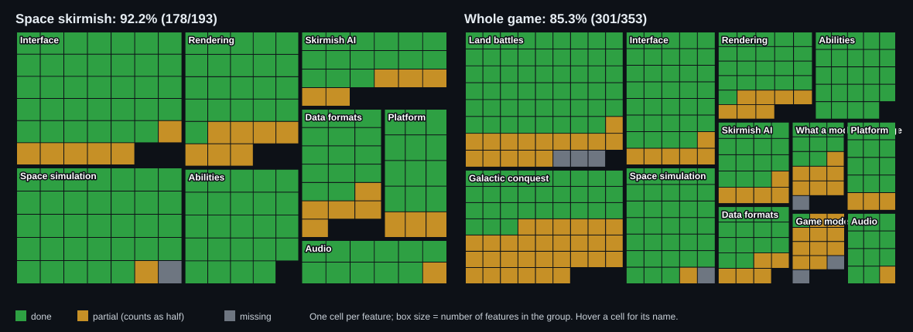

# Progression

How much of *Star Wars: Empire at War — Forces of Corruption* the browser version covers.

| | Coverage | Done | Partial | Missing | Features |
|---|---|---|---|---|---|
| **Space skirmish** | **94.1%** | 172 | 23 | 0 | 195 |
| **Whole game** | **93.6%** | 319 | 40 | 3 | 362 |

**How to read this.** Each cell is one feature or system from a hand-kept inventory (`tools/progress.mjs`), not a
measurement of code. A feature is *done* when it works in play, *partial* when it works but is simplified or rests on
an interpretation of the data, and *missing* when nothing exists. Partial counts as half. Features are not weighted by
size, and the land and galactic lists are coarser than the space ones, so the whole-game figure still flatters the port.
Regenerate with `node tools/progress.mjs`.

## By group

| Group | Scope | Coverage | Done | Partial | Missing |
|---|---|---|---|---|---|
| Data formats | space skirmish | 86.8% | 14 | 5 | 0 |
| Rendering | space skirmish | 87.5% | 21 | 7 | 0 |
| Space simulation | space skirmish | 100.0% | 35 | 0 | 0 |
| Abilities | space skirmish | 100.0% | 26 | 0 | 0 |
| Skirmish AI | space skirmish | 95.0% | 18 | 2 | 0 |
| Interface | space skirmish | 93.8% | 35 | 5 | 0 |
| Audio | space skirmish | 95.8% | 11 | 1 | 0 |
| Platform | space skirmish | 90.0% | 12 | 3 | 0 |
| What a mod can change | rest of the game | 71.9% | 8 | 7 | 1 |
| Game modes | rest of the game | 46.2% | 1 | 10 | 2 |
| Land battles | rest of the game | 100.0% | 77 | 0 | 0 |
| Galactic conquest | rest of the game | 100.0% | 61 | 0 | 0 |

## What we have, and what we do not

✅ done · 🟡 partial · ⬜ missing

### Data formats — 86.8%

- ✅ MEG archives, override order, loose files
- ✅ XML database with variant inheritance
- ✅ MasterTextFile strings
- ✅ ALO models: skeleton, meshes, materials, proxies
- ✅ ALO particle systems
- ✅ ALA animations (base game and FoC layouts)
- ✅ TED maps: objects, bounds, lights, skydomes — *each skydome is turned as any object is: Rz(z) Rx(x) and the model quarter turn (minis 29 to 32). Every battle, space or land, skirmish, multiplayer or campaign, starts in a random one of the map environments, stepping past one named Cinematic (Load_Map); the index the map stores is not used for that. Lua Set_New_Environment switches to environment n. The weather scenario comes with the environment, so Endor rains in its two rain environments; multiplayer rolls from the shared game seed so every player gets the same one. A loaded battle keeps the environment it was saved in, as the engine keeps the stored index on its other load path (most likely its save path: no shipped map uses it). Ours: the roll comes from the game seed, not the engine game random stream; the engine chooser among environments of one weather type has no callers, so it is not used*
- ✅ DDS textures (DXT1/3/5, RGBA, mipmaps)
- ✅ MTD/TGA icon atlas
- ✅ SFX and music event tables
- ✅ Command bar definition (CommandBarComponents.xml)
- ✅ Shadow-blob materials
- ✅ Game fonts — *the four EmpireAtWar typefaces are embedded in the executable and read out of it. Our own extension, not an engine feature: every .ttf/.otf under Data/Fonts is loaded, a mod font replaces the face its file name says (Data/Fonts/EmpireAtWar-Medium.ttf, Data/Fonts/Arial.ttf) and is also known by its family and full name; the topmost mod wins. The dev server hands mod fonts to GDI; mods chosen on the start page get their glyph pages drawn in the browser with the same cell metrics and advances as GDI (unhinted, a few advances off by one). A font that is not one of the game faces keeps the game credit sign: $ is taken from the matching original EmpireAtWar face (kept as Data/Fonts/Game/*.ttf, which no mod overrides) in page text and glyph pages, unless the modinfo.json of the mod the font comes from sets includes_credit_symbol to true (then the font keeps its own $)*
- ✅ Lua scripts (object scripts, AI plans, game scoring) — *a Lua machine is in (Fengari, with what the game own Lua 5.0 environment has around it) and the scripts a skirmish uses run as they are: the object scripts of the data in space battles - each scripted unit its copy, serviced at its rate, with the engine functions those scripts call (the unit, its owner, its type, abilities, finding and spawning things, proximity events, perceptual equations); the game-scoring script, one copy for the battle, told of its start and end, of every unit destroyed and of everything built (the battle summary takes what each side lost from it); the AI plan scripts in space and on land (see Skirmish AI). On land the Hostile faction is a player of its own over the wild side: native squads and capture points placed for Hostile belong to it, Find_Player finds it, units spawned for it fight everyone, and Change_Owner moves units and points between Hostile and Neutral (so hostile reinforcement points can start their pirate raids). Map markers and capture points are game objects to scripts as in the engine: their Lua_Script runs (a capturable structure keeps one copy, on the structure), Find_First_Object and Find_All_Objects_Of_Type find them, and Change_Owner moves a capture point. Action points: the main menu shows land demo maps in the space world, so marker scripts are not run there (the base game DEMO_CONTROLLER markers and mod menu battles); A function not written yet does not stop a script: it is counted and can be listed. Story scripts belong to the campaign: see Galactic conquest*
- 🟡 Compiled shaders (.fxo) — *not run as they are: each is re-written by hand. The terrain, water and all three Planet techniques were re-written from their disassembled bytecode; the mesh lighting follows the original BumpColorize, Gloss and GlossColorize sources (team colour lerp by the base alpha, the sun bump-lit and the fills on the vertex normal, specular of the sun specular colour, twice the light intensity as the engine sets it, with an exponent of 16 and the gloss of the normal map alpha, the base alpha or the gloss map red); ambient and fill lights are the engine spherical harmonics (each directional light projected with the cosine lobe, which evaluates to the same wraparound term), and in the gloss shaders the sun is in them too, as their SPH_LIGHT_ALL; the shield follows the original MeshShield source (base, wave and distortion maps at their UV scales and scroll rates, the base lookup offset by a quarter of the distortion, the vertex colour times the shield colour times the facing term plus EdgeBrightness, added on). Planet reads authored FXO LOD and cleanup annotations, sampler parameters and fixed-function pass/global sampler states, including mod anisotropy and resource-patched state exclusion. Native D3D9 HAL fixtures execute the original base and mod programs; flat interiors and the full transformed-lighting fixture match browser RGB byte for byte*
- 🟡 Native UI font rendering — *Native WindowsFont and StringTexture calls generate portable per-face, integer-height, float32-stretch and UTF16-page glyph assets from the normal overlay. CreateFont weight400 for resource dialogs and History labels and weight700 for command-bar Text/TextButton components, with full face names, quality4, retained average width, GDI advances and tmHeight, replace browser measurement and synthetic styles. Normal and component variants have distinct browser and server cache keys. Conquest script controls, screen text, readouts, planet names, encyclopedia cards, overview and Base Layout labels and stack/queue counts use their native component weight. Shared component rendering uses raw-advance Max_Text_Width point fitting down to6, actual bitmap-width justification, unscaled model Text_Offset and native outline/emboss effects. The TextComponent integer physical half-width alignment path is retained separately. Production icons show the native second-label price and native queue/population-based color rather than the former invented queued count. Native C_Text lookup, static <= wrapping and line pitch, strict list wrapping, last-glyph padding, even bitmap widths, raw coverage RGBA, asymmetric outline borders, emboss shadow and additive shine are implemented. Independent GDI probes match twelve glyph masks byte for byte; automated fixtures retain original embedded-font hashes and native outline output. Glyphs and composed map labels are cached. Repeated readouts retain their canvases; pending font/page loads cannot restore stale labels. Native glyph quads counter CSS layout width quantization before compositing, snap idempotently to physical pixel origins and resnap when a hidden shell opens. Native dialog resize reflows current fonts, static wrapping, list row metrics and glyph clipping while preserving control nodes, selection and retained list handles. Radio_Button and Check_Box fonts and plain radio label offsets now follow native gadget categories. Normalized sprite dimensions, middle-sprite button height and radio sprite bounds are retained. Native static text has no parent clipping. Raw resolution, font and screen-specific code traces reproduce the narrow-aspect wrapping conditions behind Planet Info heading/list collisions and History hint overflow; the original game has not been observed at that exact window size. Planet Info now uses native fullscreen anchor9, a screen-sized frame and truncated RC centering offsets, while anchor0 dialogs retain fractional centering. Exact native overflow is retained by user choice; no browser-only responsive fitting is applied. The Windows dev server lazily caches atlases; without it the CSS compatibility path draws the text. Earlier normal-weight 1..128 export verified3840 atlases including a second Unicode page in162seconds; current small portable-pack checks retain both weight variants and Unicode pages. Component regressions cover point fitting, effects, resize, cache reuse, stale text and snapping. Live base/mod checks cover overview, Base Layout, scripted campaign setup, production price/progress labels and font rebuilds at1743x1244 and1920x1080; all45 visible mod setup text controls use native glyphs. Native language IDs and whole-DAT fallback share the resolved text and font language. Japanese and Russian request Arial; Russian clamps authored sizes to7 before point or pixel conversion. IDs5..10 exclude the exact unsuffixed EmpireAtWar and Arial Unicode MS names while preserving suffixed and custom faces. Modern hosts retain ANSI charset0, with a separate charset128 atlas variant for the native Windows2000 Japanese branch. Native stretch deadband and float32 rounding retain the first font inside the threshold. Browser queries select the initial context without changing saved preferences. The live game.setLanguage compatibility API follows native GUI refresh: serialized whole-DAT publication, descriptor rebuild from authored metadata, composed text invalidation, in-place layout, retained-key translation and owner callbacks, including same-language requests. Native lists keep row selection, scrolling and live handles; historical literal messages are not reverse-translated. Planet Info, all four log pages, map labels, radar accessibility names, overview and Base Layout, Lua controls, type cards and screen text refresh without panel reconstruction. Story titles, retained chapter text and summary row labels refresh without replaying speech, movies, timers or selection callbacks. Slow glyph completion cannot restore expired screen text, and native point fitting stays resolution driven. Fourteen live translated-DAT checks verify Russian/French/English round-trips, native face restoration, panel/campaign identity, pause counters, script states, Summary sorting and story cursors without console errors. Action points remain for native Steam/OS language selection. Portable exports include the resolved faces and translated UTF16 pages. All11 language policy fixtures, translated DAT integration, fallback, component preload, charset/style cache separation, native GDI hashes and base/mod conquest checks pass. The highlight layer of embossed captions sits on the letters for centred and right-aligned captions too (before, it stayed at the left edge, so a menu title such as Main Menu showed a faint second copy to its left). Action points: port legacy tactical/menu text, shared default-font constructor-order handling for differing mod defaults, and expanded original-engine image comparisons.*
- 🟡 Bink movies — *original Bink 1 commandbar movies decode through a lazy single-thread FFmpeg worker, with at most two bounded RGBA chunks retained. Movies.xml supplies file, alpha, start frame and commandbar offset; shell bones and GameConstants supply placement and tint. Native playback forces 30 fps, independent of the file rate and subtitle lifetime. COMMANDBAR_MOVIE replaces the current movie, looping and STOP_COMMANDBAR_MOVIE work, and EOF removes its quad. Base Light_Loop and real-mod Pestage_Loop archive tests verify alpha, animation and exact sequential versus chunk-seek output; independent native FFmpeg produced identical alpha. Player and options-menu pause freeze the current movie; simulation-only story pauses let it continue. Action points: full-screen cinematics, Bink audio, movie music and XML pause flags, smaller decoder distribution, and investigate intermittent commandbar worker memory bounds warnings during mod campaign reloads*
- 🟡 Save games — *own save format (store in the browser, download, import); the original .sav files are not read*
- 🟡 Campaign and story XML — *CampaignFiles and TradeRouteFiles are read, including all faction Story_Name bindings, ordered Lua_Script groups, nested Active_Plot entries and story event parameters. Action points: the complete event and reward catalogue and original save serialization*

### Rendering — 87.5%

- ✅ Mesh shaders: bump, gloss, team colour, additive, alpha
- ✅ Vertex-shader skinning
- ✅ Particle emitters
- ✅ Laser bolts and beams — *custom drawn bolts from the texture atlas; a shot type that names a model instead (Projectile_Custom_Render 0, as many mod lasers do) is drawn as that model, instanced*
- ✅ Shots shown by their model: meshes, particle proxies, particle files — *muzzle flashes, missile exhaust and smoke trails are the model particle systems, started with the shot and left to run out when it ends; particle size is not scaled by Scale_Factor (read from the engine)*
- ✅ Particle emitters: the inherit-velocity flag and factor — *as the engine: an emitter with its inherit flag set (mini 0x43) moves its world particles each frame by the emitter current velocity times its factor (mini 0x28, default 1); without the flag nothing of the emitter speed is passed on. Ships and shots, space and land, hand their velocity to the effects they carry; object-space particles move with the emitter as before*
- ✅ Particle systems on a removed object: remove or let run out by the system flag — *as the engine: the particle system byte in chunk 2 (default on) decides; off (most ship engine effects) the effect goes at once, on it stops emitting and runs out where it was, at the last velocity. Used when a ship or death clone is removed and when a shot ends, space and land*
- ✅ Skydomes and backdrops
- ✅ Planet shader: clouds, atmosphere, city lights — *all stock Planet techniques are ported from original FXO disassembly: DX9 sph_t3, DX8ATI sph_t2 with clamped vertex specular and its positive cloud-alpha city term, and fixed-function t0 with inverse-transpose normals, material lighting and unscrolled texture stages. Detail1 falls through to t0 because the effects contain no DX8 technique. Native FXO annotations select the first supported technique within the requested detail. Full material parameter keys prevent shared surface textures from aliasing cloud, atmosphere, specular and city values. Original base and mod HAL renders cover varied sampled normals, cloud scroll, nonuniform rotated world matrices, geometric specular and two fill lights; all transformed-fixture RGB pixels match exactly. GLSL does not execute arbitrary replacement shader bytecode; see Compiled shaders*
- ✅ Fog of war: grid tiles, regrow, reinforcement overlay — *the original has no 'explored' shade; fog grows back after 6 s*
- ✅ Selection rings with stencil masking — *rings of neighbouring units join into one outline, as the material defines*
- ✅ Wrecks with break-up animations
- ✅ Engine glows — *effects on bones (engines, death clones, props) turn with the bone, so trails leave the thrusters; PTE_ turbo proxies run only while a TURBO ability is active, and vertex burst emitters burst on every mesh vertex; ship and death-clone effects keep their authored size, not scaled by Scale_Factor, as the engine does*
- ✅ Hyperspace arrival — *flown in as the program does it (its exit-hyperspace state, read from the engine locomotors): the ship starts 10,804 behind its arrival point and moves by the game table of 150 frame steps - 25 frames of nothing, 10 at 750, a braking ease to 8.125, 75 at that, an ease to rest; it is drawn from frame 35, when the arrival sound plays, and comes up out of the dark over the remaining 115 frames (the engine puts an unnamed light effect of colour 0,0,0 on it for that long: read here as a fade from black). The streak, flash and squash that were ours are gone, as is the stagger within a squadron. The stagger of a whole fleet arriving at once (a campaign) is not used*
- ✅ Turret aiming: turn and elevation with travel limits — *only defence satellites and a few Underworld hardpoints are turrets in the data; capital-ship gun mounts are fixed*
- ✅ Idle, deploy and build animations
- ✅ Attack animations — *nothing to do: no space skirmish unit has one in the game files (only the Eclipse, the Death Star and land units do)*
- ✅ 4K asteroid surface (generated)
- ✅ Space: lines to move destinations — *prediction paths: with ShouldDisplayPredictionPaths on (a GameConstant, false in the game, true in the EaW Remake mod) a selected ship shows its route to where it was sent as straight lines in RGBA 128 255 128 128, points closer than 20 joined. Waypoint lines: while Alt is held or the waypoint order is armed, the waypoints of the selected units are joined by lines in RGBA 255 128 128 128 with a w_waypoint_beacon.alo post (WaypointFlagModelName) on each. Ours: each unit shows its own legs where the engine keeps one waypoint list per moving group; the line width is not read; the short marks across the prediction path and the moving dashes of a looping waypoint path (we have no loops) are left out*
- ✅ Space: squadrons let out by a ship or station — *as the engine: made at the fighter bay; from a ship that moves, with a guard order on it (the player guard order, as EscortEvent): they keep by it as it goes, chase within Guard_Chase_Range and come back, and when it dies the order becomes a move to where it was last; from a station a move out along its facing by its first Spawned_Squadron_Location_Flyout_Distances (else its size), after which they wait there and, having arrived from that move, chase within Idle_Chase_Range; the white flag (st_garrison_icon, i_garrison_flag.tga) is drawn beside the icon of our own and allied ones. Ours: the first fighter bay and the first flyout distance for every launch; the flag place beside the icon is ours*
- ✅ Space: squadron icons (the grab bar) — *as the engine st_grab_bar, drawn from its CommandBarComponent: the whole button, its Blank_Texture_Name frame (the game: a dark square in a white border) and the icon, times one colour - the player colour, the faction colour in a campaign battle, at the alpha of the component Color (Engine PrimAlpha is tex times diffuse, read from its ps_1_1) - the Selected_Texture_Name (the game: a gold border) over it when selected, Mouse_Over_Texture_Name under the cursor; a mod draws them its own way (the EaW Remake: an empty frame, a white box). In a dogfight the icons are laid out per cell of the dogfight grid of the battle, the cells the fighters fight in: the block is centred on the projected cell middle (at the Layer_Z_Adjust of the first squadron in the cell), ceil(sqrt(n)) columns for the n squadrons of every side in the cell, 30 apart on a 768-line screen, rows going down the screen, and only the own squadrons of the local player take places, in the order the cell lists them. The icon glides to its place once, by the Max_Thrust of the squadron leader per frame up to the step of the fastest member, slowing to arrive, and then keeps to its place without a glide until the squadron leaves the attack; out of a dogfight it glides to the middle of its fighters, and a parked squadron keeps its icon where it was. The icon anchor is a point in the world (the middle of the fighters in all three axes, a dogfight place found where the screen point 0.048 of the screen height below the slot meets the height of the squadron), and the icon is drawn 0.048 of the screen height above it. Ours: a squadron keeps its place in a cell list while it stays in that cell, where the engine takes it out and puts it back at the end each frame in its own object order (with the web unit order changing, that made icons swap places)*
- 🟡 Shield shell: scrolling energy, edge glow, flash and swell on hits — *shader rebuilt from its parameters; impact emphasis is an addition*
- 🟡 Shadows — *sun shadows cast by the large pieces of large ships only, to keep the cost low; off by default, switched on in the menu*
- 🟡 Heat haze from heat particle emitters — *optional, off by default; strength set by eye*
- 🟡 Bloom — *optional, off by default; cutoff and strength set by eye*
- 🟡 Lens flare from LensFlares.xml — *optional, off by default; only ships block it, not the planet*
- 🟡 Space battle camera — *from TacticalCameras.xml Space_Mode (a mod has its own): start tilt, tilt range, field of view, start and nearest distance, a wheel notch moving the distance and narrowing the view as the game does, the zoom-tilt rule. Ours: it pulls back past Distance_Max to 9000, the distance is not smoothed (the game eases it over Distance_Smooth_Time), no tactical overview. The start yaw is the file Yaw_Default as a world angle, as the engine has it. Ours: C on a selected unit follows it with a free orbiting camera (HUD hidden, mouse orbits, wheel zooms, C or Escape leaves), moving to the next squad member when it dies; Alt+C (rebindable) follows the middle of the squad*
- 🟡 Cinematic camera: letterbox, self-directed shots, cut to large ships dying — *own shot director; the authored glory camera scripts (.tec) are not used because their coordinate frame is unknown*

### Space simulation — 100.0%

- ✅ Capital ship movement and turning — *as the engine: a turn in place runs at the turn rate divided by TurnInPlaceSlowdown (corvette 2, frigate 3, capital and super capital 4) to the end; a move with a facing (our line-move drag) is planned to arrive on it for the first two tries as the engine planner does. Ours: the route follower flies the arrival arc by heading; the departure tangents and the speed-lowering pass of the engine planner are not used; Lua Turn_To_Face turns at once*
- ✅ Fighter and bomber squadrons — *flight by the engine fighter locomotor: roll before turn, loops, leader and formation, strafing runs: from the leader, within Strafe_Distance and the target radius it presses on while the aim point is within 45 degrees of its nose in yaw and pitch and else flies straight on one turning radius ahead, the squadron at the height of the aim point, which is the ordered hardpoint, else one picked by Hard_Point_Priorities and then the nearest, else the hull; the approach: the route to where the target was (planned again once a second when it has moved more than half its Targeting_Max_Attack_Distance), then each fighter straight at it; dogfights in the 400-unit battle grid, from the battle area corner with odd rows half a cell over: against a squadron that has no cell the leader flies straight at it with the wingmen in formation, and the cell is taken only once the target has one, chosen from the 3 by 3 cells about the target (one with squadrons in it first, else the nearest centre) and kept; a fighter more than sqrt(80000) from the cell centre flies back to it; inside, the attacked squadron is sent against the attacker unless it is on a route or already on a squadron, each fighter takes the first enemy fighter of the cell whose 10 second lock has run out, within 90 degrees of its nose in yaw and pitch and its Targeting_Max_Attack_Distance (both locked 10 seconds), and tails it at its speed (Min_Speed inside Minimum_Follow_Distance), or flies to it at full speed while it is outside that cone; without a partner the leader flies to the cell centre and the wingmen keep formation; a squadron whose target dies takes on the first enemy of its cell, keeping the order it had. Fighter guns fire within Turret_Rotate_Extent_Degrees (yaw) and Turret_Elevate_Extent_Degrees (pitch, not with Turret_XY_Only) of the nose, recharge in the recharge time plus 0 to 10 frames, fire first after a random part of one recharge, hit the member of a squadron nearest the fighter, and stay quiet while the squadron is parked unless Can_Fighter_Fire_When_Idle. The target is chosen every 1 to 1.5 seconds from the leader among what it can hit within Targeting_Max_Attack_Distance or may chase (Guard_Chase_Range, Attack_Move_Response_Range, Idle_Chase_Range, plus Autonomous_Move_Extension_Vs_Attacker against what has hurt it or what it guards): a low-health one first, then the Targeting_Priority_Set, then the nearest; one only in gun range is fired at, also on a move, without being chased. Other flight: idle passes over a spot at full speed, the look ahead that turns a craft away from ships and structures it is about to fly into, as the engine has it: a point swept two turn radii along its flight (four for the squadron leader) and tested against the COLLISIONBOX of the model as a box, else against its collision meshes, for the objects whose bounds it is within one frame of; the first hit wins and a craft that starts inside a box ignores the rest; while it hits it steers straight away from the object centre at Min_Speed, and for 15 frames after the last hit it flies straight on; it may loop then as on any other turn (a turn of more than 170 degrees with Max_Lift, kept while more than 90, never on an idle pass), and flying straight on ends a loop. the objects it asks are those whose Space_Layer holds a layer other than Land (so no fighters, no hardpoints, and no drydocks or containers without a layer); when the squadron guards a target the avoidance speed is at most half the formation speed. A fighter flying straight at a large structure may still pass through its mesh, as in the engine: it sees the structure only within one frame of its bounds and its loop away is wider than what is left. The leader of a strafing run keeps its own top speed (its slot error against itself is zero), wingmen match their slot along the leader heading by the engine rule: within Squadron_Formation_Error_Tolerance of the worst along-track error the speed is kept, ahead of the slot it eases toward half speed over the stopping distance, behind toward one and a half times, with the turn, thrust and lift rates scaled up with it. In the target choice, after the priority, a fighter with a gun of its own prefers what its gun can hit now: the led aim inside Turret_Rotate_Extent_Degrees and Turret_Elevate_Extent_Degrees (or Fires_Forward), not cloaked. An idle squadron chases only after it arrived from a move with nothing queued (coming in from hyperspace, as a called-in reinforcement does, counts as such a move), after an attack of its own ended, or on a guard order; one that never moved stays parked and goes only for what has hurt it. An attack the squadron takes up by itself in a dogfight or against its attacker ends in the order it had before (guard, move, idle), and when its target dies an idle squadron takes the spot where it is as its new idle spot and looks for the next target at once instead of at its next 1 to 1.5 second scan. Ours: the parked squadron answering its attacker, the new idle spot and the scan at once were put in because fighters sat still where the original fights on; how the engine handles these three was not read. The attacked squadron is not turned on its attacker while ION_CANNON_SHOT or LUCKY_SHOT is active on it. Each shot is led and jittered as any unit shot and then tested from the muzzle, turned with the fighter pitch and heading, against the gun cone; a shot outside it is not fired and the pulse waits; a squadron target is hit at its member nearest the muzzle. Routes of squadrons are a straight line to the goal, as the engine plans for craft without a Space_Layer (nothing is avoided at planning, the fighters dodge in flight): the leader steers one turning radius ahead along it, the move ends when the leader passes the plane through the goal across the line, or at once when the goal is within 40; an attack plans it again once a second when the target moved more than half of Targeting_Max_Attack_Distance. The dogfight and parking grids span the play area. The squadron keeps to its route line by the engine side error (FormationMinimumSideError and FormationMaximumSideError) and speeds up by it; each fighter attacks at its own speed; idle wingmen follow the leader ahead by 40 frames of its velocity; loops end with one frame of lift and the yaw error flips past half a turn; fighters may spin away on death by Spin_Away_On_Death_Chance; asteroid fields, nebulae and ion storms are left out of the look ahead tree. Ours: the object bounds are its model box turned by its heading; look ahead avoidance in every dogfight steer; idle squadrons fly back to their spot at speed; ordered squadrons keep chasing a target into fog; at most 24 wrecks stay at once for speed*
- ✅ Hardpoints: weapons, engines, shields, bays — *as the engine: engines go off only when the last engine hardpoint is gone, then speed is times Engines_Disabled_Speed_Modifier with the turn rate kept, and Turbo and Spoiler Lock switch off; a destroyed gravity well switches Interdict off for good; destroying a ship destroys its remaining hardpoints*
- ✅ Damage vs armour table, shields, hull — *as the engine: maximum hull is Tactical_Health and each hardpoint its Health, both times Object_Max_Health_Multiplier_Space (1.5) and the difficulty adjustment; hull and hardpoints are two pools - a direct hit goes to the aimed hardpoint, else the hardpoint whose model it struck, else the hull, a shot at a hardpoint already destroyed does nothing, and every frame the pools are pulled to within Hull_Vs_Hard_Points_Health_Constraint of each other; the ship dies when the hull is gone or (Should_Be_Destroyed_When_All_Hardpoints_Destroyed) the last destroyable hardpoint goes, and its health share is the smaller of the two. A Normal hit with a shooter is scaled by the Diminishing_Firepower curve over the time since the target's last such hit (60% at once, full after a second; off for a shooter whose ability clears ALLOW_TARGET_DIMINISHING_FIREPOWER), on land too. Ion storms stop shields absorbing for Ion_Storm_Shield_Disable_Time without draining them. Ours: the low and critical health voice still uses the health share*
- ✅ Projectiles: lasers, ion, missiles, torpedoes — *a weapon hardpoint fires only in the attack modes its Fire_When_In_Normal_Attack_Mode, Fire_When_In_Power_To_Weapons_Mode, Fire_When_In_Rocket_Attack_Mode and Fire_When_In_Turbo_Mode allow (all yes by default; with no POWER_TO_WEAPONS, ROCKET_ATTACK or TURBO ability on the unit is in normal mode, and with several on every one must allow it; our reading of the data, as the base T4-B missiles and bomber ion cannons need it), in space and on land, and a land rocket attack uses the hardpoint set for rocket mode; a hardpoint does not fire at a target nearer than its Fire_Min_Range_Distance. When an object is destroyed it leaves Destruction_Survivors as the engine (read): a count between Minimum_Destruction_Survivor_Count and Maximum_Destruction_Survivor_Count (1 and 1 when not set, our reading as the base speeders need it), each picked from the chance list (none when the chances do not reach it), for its owner, in space and on land; a space projectile leaves its survivors where it ends (the Discord missile its buzz droids). MS ADPCM sound files are turned into PCM before the browser decodes them. A Battlefield_Modifier_Ability with FOW_Reveal_Range_Multiplier changes the sight of the owner and allies like a combat bonus. A Redirect_Blaster_Ability block sends the bolt off harmlessly, turned at random up to Max_Projectile_Redirection_Angle_In_Degrees from straight back (read: the block deflects within that angle; where it goes and that it hurts nothing are our approximation). In a campaign land battle Always_Side_With_Defender and Always_Side_With_Invader structures belong to that side. Action points: Reinforcement_Deploy_Time_Multiplier (no reinforcement deploy delay yet, Skirmish_Reinforcement_Delay_Frames is not used either); the land TaskForce Get_Stage (the engine staging search is not traced); While Full Salvo is on a hardpoint waits its Full_Salvo_Weapon_Delay_Multiplier (0.15 when it has none, as before) and while Power to Weapons is on its Power_To_Weapons_Mode_Weapon_Delay_Multiplier (1 when it has none): our reading, the engine defaults for both are not traced yet. A projectile with a Projectile_Combat_Mod gives what it hits, when it is in the Projectile_Combat_Mod_Category_Mask (any when empty), that combat modifier (defense, damage, health, shields, energy, speed, fire rate, sight or range) of Projectile_Combat_Mod_Value for Projectile_Combat_Mod_Duration seconds, a new hit of the same projectile renewing it, in space and on land; space units now also take fire rate modifiers. The victim shows the Projectile_Combat_Mod_Effect particle while the modifier is new (a renewing hit adds no second one). MeshAdditive2X is MeshAdditive at twice its colour (read from its compiled shader); a mesh whose shader file is in neither the game nor the mod is not drawn (our reading: base data names such shaders only on hidden helper meshes). Reflect shaders draw without the sky cube reflection: the engine binds SKY_CUBE_TEXTURE through its normal texture loader and neither the game nor the mods ship a cube map, so the reflection term is likely empty in the original too (not traced further). As the engine: a hardpoint or unit Projectile_Damage above 0 replaces its projectile's, and a projectile with no damage but a blast hits its victim for the blast; a blast is full Projectile_Blast_Area_Damage, steps down in tiers only with Projectile_Blast_Area_Dropoff (distance to the model surface), is shared among the destroyable hardpoints inside it except the one hit directly, and keeps Projectile_Blast_Area_Max_Victims and the delayed damage time; the lead against a turning target fits a circle through its last three positions and solves the flight time by the engine's secant search; sensor jamming deflects missiles within its radius and sends missiles at a jammed target straight, with no shot scatter. Not in: the jammed units' radar blips are not hidden*
- ✅ Hardpoint targeting — *as the engine: a shot with no chosen hardpoint goes at the nearest live targetable hardpoint in 3-D, an attack order picks by Hard_Point_Priorities and picks again when that one dies; a hardpoint fires only within Fire_Cone_Width and Fire_Cone_Height in its fire bone frame (turrets within Turret_Rotate_Extent), tested on the led aim point, and a missing cone is 0 as in the engine; a pulse that cannot fire waits and retries every frame, and the recharge starts after the last pulse fired; the AI fires at opportunity targets with hardpoints whose Fire_Max_Recharge_Seconds is within the cutoff*
- ✅ Garrison fighters from carriers and stations — *as the engine: squadrons launch from a random live fighter bay, and a type with no bay launches none. Ours: the first flyout distance*
- ✅ Reinforcements by hyperspace — *as the engine: a drop is refused when the last Space_Reinforcement_Collision_Check_Distance of its approach meets anything on the unit's own Space_Layer (moving ships where they will be over the next 115 frames) or on the static layer, for a squadron anything that is not corvette layer; AI drops arrive facing the player's start facing. Ours: the lane is a capsule tested against circles, and a human drop keeps the heading chosen while placing it*
- ✅ Build pads and construction
- ✅ Salvage bounty on object deaths (tactical) — *read from and the death routine (bounty.js): paid only while bounty collection is on (a story switch, ENABLE_BOUNTY_COLLECTION and DISABLE_BOUNTY_COLLECTION, set back on by each story reset), to the players allied to the killer that have a rule for the victim faction, never for an ally victim. The worth is Override_Bounty_SP or MP of the type, else the largest Default_Bounty_By_Category of its categories (MP numbers outside a campaign battle); the rules are Bounty_On_Faction_Ability (the skirmish UL_Bounty_Upgrade): Bounty_Percentage_Amount per Stacking_Category (largest in a category, categories add), Target_Faction_Names, Apply_To_All_Allies. The payout is worth times percentage rounded half away from zero, at least 1, credited with the AI credit multiplier, counted for the end screen Salvage collected line, and shown as +N over the wreck for the local player in space. Each fighter pays by its own type and the squadron container pays nothing, as the engine; the +N shows only for the local player, on land too; the corruption and Nal Hutta bounty upgrades reach campaign battles through the planet upgrades, and bounty credits are not counted as earned, as in the engine*
- ✅ Mining income — *paid a little every frame as the engine (the amount over the interval), with the same totals; tactical credits are capped by the campaign credit cap as the engine, with no cap in skirmish*
- ✅ Capturing pads and structures — *a build pad left empty with none of its side near goes back to nobody over one transition, as the logs of the original show; what stands on a pad holds it, and a captured structure (the merchant dock) stays taken*
- ✅ Station upgrade levels
- ✅ Tech upgrades — *upgrade Combat_Bonus_Ability goes into each ship combat modifiers under its Stacking_Category as the engine: levels of one category replace each other, different categories add, and health bonuses raise the hull*
- ✅ Population cap — *the faction own cap for a space battle (Space_Tactical_Unit_Cap: 20 for the Empire, 25 for the others), which is what the program shows and tests a new ship against; the setup screen can override it*
- ✅ Asteroid fields, nebulae, ion storms — *a nebula: no ability may be switched on inside or for Nebula_Ability_Disable_Time after (read from the engine); what is on is switched off once on the way in, except the kinds the engine ability table gives no nebula flag - hunt, lure, lucky shot, deploy troopers, self-destruct, sprint, ion cannon shot, S-foils, maximum firepower, stim pack (their flag is the table default, taken as off - the default was not found). UnitAbilityTypes.xml, which may change that table, is empty in the game and the trial mod and is not read. Asteroid fields hurt capital, frigate and super capital ships only while they move and not in hyperspace, each hit on a random live destroyable hardpoint, as the engine*
- ✅ Craft fly through asteroid fields, nebulae and ion storms — *the engine keeps those out of the tree its fighter look ahead asks; impassable asteroids are still avoided*
- ✅ Route search through asteroid fields, nebulae and ion storms — *read from the engine: each field sits on the static layer with its kind bit; a move avoids asteroid fields when the unit has ASTEROID_FIELD_DAMAGE and every ship avoids nebulae and ion storms, except the kinds it starts or ends in, until the fourth try. Ours, by choice: ships fly straight through any field that does not hurt them*
- ✅ Nebula effect on ships inside: Nebula_Effect_Color multiplies their sun and fill light and its alpha is their opacity, alpha blended as the stock shaders do, faded in as the engine does
- ✅ Reinforcements cannot drop into asteroid fields, nebulae or ion storms — *read from the engine: the drop test sweeps the footprint of the unit against everything on the static object layer, where fields sit as a circle of their Space_Obstacle_Radius. Ours refuses a drop when the footprint of the unit (Custom_Soft_Footprint_Radius times Scale_Factor, else the extent of its model) overlaps a field, for the placement preview, the reinforce command and the AI drops*
- ✅ Beams start at their bone wherever the ship is — *tractor beams and other bone beams took the bone from the bone world matrix, which is not updated for ships whose model is drawn apart from their scene object, so a tractor beam started near the centre of the map; the start point now comes from the position and heading of the ship and the offset of the bone in its model. The beam already lets go beyond the range of the ability*
- ✅ Ships at the edge of the battle area turn back in — *a ship pushed against the edge and facing out was given a turn that leaves the battle area, was clamped back every step and never turned; a waypoint outside the battle area is now skipped and the ship steers for its destination*
- ✅ Ships turn only toward an ordered target — *read from the engine: a ship turns its hull in place toward its target only when the target was set by an attack order, or when the ship has no hardpoints, or when GameConstants Auto_Rotate_For_Space_Targeting is on (off in the base game); idle, guarding or attack-moving ships with hardpoints keep their heading and their hardpoints fire at what is in arc. Ships with a space layer (unless Disregard_Space_Layer_For_Guard_Attack_Move) no longer chase on Idle_Chase_Range. When it turns it aims at the targeted hardpoint, only when more than 10 degrees off, and a type with UNIT_AI turns its strongest side to the target by the engine side firepower (each weapon hardpoint's share of AI_Combat_Power on the sides its fire cone covers, worked out again when one is lost); in the base game the bow is the strongest side of every ship, so they still point their nose*
- ✅ AI fleets travel to their target without stopping to fight — *read from the engine and the AI plans: space attack plans send task forces with Move_To or Attack_Move, and for ships with a space layer an attack move does not stop to engage in the engine (its engage test returns no for them), so ships there fire at what comes in range while they keep going. Ours, by choice and not the original: every ship on an attack move stops while its target is within its engage range and goes on along its route once that target is gone, for the player and the AI alike. Ours does the same. Squadrons launched by a ship that moves get a guard order on it at once, as in the engine, and attack enemies within their Guard_Chase_Range plus weapon reach of the carrier (checked on the battle worker)*
- ✅ Shots hit the models attached to hardpoints — *read from the engine: a hardpoint with a Model_To_Attach puts that model on its bone as part of the object, and the collision meshes of the attached model take projectile hits like the hull does (the shot then goes through the shields first, and a shot that was not aimed at another hardpoint damages the hardpoint it struck). Before, only the collision meshes of the base model were tested, so turrets and shield generators that sit outside the hull could not be hit: on the Rebel level 5 station the shield generator hangs 231 below the hull, every shot at it missed and the station regenerated its shields under the fire of three Star Destroyers. Three Star Destroyers ordered onto that generator now land 459 of 534 shots, take the 9000 shields down in about 18 seconds and destroy the generator a few seconds later; shots aimed at laser turrets went from 24 of 324 to 379 of 391 hits*
- ✅ Nebulae stay drawn off the centre of the screen — *a nebula model is all see-through meshes (and some carry particle effects), so the model bounds, which leave see-through meshes out so glows do not grow hit boxes, came out as the one-unit fallback and the nebula was culled as soon as its centre left the view. Culling now uses a separate draw radius over every shown mesh and the reach of the attached particle effects (spawn volume, speed over the lifetime, acceleration and particle size), so any model drawn mostly by see-through meshes or particles is kept while part of it is on screen. Checked on Thrawn Revenge*
- ✅ Visibility and stealth
- ✅ Teams sharing a station
- ✅ Group-move formations (per layer, arrive together) — *as the engine space movement coordinator (read): each ship is paced once at launch, its straight distance to the order goal over its top speed plus half its turn to it over its turn rate, against the longest of the non-fighter ships, floored at SpaceIdleMovementSpeed (0); squadrons are not paced; nothing paces again on the way, so a ship that is held up or detours arrives late in the original too. In the engine an attack-move ship with a Space_Layer (every corvette, frigate and capital ship of the game) does not stop for what it meets unless its type has Disregard_Space_Layer_For_Guard_Attack_Move (read); ours stops every ship for a target in engage range and resumes the route after (see the AI travel entry). Ships are kept apart only by their route planning; space has no pushing apart, so ships fighting in a crowd may overlap as in the original*
- ✅ Route planning around stations, rocks and asteroid fields
- ✅ Height layers (Space_Layer)
- ✅ Ships steering around each other — *the engine space path finder: a search over place, heading, speed and time with its moves (straight on, turn steps of 360 / MaxRotationsSpace on the turning circle, come round onto the goal and fly onto it, speed up, slow down, creep, turn on the spot at the start), each step costing its time, ruled out by what stands still (except near the start) and made MinObstacleCostSpace / CurrentPathCostCoefficientSpace dearer by ships under way where they are to be then; states told apart by place and heading, SpacePathfindMaxExpansions, the retries of SpacePathingTries growing coarser and greedier, fields only a cost from the fourth, half speed from the fifth; a search that fails all its tries gives no new route and asks again 2 seconds later: a ship ordered with others keeps the route it had, a ship ordered alone holds; nothing is left out of a search for overlapping the ship at the start: a hit on what stands still only costs more while the step starts within OccupationRadiusCoefficientSpace times the radius plus the turn radius of the start (never for the jump onto the goal), and a step off the map is allowed within that plus the braking distance plus 100; the destination moved to a free place first; shapes as the engine tests them, a reach that depends on the direction, along and across the course, half sizes of Scale_Factor times Custom_Hard_X/YExtent, else each from the half size of the box of the collision meshes on its own (x along, y across: the box of the unplaced model, before the quarter turn the engine gives a model when it places it, so a ship with its nose along its model y and no Custom_Hard extents reads wider than long, the reverse of how the XML extents are written), with no floor; against stations and the rest of the static layer the width grows by SpaceStaticObstacleAvoidanceBonusDistance; no pushing apart; ships fly the route speeds. The searches run on a thread of their own (pathworker.js; the answer a step or so later, as the engine also spreads its requests over frames), compiled to WebAssembly (wasm/pathsearch.ts; the JS search the same, as fallback). Ours: a search may take 60 ms there; the moves onto a final facing are unused (our orders give none); which of our hazard fields are in the engine static layer was not traced (the extra width is left off them)*
- ✅ Interdiction (reinforcement block)
- ✅ Repair stations and structure self-repair — *as the engine: each heal tick mends only the least healthy live destroyable hardpoint (Heal_Percent of its maximum plus Heal_Amount) and the hull when none is hurt, so a ranged healer never raises the hull past the hardpoints; repair for credits raises the hull toward the hardpoint share every frame*
- ✅ Waypoints

### Abilities — 100.0%

- ✅ Hunt
- ✅ Hero and unit combat bonuses (Combat_Bonus_Ability) — *object categories are the bit masks of Enum/GameObjectCategoryType.xml as in the engine: a type is in every category whose mask meets its own, so the group categories a game or mod defines there (Hero and All in the base game; GroundUnit, SpaceUnit and others in mods) match bonuses, restrictions and lookups by name; auto-resolve keeps building its masks from the listed categories. Read from the engine: every object whose type carries one that holds in space (Space_Automatic, Combat_Automatic, Global or Galactic_Automatic) offers it when made to every allied ship of its types or categories (with Specific_Faction: of that faction; never its own Unique_Space_Unit, not itself unless Apply_Special_Ability_To_Self_On_Creation); later ships take it as they are made and it is taken back when the source dies; the largest of each Stacking_Category counts and categories add; health and shields raise the current value by the gain, and damage, defence (damage taken times one less the bonus, before shields), speed, energy and fire range follow. A hero with Attach_To_Flagship_During_Space_Battle and no space unit of its own (Tarkin, Mon Mothma, the Emperor) rides the fleet flagship as the engine: the arriving ship with the most hull plus shields, counted with its owner's difficulty multipliers, upgrades (galaxy-wide ones included) and bonuses as the engine (never a company, squadron or Super ship), carries it hidden and its tooltip reads Flagship, no transport comes for its company, the flagship takes the bonus too, the hero is lost with the flagship and kept when it retreats; without a flagship, and arriving as reinforcement, it comes in its own transport. A hero elsewhere on the planet, or one still waiting as reinforcement, gives nothing, as in the engine (it is not in the battle until it arrives). Ability recharge (Recharge_Seconds times one plus the unit's own recharge total, in space and land, Lua Force_Ability_Recharge as the engine) and tactical build time (the producing station or factory book, fixed when queued, pads unaffected) are applied. Ours: the tooltip is our encyclopedia card, so the engine's list of who rides the flagship is not shown*
- ✅ Power to weapons / engines / shields
- ✅ S-foils
- ✅ Sensor ping
- ✅ Barrage area
- ✅ Tractor beam — *range of a unit-targeted ability counts from the caster hull, so a Star Destroyer at its attack distance can use it*
- ✅ Ion cannon shot
- ✅ Concentrate fire
- ✅ Invulnerability
- ✅ Missile shield
- ✅ Energy weapon
- ✅ Energy pools and energy per shot — *as the engine: POWERED objects hold Energy_Capacity times one plus the energy bonus and gain Energy_Refresh_Rate every EnergyRechargeIntervalInSecs, both scaled by the ENERGY_REGEN_MULTIPLIER and ENERGY_REGEN_INTERVAL_MULTIPLIER of active abilities (DEFEND on the Nebulon B, Assault Frigate, Calamari Cruiser and Home One, SPOILER_LOCK on X-wings and B-wings); a unit weapon (fighters, transports, defence satellites) needs Projectile_Energy_Per_Shot stored to fire and spends it per projectile, hardpoint guns never do, and a costed weapon on a unit without POWERED never fires. In the base game only the defence satellites run dry in long fights (about 170 s of full fire) and the TIE Prototype slows slightly; saves keep the pools*
- ✅ Full salvo
- ✅ Harmonic bomb
- ✅ Blast
- ✅ Weaken enemy
- ✅ Corrupt systems
- ✅ Leech shields
- ✅ Buzz droids — *aimed at any location, spawning the ability Object_Type there; the swarm chases and damages enemies within Chase_Radius and Damage_Radius, wears down by Own_Damage_Per_Second and keeps its own healing abilities (mods use it for repair drones); the AI drops support swarms on its most damaged ship. Objects with Is_Valid_Target false cannot be targeted*
- ✅ Stealth
- ✅ Interdict
- ✅ Defend
- ✅ Auto-fire for abilities
- ✅ Replenish wingmen
- ✅ Self-destruct

### Skirmish AI — 95.0%

- ✅ Builds units, structures and upgrades
- ✅ Attacks, defends, captures pads
- ✅ Three difficulty levels — *easy, normal and hard as the engine applies DifficultyAdjustments.xml (read): only to a computer player, by its own difficulty and the entry its AI player type names, in space and on land - what its units deal to others, the most health and shields they have, what it earns (Credit_Multiplier only: easy 0.5, normal 1, hard 1.2), how long it builds, the contrast of its forces and the sleep of its goal system. The old AI income table applies only behind ?oldai*
- ✅ Uses abilities
- ✅ Several bots per team
- ✅ Target priorities (Targeting_Priority_Set)
- ✅ Hand-written tactics of the first space AI (scout, pad rush, escort, artillery, bombing run, sweep, flank, last stand) — *replaced by the engine goal system and the game plans; kept behind ?oldai for comparison*
- ✅ Original Lua AI plans — *the plan scripts of the data (or of a mod) are run as they are, in space and on land: the goal system of the engine chooses goal and target, the plan whose Category names the goal is given its task forces by the engine plan solver (or buys them), and its threads, blocks and the events of its forces are served; the library Default_ handlers, the evaluator scripts the equations call, map hints and weighted type lists are there. Not run: galactic plans. The task force orders follow the engine: Attack_Target goes for the weakest hardpoint of the kind it names and the next one with repeat, Guard_Target on a force guards one member, Prepare_Ambush steps out along the target facing until the threat is low, Explore_Area goes to the cell seen longest ago, Attack_Move on an object attacks it to the end, and an avoidance string lets a move pass through those fields; the events Unit_Damaged (with the real attacker), Original_Target_Owner_Changed, Current_Target_Destroyed, Unit_No_Threat and the ability events are sent; the plan scripts see captured pads, pads with a structure, single fighters and the planet weapon as the engine lists them, and Purge_Goals ends the removable plans of the player*
- ✅ Avoids fields and hazards
- ✅ Space AI: which ships a plan is given (the engine plan solver) — *as the engine plan solver (aiplans.js staff): one unit at a time, the best sum of nearness to the target (normalised over the whole free store), tech level, room on the first line with room and contrast against the enemy at the target; no type over half the choice while another can be taken; escorts after the main force; the choice stands only if lines, totals, RequiredCategories and the contrast (with MinimumCost and AdditionalCost) are met. No ship under Health_Low_Percent_Threshold is given; with AllowEngagedUnits off only engaged squadrons are left out; a unit held by a running plan is not offered to another goal. A buy plan with a target buys by the same contrast, and may take a named hero from the field. A waiting ship of a type is taken over the best one of that type on the field unless that one stands at the target; distance is the straight line, as the engine*
- ✅ Space AI: reinforcements of the AI (built ships wait to be called in) — *as read from the engine: a ship the AI builds goes to its reinforcements like a human player's; the plan solver gives it to a plan that takes free store units, and the plan script lands it (QuickReinforce) under the same drop test as a player drop, now with the engine drop lane; each drop waits for population room and an entry no longer in the pool is dropped; no landing once the station is gone. A unit no plan has a line for stays in the pool for good, as in the engine*
- ✅ Space AI: reachability of a target — *as the engine: a space battle has no reachability test at all (read from the space goal system)*
- ✅ Space AI: a task force moves as one formation order — *as the engine space movement coordinator (read), for the player and the AI: squadrons going the same way form wings that escort the nearest ship of the group (flying its course at up to twice its speed when close, else going to where it was), ships set off SpacePathfindFrameDelayDelta frames apart layer by layer with the furthest ahead first, an attack group is checked again every MovementReevaluationFrameCount frames (a shared hardpoint pick, the layer put back on its ring when the target moved out of reach), and wings with the same orders that meet are merged; the move counts as done when every unit has arrived. Ours: a wing gives up its escort when the ship stops, where the engine leaves it beside the ship; wings and attack groups are not kept in saves*
- ✅ Space AI: the force perceptions (FriendlyForce, EnemyForce and their unnormalized forms) — *checked against the original: a fourth run with the logging mod wrote the perceptions every ten seconds (PERC lines from probe equations, re/ailog_mod; re/ailog/original_kuat_empire_ai_medium_run4.txt). As read from the engine they are a plain sum of AI_Combat_Power over every object of the side - fighters one by one - with the neutral player counted as enemy; the log shows the one exception: the station a skirmish places at the start counts nothing and BaseLevel reads 0 while it stands (seen, not read - the station an upgrade puts in its place counts in full). Ours now gives the same figures (840 against 600 at the start, 10840 with the level two station) and the same turns: the AI wants a new station from the 2nd minute, which holds its ship buying at nought - in that run the original too bought no ships in ten minutes against an idle human, so the earlier runs that did were the exception, not ours*
- ✅ Space AI: defence satellites and the level five station against an idle human — *compared over the four logs of the original: what it builds early follows the pads it takes first, and those it picks by lot among pads of equal desire - in run four the one next to its station (a mining facility at 21 seconds, two satellites before the second minute, level four at about 464 seconds), in run three the two far ones as ours does (mining at 66 seconds). Run two, with the human idle as well, reached level five at 546 seconds and bought its first capital ship after it; ours level five at about 573 and its first capital ship right after. Run three is no idle game: the human raised his station to level three by 202 seconds, which is why that AI saw a stronger enemy, took its cash drop and built satellites and ships early*
- ✅ Space AI: the cash drop of a computer player that is behind (Skirmish_Generate_Magic_Cash_Drop_Space) — *its plan buys nothing - a force marked TaskForceRequired, and Give_Money(6000) - and was never begun here, as the check beforehand wanted something bought; the engine lets such a choice stand. Now a computer player under 3000 credits facing more force than its own after the third minute gets its 6000 and goes on to raise its station, as in the log of the original (cash drop at 202 seconds, upgrade at 205). The same holds for the land cash drop. Not yet watched in a game the human is winning*
- ✅ Space AI: Game.ForceVisibility — *as read from the engine: the share by count of the objects of every player but the one asking - allies too - that are in view, of the equation Parameter_Category; the objects are those of the perception lists (registered by their unit AI behaviour), the same the force sums go over, structures included. Ours: in view is the side sight now (the engine asks the unit AI behaviour, a slot not resolved); with nothing to count the engine divides nought by nought, ours gives nought*
- ✅ Space AI: the firesale map reveal (BurnUnits plans) — *the plan of the data (or of a mod) shows the whole map to the computer player and, in a skirmish, to the human when Should_Firesale_Space holds - in the game when a computer player has no upgraded station after two minutes, in the trial mod whenever it is within 50 of its population cap. The reveal now ends with the plan that made it (or a restart of that script), as the plan comment says the engine does when its reveal objects go; before, it stayed for the rest of the battle. Watched: on Kuat every computer player upgrades its station at 81 to 86 seconds (the original at 86), so it does not fire in an ordinary game*
- 🟡 Goal system (goals weighed by the perceptual equations) — *the decision layer is the engine own, the same one the land battle uses (landgoals.js core, spacegoals.js, spacebrain.js), as read from the engine: evaluations per frame are capped at 20 over the number of computer players (the faction players a skirmish makes count too, so the first cycle ends at about 3 s as in the original), categories go by budget share with ties in the reverse of the category list, every category is visited, a category with no new proposals keeps its goals unless they are no longer allowed or removable at no desire, the ordered phase runs while the start allocation lasts and stops at the lowest dropped goal, GoalSetExtensionSize as given, one plan drawn per proposal by its success ratio, and the plan's cost set aside when its goal starts and given back when it ends; build pads are targets from the start (they stay visible under fog) and a structure under construction counts as built. Against the logs of the original (Kuat, idle human): decisions every few seconds from the start, first refinery at 32 s (original 22 to 66), first defence satellite at 132 s (original 86 to 153), the planet weapon plan restarting about 7 s after each burn, station levels near the original's, the idle human left alone. Each activation works as the engine (read from the program code): every running goal's plan lets go of its units, categories go in budget order, a kept goal takes its units again and a new goal may take units nobody has taken back yet in this pass, so a plan outbid this way loses its units and ends; proposals see every unit and the activation check only the units open to it; every proposal of a category is drawn, a failed one recording its failure for Activation_Tracking_Duration; plans start removable, and a land Reinforce block clears that while it runs. The budget time checks of the engine pass in every tactical battle. Open: our computer player scouts in half the games and late (about 248 s) where the original sends 3 to 26 scouts, our opening is the same every game where the original's varies, and the station reaches levels three and five somewhat late (L5 575 to 596 s against 546) - the original keeps long stretches without pad rushes, and the rule behind that was not found*
- 🟡 Space AI: checked against logs of the original (a logging mod, re/ailog) — *four ten-minute runs of the original (Empire AI on Kuat, easy and medium) against ours over six seeds with a headless run of the same logging mod: the decision rhythm, opening, refinery and satellite times, pad rushes, station levels, burn and planet weapon plans and the idle human now match within the spread of the original runs, except scouting (see the goal system). Still to compare against new runs of the original: the Rebel and Underworld AI, other maps, the mod, allied AI, and a game where the human fights (the original cannot start a skirmish from the command line, so these need a person at its menus)*

### Interface — 93.8%

- ✅ Command bar from the original layout
- ✅ Radar
- ✅ Selection slots with health and shields
- ✅ Build slots
- ✅ Production queue — *each queue of a station holds five at once, the one being built included (Max_Build_Queue, else the engine own five): units and the station level upgrades share one, the other upgrades have their own; as the engine tests it only the human player is held to it*
- ✅ Research sidebar
- ✅ Reinforcement window with drag-to-deploy
- ✅ Droid advisor panel
- ✅ Unit icons, clickable
- ✅ Hardpoint reticles
- ✅ Order buttons
- ✅ Control groups and hotkeys
- ✅ Ability buttons — *the recharge clock is the Build_Texture_Name of the button cut as a fan from the middle: as the engine draws it, the covered part runs from the elapsed share of the turn clockwise round to twelve, so the edge sweeps like a clock hand and uncovers the icon; no clock while the ability runs or with nothing elapsed, and no countdown text. A disabled command bar button draws its Disabled_Texture_Name over the icon (not under it), shows no hover or pressed art and keeps the game pointer, as do all bar buttons. Pressing a targeted ability that no selected unit can use yet (recharging) no longer arms it, and an armed ability that no selected unit can use any more is dropped, so the targeting pointer cannot get stuck (seen with the tractor beam)*
- ✅ Skirmish setup screen (players, factions, colours, teams, map, advanced options)
- ✅ Map lists: official and custom maps — *the engine list: every map file whose header is of the battle kind, made for two players or more, named by its text id; the Official and Custom Maps buttons switch between the maps flagged custom (header field 11) or not, the custom list also holding the flagged maps of the game Data/CustomMaps folder. Map kinds are labelled with the Space and Land game type names (mods repurpose the lobby list strings), and skirmish and multiplayer setup both show the preview embedded in the map file when there is no loose picture*
- ✅ In-game menu: save, load, options (audio, video, game), quit
- ✅ Game fonts
- ✅ Command bar per faction — *our own extension, not an engine feature: the engine has three command bar skins, the ALT0, ALT1 and ALT2 meshes of the tactical and galactic control models (Empire, Rebel, Underworld), and every other faction falls back to the first. A faction can have its own command bar, in tactical battles (space and land) and on the galaxy map. Data/Art/Models/CommandBar/<faction name>/ holds that faction i_tactical_controls, i_galactic_controls or i_main_reinforce model, so its whole layout can differ, the way a mod that replaces those models moves every element. Data/XML/CommandBar/<faction name>/ holds components in the CommandBarComponents format that replace the components of the same name. Those components may name textures that only the faction texture folder has, not the MT_CommandBar atlas. A texture under Data/Art/Textures/CommandBar/<faction name>/ replaces the texture of the same name on that faction bars only (.dds, .tga or .png): the faceplate and radar scan of the control models, and the command bar component textures named in CommandBarComponents.xml. A replaced faceplate texture also picks the skin whose meshes use it, so a fourth faction can take the Rebel or Underworld shape with its own art*
- ✅ Hero portraits bar — *the enemy team heroes in sight on the left, the player team on the right (the player own first, those clicked to select, then the allies). The banner plate behind each row is placed from its own model, so the enemy banner on the left is no longer pushed off the screen edge. On the galaxy map the right-hand frame lists the named heroes the player owns, in fleets (also in hyperspace) and on planets, without health bars; a click selects the planet the hero is at (or heading for) and centres the view on it. Ours: which heroes the galactic frame takes and in what order, and the click behaviour, were not read from the engine*
- ✅ Build limits — *Build_Limit_Current_Per_Player, Build_Limit_Current_For_All_Allies (a team fields one Rogue Squadron), Build_Limit_Lifetime_Per_Player and _For_All_Allies; standing counts the field, the queues and the reinforcement pool; allies may field the same hero once each*
- ✅ Waypoint button
- ✅ Retreat button (disabled in skirmish, as in the original)
- ✅ Cinematic camera button
- ✅ Help and holocron
- ✅ Losing side credit bonus (Multiplayer_Losing_Team_Bonus_Credit_Percentage) — *as read from the engine, every frame of a skirmish, in space and on land: only when the playable players form exactly three alliances, the middle side gets 0.08 of its gap to the richest and then the lowest side its gap, counting only income stream credits; in space a side is paid only while its star base stands. A lone player takes all; in a team each gets one less its share of the side's income. In a 1v1 nothing is paid, as the logs of the original show. Stations now earn their own income bonus too (the supply dock of a Kuat station: 5 credits a second with it, 3 without), as the engine*
- ✅ Skirmish opening: the factions default forces, no station garrison — *Space_Skirmish_AI_Default_Forces for every side, and a station launches nothing in a skirmish - seen in the original*
- ✅ Battle summary screen
- ✅ Dialog renderer (GUIDialogs.rc + GUIDialogs.xml)
- ✅ Loading screen
- ✅ Chat — *multiplayer space, land and galactic: Enter (rebindable) opens IDD_INGAME_CHAT_DIALOG with Send to allies only remembered; 160 characters; lines read Name(All): or Name(Team): from TEXT_CHAT_MESSAGE_ALL and _TEAM in the sender colour; team lines reach allies only; GUI_Common_Chat_Send on sending and GUI_Common_Chat_Receive for others (the shipped SFX file misspells it, so it stays silent as in the original)*
- ✅ Radar only with a communications array or station (Enable_Radar_Ability) — *enemies show on the radar only while the side has a working Enable_Radar_Ability - on from the start, or switched on by an intact Comm Array hardpoint (HARD_POINT_ENABLE_SPECIAL_ABILITY) of a station of its own or an ally; capture points always*
- ✅ Space radar (minimap) as the engine draws it — *RadarMap.xml settings and colours, the grid 25 times across over the fog and asteroid fields, each type with its own Radar_Icon_Name from the command bar atlas (stations, mines, capital ships, the default blip) at Radar_Icon_Size of the radar, in the owner colour or the selected colour, turned to its heading unless Radar_Show_Facing is No, a quarter turn with Radar_Rotate_Icon; only what is Is_Visible_On_Radar and, in fog, Visible_On_Radar_When_Fogged; a unit just hit dims; Default_Unit_Die marks every death the player could see with the event model (the red pulse). Orders on the radar: right button a move (Ctrl an attack-move), left button with attack-move, waypoint or guard armed gives that order there, each marked with the GameConstants click event (the growing green or red square, sized from its model animation). Ours: redrawn a few times a second, not every frame; the beacon and control point events not shown*
- ✅ Radar events (RadarMap.xml: order clicks, a unit lost, a point changing hands, interdiction) — *as the engine: move, attack-move and ground-targeted ability orders from the main view or the radar ping the GameConstants click events, a second click on the same spot swaps the last click for the double-click event; every death the player can see pings Default_Unit_Die; on land the Begin_ and End_Control_Transition_Radar_Event of a point (reinforcement points) ping for players allied with the old owner or the taker; Interdict_Activated stays on the interdictor while its gravity well is on, for every player; beacons ping for allies. Events play their model animation over the icons on the game clock, space and land. Not done: the separate radar blip system (Lua Add_Radar_Blip, story highlights, structure under attack pings)*
- ✅ Double-click: select all of a type in view — *space and land: a second click within the double-click time on one of our units of the same type selects every one of that type on screen*
- ✅ Multiplayer beacons — *multiplayer space and land: the command bar ping button (TEXT_PLACE_BEACON) or the PLACE_BEACON key, then a click on the ground; a lockstep command places the faction Multiplayer_Beacon_Type (E_ or R_Multiplayer_Beacon) at the spot, one per player, for Beacon_Lifetime_In_Secs; allies see its model and radar icon, hear SFXEvent_Beacon_Placed and get its Beacon_Radar_Map_Event_Name ping; enemies see nothing. Ours: BeaconPlaceDelay is applied per player as a cooldown (where the engine reads it was not found); the default key is unknown and left unbound. Checked between two players through the LAN lobby, space and land, with matching lockstep hashes*
- 🟡 Planet special weapon (ion cannon, hypervelocity gun) and its button — *as read from the engine: every side has its faction Standalone_Space_Maps_Special_Weapon at the map special weapon source, charged at the start; each shot in a skirmish is bought as the use upgrade and uses it up; its volley flies from the planet at a unit of a valid kind; recharge, the advisor lines (ready, firing, charging, for both sides), the button with the weapon own icon and tip, the game own targeting pointers, the AI plans fire it. Not seen against the original: the shot in flight*
- 🟡 Original main menu and screens — *main menu, single player, options and the demo battle are in. Native custom-campaign and tutorial selectors read advertised campaign sets and exact faction variants. Mods can relabel the tutorial entry as conquest and start a scripted menu campaign. Original RC layouts, skins and localized assets drive the screens. Localized_Menu_Overlay uses the resolved active language, last valid mapping and native empty-slot default; mapped missing artwork does not fall back. Full original textures retain studio marks and mod artwork. Live visible-menu refresh is a browser adaptation beyond native menu creation; cached loads and generation guards preserve open menus. Base French/German and real-mod mapping browser checks pass using labeled English-text DAT fixtures. Action points: original story-campaign entry, native main-menu tactical backdrop scenes, tutorial completion profile import, advanced campaign overrides, generated normal-campaign preview, multiplayer and mod management screens*
- 🟡 Keyboard options and key bindings — *the original five-page IDD_KEYBOARD_OPTIONS_DIALOG from the main and in-game options: a click on a box opens a listening box (ours) that shows the keys held together, any of Ctrl, Shift and Alt and one or more other keys (the engine takes one key and one modifier), starting over when all are let go, with Set to replace, Add to keep it beside the others (up to three per command), Unset to leave the command without keys, or Cancel; key names from TEXT_KEY_* as the engine builds them; a key held by another command asks first with TEXT_KEYBIND_WARNING_0/1 and moves on Yes; Accept stores, Back discards, Defaults restores. Space, land and galactic input and the command bar tips read the bindings (keybinds.js). Defaults are the keys this port used, the engine default table is in its code and not read yet. Pause, game speed and camera turn and tilt have no row in the original and are on a sixth page of ours (Other) behind a tab in its style, with Use Ability 1 to 5: the abilities by their place on the command bar, left to right, each kind counted once, used by every selected unit that has it, in space and on land (ours, in place of the original key per ability). Action points: read the engine default keys, the per-ability rows of the Land, Space and Hero pages (covered by Use Ability 1 to 5 for now), select all, select like, next and previous unit, retreat, reinforce, beacon, camera reset, center and tether, quick save and load, screenshot, toggle interface and the other greyed rows*
- 🟡 Dialog placement, battle loading screen and battle end screen — *as read from the engine: a dialog rectangle is a fraction of the screen and the screen is stretched to the window; each dialog takes the anchor its creation site passes (0 centred; 1 to 8 against an edge or corner, off the dialog frame thickness, Frame_Left and Frame_Top, plus the engine fixed margins: main menu panels top right, chat top left, story dialog top centre; 9, native dialogs only, the whole screen with the background stretched over it and controls moved by the centring offset), so a mod background of any size (the Thrawn mod ships 3840x2160 ones) fills the screen as in the original. The battle loading screen is the engine one for space and land (planet name line, weather, terrain, population, history, weather/native/overlay pictures, the map picture, Begin), the end screen has the engine title, hh:mm:ss time, planet line only in a campaign and the strips under the hero rows. Checked against the original with the mod at 2560x1440. Action points: the story mission loading dialogs (MT/MB texts), the theme text colour the engine passes for the planet texts*
- 🟡 Mouse cursors — *MousePointerClass as the engine has it: the pointers of MousePointerFiles.xml (mods included), frames numbered at the first 0 of the name, (delay+1) ticks of about 16 ms a frame, the class default DEFAULTPOINTER_00 for a missing one; POINTER_NORMAL everywhere, and in battles the tactical choice of (drag box, armed commands, bombing run, reinforcements, abilities, select, attack, move, attack move, superweapon). In the game fullscreen (Alt+Enter) the mouse is kept inside the window as ClipCursor does and the pointer is drawn by the page, so edge scrolling works. Open: the galactic and menu callers of the pointer (wait, grab and drop), ability validity, out of range and the attack and move only modes*

### Audio — 95.8%

- ✅ SFX events: pools, pitch, volume, limits
- ✅ Battle music playlists
- ✅ Engine loops and station hum
- ✅ Fighter fly-bys
- ✅ Unit responses
- ✅ Health and damage call-outs
- ✅ Faction announcer
- ✅ Field entry lines
- ✅ Positional mix (saturation distance, priority, pan)
- ✅ Voice rules (overlap groups, replies, announcer queue)
- ✅ Ambient / battle music switching
- 🟡 Spotted-enemy lines — *the faction lines play when a listed enemy unit comes into view; exactly when the original fires them could not be read from its code*

### Platform — 90.0%

- ✅ Runs in the browser, no install
- ✅ Game data in private storage (OPFS): a tar of the game folder read through its archives
- ✅ Offline via Service Worker
- ✅ No game data hosted or downloaded: players bring their own folder or archive
- ✅ GitHub Pages deploy
- ✅ Windows app with updates — *a Tauri build released through GitHub Releases by a workflow on each v tag (signed installer and latest.json updater feed); the browser asks before leaving a running battle or campaign*
- ✅ Benchmark mode — *space: ?benchmark=N ships a side; land: ?mode=land&benchmark=N companies a side of what each side buildings sell, met in the middle with no commanders and no fog, the same figures for a minute*
- ✅ Land battles draw fast — *the troops skinned and rigid meshes alike are drawn in batches, one call for each geometry and material, a skinned one with its bone matrices in a picture read by the shader (landinstances.js, model.js INSTSKIN); each unit in sight has its matrices and its skins worked out once a frame, and what is out of sight, hidden or never moves (scenery) is not walked at all; units far from the eye are brought up to date every other frame; a batch program is made on the side before it is used. Trial mod, 30 companies a side, a minute: 55 frames a second on average before, 93 after; 1 percent low 19 before, 33 after; frames over 33 ms 45 before, 5 after (all in the first second). ?nobatch draws as before*
- ✅ Model viewer
- ✅ Volume settings remembered
- ✅ Graphics options: shadows, bloom, heat haze, lens flare
- ✅ Multithreading — *space battles step in a worker of their own by default (skirmish, benchmarks, multiplayer; ?nospaceworker steps on the page, campaign battles still do), the page drawing from its records. In the battle worker, job workers sharing memory (SharedArrayBuffer, Atomics) gather every unit due a target scan from one snapshot a step, the same answer on any number of cores so lockstep holds, and the headless battle skips model transforms. On the page, job workers work out the instance matrices of moving units. Mod 400 v 400 benchmark: 7.9 / 5.3 fps on one thread, 39.1 / 20.6 with the threads, the battle at real time. Not split yet: fighters, projectiles and weapons within a step, the page record apply and drawing*
- 🟡 Build stamp and self-reload — *not yet exercised by a real deploy*
- 🟡 Touch and mobile — *touch.js plays a finger as the mouse in every mode: tap is a left click, a double tap a double click, drag the left drag, press and hold a right click (held and moved a right drag), two fingers scroll, pinch for the wheel and turn the view. One button of ours, on a touch screen only: fullscreen on and off (with landscape asked for). Still to do: try it on real phones and tablets, the HUD at phone size, tooltips that need hovering, hotkeys with no button (groups, abilities by key, speed). iOS draws with WebGPU as elsewhere (?webgl for WebGL): on WebKit without render bundles (WebKit bugs 320490, 321876), its programs keep every array index in range themselves, and DXT textures are unpacked to RGBA where WebGL has no S3TC (?nodxt tries that on desktop; land terrain layers still need it); ?gfxinfo shows the drawing path on the build tag. Still to check on an iPhone that this ends the flicker*
- 🟡 Other languages — *Native language IDs0..10 select installed or mod DATs through a browser language query or portable-pack default. Native whole-file fallback updates text and conquest fonts together, with language-specific face and minimum-size rules. Installed test data contain only English; translated DAT fixtures cover localized loading and BMP glyph pages. The live conquest API refreshes current text and fonts through native layout and retained-source callbacks without restarting the campaign. Translated-DAT browser checks cover French and Russian and preserve existing panel objects, pause, sorting and story playback state. Speech queues and active SFX capture the selected language. Native filename marker priority, suffix substitution and speech directories select original recordings; only Localize SFX substitute filenames. Server archive views reuse ordered mount indices instead of rescanning folders; the first real-mod alternate view measured about5ms rather than two seconds. Cached server and folder-import archive views mount SFX2D for the selected language while preserving expansion, mod and loose-file order. Missing localized clips retain native failure completion with no English retry. Menu artwork reads language mappings and keeps the full texture. All11 policy, cache, queue, loop, race, missing-file and real archive fixtures pass. Browser checks use original English Tarkin audio, a real German mod alarm and missing French speech, plus native base/mod artwork. Action points: native platform language selection, localized splash screens and full original-engine comparisons for translated installs*

### What a mod can change — 71.9%

- ✅ A mod folder laid over the game: archives, loose files, files taken away; chosen on the start page or given to the server
- ✅ Object data: every file GameObjectFiles.xml names, variants, a tag written once for each faction
- ✅ Factions, their colours, stations, maps, command bar, tech levels, population cap — *all from the data; nothing names a faction in the code any more except three land emblem names kept for data that has no Faction_Anim_Subindex*
- ✅ AI data: goals, goal sets, equations, player types — *the mod's own are read, for space and for land. Templates and budgets are read by nothing (in a battle the program does not use them); hint sets and the galactic markup are the campaign's*
- ✅ AI plan scripts and the equations' evaluator scripts, space and land — *see Skirmish AI*
- ✅ Game-scoring script — *a mod's own runs; where it keeps no loss tables the battle's count is shown*
- ✅ Models, animations, textures, particles, maps, sounds, music, text — *A texture is read by what is in the file, DDS or Targa (plain or run-length) or a bitmap, as mods ship .tga pictures where the base game has DDS. PNG pictures are read with their raw sample values, as the engine reads them: no colour profile or gamma chunk is applied, alpha is not premultiplied, 16-bit samples are cut to 8 bits (a Halo mod skybox with a linear ICC profile had turned its near-black stars field into blocky teal patches); the decoding runs in the texture workers. SpeechEvents and localized recordings follow the normal mod overlay; native Localize flags and language mappings drive sound effects and menu artwork*
- ✅ Interface: dialogs, main menu picture, command bar parts — *from the mod's GUIDialogs.xml and command bar files*
- 🟡 The lists the program follows — *followed: GameObjectFiles, HardPointDataFiles, SFXEventFiles, TargetingPrioritySetFiles, FactionFiles, CommandBarComponentFiles. CampaignFiles and TradeRouteFiles are followed by the galactic loader. Not followed: MousePointerFiles*
- 🟡 The rule files beside them — *of the 34 files the program opens by name 29 are read (TacticalCameras for the land camera: its distances, tilt and overview stops; the space camera keeps its own wider range. GraphicDetails for the steps of the detail slider in the video options. HeroClash for the duel of two heroes who meet on the ground - the melee kind; the action-driven kind has no range in the data and only a story script starts it). SpeechEvents supplies story recordings and localization. Not read: LightSources, UnitAbilityTypes, BlackMarketItems, TradeRouteLines, and the Enum folder (new category and property names work without it: they are read where they are used)*
- 🟡 Behaviours and abilities of units — *a mod cannot add kinds, only use the program's; ours are those listed under Abilities and Land battles. All 49 ability buttons the trial mod uses are written. Lucky shot, the superlaser and deploy squad are in space only (the mod also gives lucky shot to some ground heroes); that a vehicle does not outlive the thief thrown out of it is from memory of the game, not from the data*
- 🟡 Object scripts — *run for space units and land units, with the mod's own script libraries. Of the engine functions the mod's reference lists, battle scripts call about 37 global ones that are answered with nothing - nearly all of them cinematics, camera, radar blips and interface switches - and some twenty object functions that are not there (Highlight, special weapons, bombardment, invading). Written since and not yet seen at work in a battle: Hide_Sub_Object, Turn_To_Face, Play_Animation (land), Get_Hint, Disable_Capture, ability recharge and autofire, Sell, Get_Enemy, Lock_Tech and Unlock_Tech, the type questions, DiscreteDistribution, Game_Message. Create_Generic_Object of an UpgradeObject grants the upgrade to its owner instead of spawning it (EaW Remake hands out its starting faction focus this way)*
- 🟡 Free-store scripts (what the AI does with units no plan holds) — *in space and on the ground the script the AI player type names (SpaceFreeStoreScript, LandFreeStoreScript - BusyTacticalFreeStore, or those of a mod) is run as it is: its FreeStoreService every ServiceRate, its On_Unit_Service for every unit no plan holds every UnitServiceRate, and a plan may still take a unit the script has given something to do. Is_Good_Against is the engine own (read from the engine): good where, for some category of the other, the contrast weights of PGAICommands (EnemyContrastTypes and FriendlyContrastTypes) give this type - its own entry, else the first of its categories with a weight not one - more than one. Garrisons are not reported. FindTarget on land chooses from the goal system own targets (FindTargetClass and Reachable_Target, read): only things that have a target of their own - no foot soldiers - friend or enemy by alliance, and of the others only what the side sees now or has not yet lost to the fog (ours: the cell under its middle for all the cells under it); it hands back the object itself. Before, its enemy search on land always came back empty. FindTarget in a free-store script weighs with the commander of its side, as in its plans (it found nothing before, so the land free store sent its idle companies to guard the nearest friendly building - a teammate base shield generator at the start of a skirmish - instead of to where its army is). The galactic free stores belong to the campaign*
- 🟡 Story scripts, interventions, galactic AI plans — *campaign story XML and unchanged Lua state machines run through separate galactic and tactical story managers, including scripted setup menus and custom GUI shells. Owned space and land tactical manifests come from STORY_SPACE_TACTICAL and STORY_LAND_TACTICAL; pending master Lua attaches only to the next Active_Plot and every owned subplot has its own environment. Shared XML execution calls Story_Event_Trigger synchronously before completion, rewards and dependent triggers. The original Alderaan destruction and scripted victory chain now increments its campaign flag, with current-mode planet cleanup and no galactic plot replay. Native XML flags use a separate signed-int32 CRC table, persist across tactical snapshots and poll every application service while paused; restored galactic XML continues while Lua remains suspended. Base and actual-mod fixtures cover real mission XML/Lua, original PGStoryMode callback gating, owned faction bridge manifests, callback mutation/errors/reentrancy, native wildcard and pruning behavior, flags and victory waits. Linked missions now retain the same live campaign VM, Lua environments, scoring state and strategic record identities, with native load-map, mission-loss and return callback order. Action points: remaining tactical XML event producers and rewards, tactical mission dialogs and cinematics, native hash-container iteration order, further live original-engine mission comparisons, interventions, persistent Lua and GameScoring state across tactical page restarts and remaining galactic AI services. Galactic AI perceptions read from the engine: IsConnectedToCorruption (any corrupted neighbour), IsCorruptionTransitionActive, TimeSinceCorruptionChange (seconds since a change completed), Game.Timeline (the highest player tech level), BudgetFractionToBuild (price against the budget over the build time plus money on hand, by category or for the player), Human and Enemy TechLevel, TimeSinceConversion (seconds since the planet last changed owner, 1e18 when never; ours notices the change at the next AI update), Space and GroundDefendedPlanets (the share of the player own planets with a space or ground force, for Self, Human or Enemy), TimeSinceGroundConflict. Purge_Goals in galactic plans kills every other removable plan of the player and cancels its undelivered builds. A Thrawns Revenge galaxy (Known Galaxy Small, 21 factions) ran 600 seconds with no unsupported perception, no blocked budget and no plan error. Plan functions from the engine: TaskForce.Activate_Ability (every unit of the force fleet in orbit uses its ready planet abilities on the planet it orbits, nothing to wait on), Is_Corrupted (any corruption) and Fleet.Move_To (Move_Galactic, a wait that ends in orbit at the planet; ours puts the fleets holding the units together first and does not lift units from the ground). Seen working: Remove_Corruption by Vader, Deploy_Saboteur flying stealthed to a Rebel planet and corrupting it, Black_Market_Purchase running through. Galactic stealth: a company or transport is stealthy when every unit in it is, and Galactic_Stealth_Ability is automatic whatever its Activation_Style says, so the saboteur and Tyber Zann no longer start a space battle where they arrive. Open: Deploy_Saboteur ends without its result because the saboteur leaves the map before the plan checks Is_Corrupted (whether the engine keeps the plan thread running with an empty force is not read); Corruption choices for a computer player (read from the engine): the same four requirements as a human (credits, earlier corruptions of the required type, planets, units), the count of a type going up whenever the player applies one - the starter types Intimidation, Piracy and Kidnapping each need an Underworld hero (Tyber Zann, Bossk, IG-88, Silri, Urai Fen) in the player forces, so an Underworld without one cannot corrupt; seen working with Tyber Zann present (Piracy on Bespin, count 1). An equation with an unsupported perception is void and a void budget equation blocks the whole budget, which had stopped the Empire AI from building anything. Ours: for an item already in production BudgetFractionToBuild takes the share of the price for the time left instead of the remainder of its budget allocation*
- 🟡 Shaders — *a mod's compiled shaders are not run: a material goes to ours by what its shader's name says (bump, gloss, colorize, additive, alpha). Counted over the trial mod's 5,385 models, all but two of the shaders they name are the game's own; the two (MeshBumpSpecColorize, MeshAdditiveOffset) are drawn as bump-and-colorize with a gloss picture, and as additive. A gloss picture of its own (GlossTexture) is used wherever a material names one. Action point: a mod can replace a stock effect outright (one Halo mod ships MeshBumpColorize as a ps_3_0 physically based shader of over a thousand instructions with exposure, sky cube and lobe parameters, and a longer Planet); ours still draws such materials as the stock effect, so running the compiled shader would be needed to match it*
- ⬜ Movies — *Bink*

### Game modes — 46.2%

- ✅ Space skirmish
- 🟡 Instant battle (space, our own mode) — *not in the original game: a Single Player entry under Skirmish Battles. Any number of fleets on up to ten teams (fog of war is shared per team, so the fleet count has no fixed limit), each bought from a budget (15000 by default, set for all or per fleet) out of the space units the faction skirmish stations can build and those the capturable structures of skirmish maps sell it (merchant docks and pirate bases: the heroes of Thrawn Revenge are sold there), hero teams placed as their ships. Ours: the list also offers every combat hero of the faction with a skirmish price of 50 or more that a skirmish does not sell (Phoenix Rising sells none in space); copies are left out by their variant parent (a variant of a hero already offered or of another faction hero) and by name and model, or picked at random within the budget (click adds one, right-click removes one, with Shift five at a time); players on one team share a faction. No stations, no building, no credits in battle; the build pads and the capturable or income structures of the map (mines, merchant docks, sensor pods and the like) are left out so the AI does not go for them. The teams come in from evenly spaced points around the middle of the map and drop out of hyperspace as an attacking fleet does in a campaign battle, under a letterboxed camera shot of the player fleet (Escape, Space or Enter skips it). A team is out when it has no ships left; the last team wins. Runs in the battle worker; the ships still in hyperspace are listed in the battle snapshot and the worker starts their jump again. Multiplayer: Instant Battle is a game type in Host Game; the host sets the map, budgets and computer fleets, every player builds their own fleet and presses Ready, and the battle runs in lockstep (checked with two players and a computer fleet, page and battle worker, hashes equal for 100 seconds, and over two whole battles to the end); a fleet that changes only redraws its own row, so the host can type a budget while players build. Not done in multiplayer: saving. Action points: the Tactical_Intro speech for space attackers is asked for but has not been heard in a test; a stagger between the teams arrivals; whether to hold units over the faction Space_Tactical_Unit_Cap back as reinforcements as campaign battles do*
- 🟡 Dynamic maps (space, our own feature) — *not in the original game: Dynamic Map rows in the skirmish setup (single player and Host Game) and a Dynamic Map entry in Instant Battle, in five sizes (Small 10000, Medium 13000, Large 17000, Huge 22000 and Massive 40000 wide, listed for 3, 4, 6, 10 and 10 players) with a seed bar under the preview: the map code (size and seed, like MEDIUM-3945978646) can be copied, a pasted code (or a bare number for the selected size) plays that exact map, and Random rolls a new one; joined players see the code read only. The same code gives the same map for the same team count, mode and game data. The map is built from a seed in the map name, so every player of a multiplayer game and a loaded save rebuild the same one, and the battle worker gets the built objects in its snapshot. Everything placed comes from the skirmish space maps of the game data, sorted by their XML flags (Is_Asteroid_Field, Is_Nebula, Is_Ion_Storm, Space_Obstacle_Radius, build pads, capture points, In_Background), so a mod gets its own props (checked on Thrawn Revenge). Each prop is measured from its model (the bounds of its visible meshes placed on their bones, times Scale_Factor) and that size stands in where the type gives no Space_Obstacle_Radius; scenery larger than 1500 across, props that use the model of a ship that moves, and non asteroid scenery found on only one map (set pieces such as fleet dioramas or a black hole) are left out, so a mod like EaW Remake, whose asteroid fields are scenery without a radius, gets a map of its own asteroids, pads and girders instead of failing. A mine pad is a pad whose built structure (through Tactical_Buildable_Constructed) has an income ability, with the asteroid field the real maps put under it most often (home mines take the smallest field the real maps put under a mine, so a mod that mines in large fields does not bury the bases in asteroids). The sky, lighting and backdrop planet come from one real map, scaled to the size. What decides the economy is rotationally symmetric with one copy per team, so every team gets the same base, mines, pads and approach: each skirmish team has its star base, spawn points, two home mines (at the spots the real maps put mines near a station, in the frame of the station, or their mirror image, so they stay clear of large station models) and two defence pads (each beside a home mine, on the side away from the station), plus the base kit the game data puts around bases: every team marker that sits next to a team station on the real skirmish maps (Thrawn Revenge has a research station behind each base and two defence stations ahead of it) is placed as often as the real maps have it, at one of the farther half of the offsets taken from them in the frame of the station itself (the station is turned against the centre as the real maps turn it, so the kit lands where the station model leaves room, as the mod authored it) (never pulled in closer than their median distance, so it does not clip into the station), with room kept behind the base for it, and the contested mines with their defence pads are mirrored the same way. Everything else is laid out freely, once, and not per team: capture structures that earn nothing (sensor pods, merchant docks), a number set by the map size; asteroid fields, junk and nebulae as clusters of two to six overlapping blobs of mixed sizes along a wandering line, with rocks, lightning and deep props around them; and the centre, one of four set pieces (an asteroid crown, an ion storm core, a ship graveyard or station ruins) built as an uneven ring around a prize (a pirate base or a mine; a large asteroid in Instant Battle). The free props keep clear of the lane from every base to the centre and of a 2000 radius around every base, measured to the edge of each field or nebula (the centre prize is exempt). In Instant Battle the entry points are fixed by the seed, so Shuffle Entry only moves the teams between them and keeps the map; Instant Battle keeps the entry lanes clear and leaves out bases, pads and capture points. Skirmish space battles now take up to ten teams (add slots past eight); more than two teams always play on a Dynamic Map, and a player whose team is knocked out while others fight on gets the defeat screen. Action points: a Dynamic Map for land battles is not planned; check AI behaviour with many teams over a whole game; saved layouts are only the last seed per size*
- 🟡 Land skirmish — *playable from the setup screen to the end-of-battle screen on every land map, with several commanders a side; the enemy is a stand-in commander*
- 🟡 Galactic conquest — *native campaign entry, scripted setup menus and a partial playable galaxy are available; see the detailed conquest entries below. The Choose your side list offers only the playable factions that start a campaign of the listed sets (Starting_Active_Player), so EaW Remake shows Empire, Rebellion and Criminal Underworld rather than every Is_Playable faction. Space battles started from the galaxy (not linked or story missions) open with the same letterboxed camera shot of the player fleet as Instant Battle, with the faction Tactical_Intro speech for attacker or defender; the original has an arrival cinematic, ours is not a copy of it*
- 🟡 Story campaigns — *the three campaigns start (Full_Story_Campaign_Empire, Rebel, Underworld) with no galactic reward unsupported: storyrewards.js adds REVEAL_PLANET, UNIQUE_UNIT, TRIGGER_EVENT, CREDITS, STORY_ELEMENT, REMOVE_UNIT, CHANGE_OWNER, DESTROY_OBJECT, MOVE_FLEET, INVADE_PLANET and the lock and camera rewards; the generic story triggers fire; the Underworld prologue mission runs. Single player New Campaign opens IDD_MAIN_CAMPAIGN_DIALOG (tutorial suggested once, difficulty radios) and starts Full_Story_Campaign_Underworld, as the executable names it. Battles play story speech and screen text (SPEECH, MULTIMEDIA, STORY_SPEECH_DONE: tacticalspeech.js), so scripted dialogue advances; a hidden hinted prop stays hidden through the fog pass. Land scripts: Create_Generic_Object spawns, Play_SFX_Event is heard (Allow_Localized_SFX), Get_Bone_Position reads the bone, Play_Lightning_Effect strikes its bolts, Hide_Sub_Object reaches props, animated props fire their particle proxies, and sound loops follow the cinematic camera. Land units move at Object_Max_Speed_Multiplier_Land times their Max_Speed, as the engine does; small vehicles route with one cell of room; cast shadows follow the cinematic camera. Battle rewards: the retry dialog of story missions (USE_RETRY_DIALOG, ACTIVATE_RETRY_DIALOG; Retry starts the mission again where the engine loads its autosave), DISABLE_REINFORCEMENTS, SET_ADVISOR, ENABLE_FOW, POSITION_CAMERA, CREDITS and STORY_CHECK_DESTROYED. Not played through to the end*
- 🟡 Tutorials — *the tutorial campaigns start and their interface rewards are drawn as the engine draws them (tutorialfx.js, tutorialrewards.js): component flashes, the i_tutorial_arrow.alo arrow, planet label flashes, DUAL_FLASH, HIGHLIGHT_OBJECT with its radar marker, IDD_TUTORIAL_DIALOG, SHOW_COMMAND_BAR, forced ability slots. Ours: an arrow points at the middle of a component (the engine uses its attach bone), a planet label flash is a white glow, Continue sends the generic trigger Continue_Tutorial, HIDE_CURSOR_ON_CLICK has no reader found. Not played through*
- 🟡 Multiplayer — *space and land skirmish for up to 8 slots (humans and AI) in deterministic lockstep: the lobby service web/lobby (Cloudflare Worker) lists games and connects players to the host over WebRTC, with the room as relay when no direct link can be made; the original Internet and LAN lobby and staging dialogs, the Internet lobby listing its games and the LAN lobby hosting private rooms that are never listed and are joined by invite link only; orders travel as commands carried out at the same step everywhere; one seeded random generator; routes searched in batches answered a fixed number of steps later, the battle thread holding a step until the answers due are in; a state hash every second reports a desync; the host then has every machine record its battle at one agreed turn (a full save, every unit at full precision, the random numbers drawn, the recent orders and route answers) and prints in its console what differs between them, which units already differed at the check and whether code ran on one side only; then it sends its battle to everyone and all players load it again (space and land skirmish, up to five times a battle; each player keeps their camera, the host keeps the speed; not in campaign battles); every space unit of the factions in the battle is loaded first and nothing is fetched during it; the host alone pauses and sets the speed, for everyone at the same step; a player who leaves is taken over by the AI; a player whose side is out of a battle that goes on (three teams or more) watches the rest of it with the whole map in view and gives no orders; the host can bring every player back to the game setup (Back to Game Setup in the game menu and on the end screen; space, land, control and Instant Battle, not campaigns) with the map, slots and fleets kept, each player getting their own slot back; chat with the game own IDD_INGAME_CHAT_DIALOG (Enter, team members only). Ours: where the chat line stands and that lines that come in are shown with the messages in the sender colour. Land: whole steps one browser task apart, every model and animation that can take the field loaded first, shots from rest-pose bones. Saves: any player saves a multiplayer game (space, land, campaign) with its slots, the host loads one of the same game type with Load Game in staging; each slot keeps its side and shows whose it was, anyone may take an open slot, the save goes to the players in pieces. Open: browsers of different engines may round trigonometry differently, saving on every machine at the same frame as the engine does*
- 🟡 Save and load — *skirmish battles, space and land, and campaigns, save and load in our own format (see Campaign save and load); a single player campaign battle, space or land, is saved with its galaxy in one file and loads back into the battle, then returns to the galaxy (engine: one save holds the galactic and the tactical mode; multiplayer campaigns save on the galaxy only). A game in the background is saved to one slot of its own and offered again after the browser ended the page. A battle save keeps its scripts as the engine does (their Lua state): object, scoring, story and free-store scripts and the AI plans with their task forces, what they wait on and the goal system memory, the story events and objectives, and a retreat under way. Action point: a script waiting inside a call of the engine at the moment of saving is saved without the scripts (they start over), and the mod campaigns story scripts are not yet checked in a saved battle*
- 🟡 Spectator (space and land, our own feature) — *not in the original game: the player slot team list (skirmish setup and Host Game, space and land) has Spectator at the top; only a human slot can take it. The spectator has no units and gives no orders. A top strip shows every team with its faction, players, total available credits and combat power (the sum of AI_Combat_Power of its living units, as the engine sums it for a team), a power share bar across all teams, and pages through teams when they do not fit (arrows, mouse wheel, Tab and Shift+Tab, keys 1 to 0). Fog of war toggles with F: off is full vision, on shows the fog, the radar and unit visibility of the followed team. The command bar build slots become a battle log of units and upgrades bought (space: each player bought counts; land: new build queue entries and build sites; nothing is added to the simulation) and units that arrive (land: each new squad once it has landed), which move the camera there when clicked. A multiplayer host can spectate and still pause and set the speed. The end summary is titled with the winning team. Instant Battle (single player and multiplayer) has the same Spectator seat: it brings no fleet, any number of players can take it, and the last fleet standing rule ignores the followed team. Each team card also shows income per minute (credits earned over the last minute), population and upgrades owned (listed on hover). The battle log lists units, squadrons, heroes and stations lost (with who destroyed them) and superweapon shots, all clickable to move the camera and keep it on the unit until the spectator pans away (C starts the cinematic follow camera on the selected unit); a Production tab lists what every team is building with progress bars and queued items. At the end the spectator gets a full screen battle report, frozen at the moment the round ends, instead of the two column summary (players get the same report in place of the original victory and defeat summary, titled with the win or loss line, their own team marked, and Continue doing what the original button did: battle end story signal, back to the galaxy after a campaign battle, otherwise the menu; galactic auto resolve keeps the original summary dialog; outside a campaign the in-game menu gains a Battle Report button after the battle ends, which opens the report again until the player leaves): per team built, lost, kills, credits earned, peak combat power and upgrades, the losses of each team, and graphs over the whole battle the spectator can switch between (combat power, income per minute, credits earned, credits banked, population, kills, losses); hovering a graph shows the time and every team value at that moment; a Units lost timeline has a lane per team with a dot wherever units were lost (stations as diamonds) and hovering a dot lists the units lost there and who destroyed them. To do: the log does not list cancelled purchases*
- 🟡 Mod support — *a mod folder is laid over the game as the engine lays it, untouched (chosen on the start page - the folder is read from disk by the browser, its archives and loose files, nothing copied; Chromium browsers only - or imported as a .tar of the folder into the site storage in any browser, read the same way - or given to the development server: --mod). Tried with a total conversion (Thrawn's Revenge): its database, models, animations and maps read; its factions, stations, maps and command bar are taken from its data; what its stations build beyond 256 MB of pictures is fetched while it is being built. its population cap is its own (300) or the one chosen at setup; its computer players use the goal sets their AI player type lists and every equation file the mod has, and build and attack. Its land battles run too, on its own AI plans. A plan line its script joins from pieces (a .. b) is read whole; a team building that is Is_Community_Property (its research station) sells to every player of the team. The start-page picker has been tried with a small made-up mod only, not yet with a big one from a real folder*
- ⬜ Replays
- ⬜ Map editor

### Land battles — 100.0%

- ✅ Terrain and heightmaps
- ✅ Terrain textures and blending — *each layer is the game terrain material: texture and bump map at their own size, turn and tilt (the projection is the loader arithmetic read from the program), diffuse and specular colour, lit by the formula of the game terrain shader, under the drifting cloud shadows; the four corner layers of a grid square are mixed in one pass where the game draws a pass per layer; a grid square is left out only when all four corners have a layer with the map hole flag (chunk 0x23), a layer merely without a texture is drawn (with a neighbouring texture, a guess); scenery is drawn under the fog everywhere (props have no HIDE_WHEN_FOGGED) and the terrain-style object shaders (TerrainMeshGloss, TerrainMeshBump, BatchMesh, Grass) are darkened by the fog texture as the ground is; ordinary mesh shaders are not*
- ✅ Water — *by the game water shader and the code that feeds it: the scene mirrored in the water and bent by two sliding bump layers, mixed with what lies under it by the map tint and reflectivity, fading in from the shore with depth; lava (flowing base under a lit crust) and ice (a lit sheet that mirrors) likewise. What is under the water is not bent by the ripples, and the sky cube map the game tints water by is left out (its source is not known)*
- ✅ Terrain modifier surfaces (water, slow, good, high and damage ground, lava) — *as the engine (read): the surface under each unit (the map water plane more than 0.5 above the ground, else the surface type of the terrain layer) gives the SurfaceFX settings of its type, entered into the unit combat modifiers under stacking key 0, one entry per SurfaceFX list, and taken out on stepping off: slow ground and water their Speed_Mod on speed, good ground Defense_Mod on defence and Damage_Mod on the damage it deals, high ground FOW_Reveal_Range_Mod on sight and Fire_Range_Mod on weapon, hardpoint and projectile reach; damage ground and lava deal Terrain_Damage every Terrain_Damage_Delay from stepping on, with no attacker and no armour table but through defence and shields; mud and infantry ground change nothing, and units with no terrain modifier wade at full speed. Combat modifiers combine as the engine: within a stacking key the largest counts, keys add, the player own modifiers join the unit key by key (not for speed and build time), defence stops at 0.75 and the rest at their engine bounds; damage is (1 + attacker damage) x (1 - target defence) at the hit; weather, unit ability multipliers and difficulty stay separate factors, as in the engine. The status icon shows left of the health bar and each member on the surface pulses in its colour from the game constants once a second. Ours: modifier entries do not expire (no land source gives one a time)*
- ✅ Passability and cover maps — *each vertex is one of the game ground kinds (clear, steep, water, infantry only, impassable - the values of its CellPassabilityType, read from the program) and each unit crosses what its movement class crosses in MovementClassTypeDefs.xml: hover craft go over water, nothing on the ground climbs steep or impassable ground, only those on foot take the infantry paths. The wall, obstacle and shield kinds are put down by objects, not by maps: buildings block by their footprint here and the base shield has its own rule*
- ✅ Ground pathfinding — *the engine land path finder (LandPathFinderClass, landpath.js), read: the cells (one a vertex, 20 a side) carry the map ground bits joined with the bits of what stands on them - an obstacle or wall its OverridePassability, else Obstacle; a raised base shield its SecondaryOccupationPassability over the cells it covers - and obstacle outside the playable rectangle, clear dropped when another bit is set; an obstacle closes the cells sampled every 10 over its size (from Obstacle_Proxy_Type when set: the Obstacle_ sizes, else the model box times Scale_Factor centred on it), turned by its facing only, water cells left unless the water lies 5 below half its height, and with Fine_Tune_Occupied_Passability only where a ray down hits its collision; the playable rectangle is cut into rectangles of like cells, grown as squares then on to twice the other side, two by one kept as one by one, each with the rectangles touching it, made again when the ground changes, the zones being the rectangles joined for a movement class; A star over them, a state being a rectangle entered at the cell just inside the shared edge nearest the cell before, a step costing the cell distance (more under a clearance where the way is narrower), the estimate the straight cell distance, no step from one rectangle into the same one twice unless cheaper, never back into the start one, given up after 2 x cells states or 20000 steps; start and goal in one rectangle go straight; the way is the cells either side of each edge crossed, pulled straight by halving and its corners cut in thirds down to 15 apart, a line open when all it crosses is open (by rectangles, then cell by cell), cutting a corner further on also half a cell to each side; a clearance as the plan of a move asks it (a way without, the narrow stretches searched again with it). A move is planned as the engine formation planner plans it: a goal outside the mover zone moves to the cell of that zone nearest the mover on the first of 29 rings about it (none: the move fails), the start is the formation centre where it shares the leader zone and is reached straight or by a way within 1.9 times, the search asks a clearance of twice the formation half width, and a plan that fails keeps the order and is made again every 2 seconds. A request may ask a danger cost (threshold and weight: a step costs its length times the dearer cell, a line fails through a cell dearer than 1.5 times its ends); no order asks it, as no unit of the game or the installed mods carries AVOID_DANGER. Measured headless on the Endor land map: 0.28 ms a search, 0.32 with the clearance. Measured on the trial mod land benchmark, 30 companies a side: 3600 searches in 3600 frames (two minutes) took 152 ms (0.04 ms a frame), the rectangles made again in 2 to 12 ms when a building changes the ground. An exit move (squadron spawn, units leaving a landing transport, garrison exit and ejection; never player, script or AI moves) keeps its goal, takes the first open point of the engine ring search about it when that spot is closed (rings 1.5 times the unit size apart, up to 20, at least 4 points a ring), and walks one straight leg that skips the ground test. A unit whose locomotor flies keeps an open goal, else takes the first open point of the free spot rings about it. The danger cost is priced on the rectangle steps, as no engine request asks its cell search. A unit on open ground whose next step is closed takes the collision system way round toward its path as the engine terrain collision does (the rejoin search from its radius plus 40 along the path, the rejoin point always kept), a team member toward its slot; on closed ground, or with no way round, the move is given up. Structures with no obstacle behaviour are not in the cells: they stand in the collision system. Ours, kept on purpose: when the ground closes under a unit during play (a building placed on it) the unit is moved to the nearest free cell, where the engine moves units off closed ground only when a map or save is loaded and would leave it inside the building. The search itself has no memory between searches, so it is the same on every machine*
- ✅ Land: places for a group tested as the engine does — *as the engine (read: the movement coordinator anchor and formation place searches): anchors on a ring of 40 about the ordered point, each needing open ground for the first formation, the same movement zone as the point and a straight line or a path finder way no longer than 1.8 times to it; each formation box (its size plus BetweenFormationSpacing) tries 40 spots pushed back and to the sides, needs open ground at its centre in bounds, past closed ground the anchor zone and a line or way no longer than 1.8 times (a find that fails does not rule it out), and no more clutter than 0.15 of its area from collidable units outside the group that overlap a slot and cannot be crushed; all failing, the next anchor; after the last, the ordered point is forced. A single team place uses the same steps. Ours: the clutter test is always made (the move flag that skips it is not read)*
- ✅ Land: big battles cost a fraction of the frame — *troops are posed from frames kept once for each animation of each model and blended (posecache.js), the turn of a turret and the lift of its barrel on top as one more matrix, a unit never animated from its rest pose; the frames are worked out and blended in WebAssembly over skeletons and tracks in flat memory (wasm/landpose.ts; ?nowasm the same in JS); their own bones are posed only when something asks where one is (a muzzle, a footfall, an effect); a unit is posed once a picture, not again at each step; only what the picture frames (with room for shadows) is posed and drawn; scenery and missiles in flight are batched; the skinned batches send the rows of bone matrices in use; nearestFoe and the blast of a shot look in squares about the place, not the whole field. Mod, 30 companies a side, processor time of a frame driven back to back: 26.5 ms on average before, 6 after; the slowest 1 percent 57 ms before, 13 after. ?nocull, ?noloose, ?nocache, ?nowarm each leave one out*
- ✅ Land: no stalls when new things come on — *shaders are not asked whether they built (?shadercheck asks: it waited on the driver), and what is drawn with shaders not built yet waits a picture or two while they are built on the side; a unit that comes on has its own made first; the warm-up draws everything and readies every batch before the battle is shown; a big spawn is built a few milliseconds at a time in single player, at most 24 new units made ready a picture; a free store looks after each unit by a time of its own, spread over the round; the warm up builds ahead only the garrison units a spawner can let out in its first minute (one per Spawned_Squadron_Delay_Seconds; ours), where it built all it wants (a Halo mod shipyard wants 9999 frigates each of three kinds, which ran the page out of memory), and puts each texture on the card as soon as it is read instead of holding every texture of the battle until the last one is in*
- ✅ Land: the 1 percent low of the mod benchmark at 60 frames a second, on screen — *mod, 30 companies a side, a minute with the page in view: 49.7 frames a second on average and 22.4 for the slowest 1 percent before, 135 and 68 after, no frame over 33 ms. Besides the land items above: the scripts of what stands on the field are settled behind the loading screen and their services spread; the search for a place to form up looks only at the squads about the spot (clutterNear) and the ground kind grids are kept by need; troops with glowing parts are batched too; files are fetched on a worker; a big spawn is built a little a picture*
- ✅ Space: the 1 percent low of the 200 ship benchmark at 60 frames a second, on screen — *base game, ?benchmark=200, a minute with the page in view at the same size: 118.8 frames a second on average and 40.2 for the slowest 1 percent before, 135.8 and 68.8 after; frames over 33 ms 6 before, 1 after. No shader is compiled in battle any more: one particle batch of each kind (blended, added, heat) and every ship batch, those with nothing to draw yet among them (engine glows), are compiled in the warm up. The AI plans and their libraries are compiled behind the loading screen. Music plays through the sound output of the game: the first track opening an output of its own stopped the page for some 50 ms. Carriers let out at most two squadrons a step across the battle (our own pacing, not read from the engine) and come on at their own point of a second; a capture point looks at the units in the cells about it. The radar keeps its grid as one picture and its colours and icons per colour; the unit icons keep the look each was drawn with; laser bolts are written straight into their buffers; the particle thread gets its arrays back. Open: the three.js scene walk still makes some 70 KB of garbage a frame with many ships in view*
- ✅ Infantry squads — *a soldier whose place in his team lies on ground he cannot stand on (a building, a rock, ground too steep) stands at the edge of it while the team stands, and is with them again once they move; the engine walks a standing soldier straight at his place and never asks about the ground there (read from the engine). Ours: how the engine stops him at the edge is not read (before, he was turned back toward the team and went to and fro there)*
- ✅ Units against closed ground (buildings, rocks, the map passability) — *as the engine (read: the walk step, TerrainCollisionClass, the local search): only the place a step lands on is tested; onto closed ground there is no step that frame and no sliding, and a way round is looked for from where the unit stands, within its own size and 40; found, it is taken and the way goes on; not, the move ends and it is 45 frames before it looks again. A line counts as clear only if it cuts no closed corner, as the route search has it, so a unit walking a route never steps onto closed ground between the points looked at. Ours: the local search is our route search; a soldier of a team takes a way round however long (left behind, the team would wait for him), to his place or, where his place lies on closed ground while the team walks (a formation wider than a gap), to where the team goes next, and leaves it once he can go to his place straight; one on its own stopped again within half a second of a way round ends its move. Before, a blocked soldier was turned back toward the middle of his team and a unit on its own walked straight on through the closed ground*
- ✅ Land: a soldier of a walking team, stragglers and closed ground — *read: the team slows for any member more than its half length plus 2 behind the container, whatever he is doing (10 behind that brings it to a stop); a team setting off gives each standing member a start delay of up to Max_Move_Frame_Delay frames; members steer straight for their places, and a stopped member far from his place turns and walks straight to it. Ours, kept on purpose: a soldier whose place is on closed ground takes a way round, and the team waits for a straggler at most 4 seconds*
- ✅ Land: map props without a collision mesh — *a wall or obstacle prop whose model has no collision mesh closes only the ground its visible model stands on at walking height, tested in the world with the full placed tilt, height and scale of the prop, so a wall sunk into the ground or laid on its side closes the line it makes and not its whole box. Props with a collision mesh are fine-tuned against it as before. Before this such props closed their whole box turned only by heading, which cut Bespin into 33 pieces so that a command centre reached 1 of 6 posts; all 24 maps now reach every post from both sides. Ours: the walking height band (18 high, tested at the feet, the middle and across the cell) is our choice, the engine rule for props without a collision mesh is not read*
- ✅ Extra effects tweak for space and land battles — *our own extension, off by default (Tweaks: Extra effects in space and land battles): laser bolts, beams and blasts light the ships, units and ground around them in their colour (in space the sixteen bolts closest to the hulls on screen, at most a fair share per ship, wider and softer when zoomed out; on land the eight nearest the camera), in the WebGL and WebGPU model shaders, space explosions light the hulls next to them for a moment, land battles get the soft bloom of the shooter mode, and both get its light colour grade (a touch of sun colour, saturation, contrast and vignette). The shooter mode now lights units with its bolts as well as the ground. Measured: space frames cost the same with it on, land about 0.2 ms more for the bloom passes; off, nothing is spent*
- ✅ Land: shield domes on mod models — *a unit whose model carries a shield mesh gets its dome drawn from that mesh in the shield colour from the data. Before this the dome code expected colour and steady settings that the shield material does not have, so every frame stopped partway on mods with such units (seen on Thrawns Revenge), which also froze the benchmark counter*
- ✅ Land: battle music — *land battles pick the faction music by the planet Terrain key (Desert, Temperate, Arctic and so on), as the Music_Event_List tuples are keyed by climate. Ambient music plays until combat involves our side, then battle music, and ambient returns after Music_Land_Battle_To_Ambient_Peace_Seconds from Audio.xml. Before this the lookup used a LAND key that no faction has, so land battles were silent. Ours: the switch rule copies the space one (combat where our side shoots or is shot at)*
- ✅ Land: destroyed structures — *structures die by the same death routine as units, as the engine applies one death behaviour to every object: a turret with Remove_Upon_Death goes on the death frame under its explosion, a death clone or DIE animation is used where the type has one, and Death_Persistence_Duration and Death_Fade_Time set how long the model stays and how it fades. Before this a destroyed building or turret stayed standing. Ours: a structure without Death_Persistence_Duration fades out at once under its explosion; the engine default for that tag was not found*
- ✅ Infantry animation sets — *the whole of a model set is used, with its variants: an idle loop broken by fidgets, three gaits, a walk when slowed, turns on the spot, an aiming stance with each shot played over it, flinches from the side the hit came from, crouched versions under cover, a cheer when the battle is won, and the deaths for being shot, crushed, thrown by the Force or struck by lightning. How often a soldier fidgets or flinches is ours. Not used: the clips for things the battle does not have yet (sliding down a rope from the transport, being eaten, being choked, flying through the air) and the talk clips of the cinematics*
- ✅ Vehicles and walkers — *they move and fight, turrets turn within their arc, barrels elevate, they fire on the move, lie to the slope and crush; shots leave from the muzzle bones in turn with their flash; each type goes first for the kind of target it ranks first (Turret_Targets_...) and never for those it rules out; the smaller guns on hard points (SPMA-T, 2-M repulsor tank, the Gargantuan) fire on their own at what they are allowed to; the sounds of the damage thresholds play. Hard-point guns fire within their cones about where their bones point, and turret hard points (Is_Turret) turn to their targets within Turret_Rotate_Extent_Degrees, resting where their attachment bone looks*
- ✅ Hover and repulsor movement
- ✅ Aircraft — *speeders never stop: they circle while they wait, bank into their turns and fight in strafing runs - in from their strafing height, down onto the target with the guns going while it is in reach and in front of them, over it, up and round again; they are hit only by anti-air weapons, trail smoke when badly hit, sometimes spin away before blowing up, and bring walkers down with the tow cable. Speeds, turn, bank, climb and heights are the type figures; how far a run carries on before coming round and the size of the waiting circle are ours*
- ✅ Artillery and indirect fire — *rounds of the GRENADE category are thrown as the engine lob solver throws them (read from the engine): gravity times Lob_Mod, the steeper of the two angles at full Max_Speed, and with Can_Lob_Slower tried again at four fifths the speed while it still reaches; nothing that reaches, no shot. Time in the air and height follow, counted in the engine logic frames (30 a game second, read from the engine). Other categories fly straight whatever their gravity, as in the engine. They hurt everything around where they land and cannot be fired inside the minimum range*
- ✅ Turrets and build pads — *pads are captured and built on, turrets fire, bacta tanks and repair stations heal, sensor nodes see; what stands on a pad can be sold again from the bar own Sell button for the credits its type gives back*
- ✅ Buildings and base layout — *each team base stands at the start (MP_Default_Pre_Built_Base) or is its build pads, as the setup screen says, and is shared by the team; an unbuilt or fallen building is its pad - the building own model in its ruined state - and is bought on it, the command centre included; buildings show their damage states as they are shot down (they do not go back when repaired until hit again)*
- ✅ Garrisoning buildings and transports — *what holds a garrison has so many slots and takes certain kinds (Num_Garrison_Slots, Garrison_Category), and each soldier or vehicle fills what its type says (Garrison_Value): a slot holds a squad, so an infantry company goes in whole (ours, from the data: the game soldiers carry no Garrison_Value and bunkers have four or five slots, so counted by the soldier no company would fit). Bunkers let infantry fire out through their ports at longer range; the transports (Juggernaut, HTT, F9-TZ, Gargantuan) carry infantry and light vehicles about. Letting them out of a transport is a button of ours on the bar; out of a bunker, an order to go somewhere*
- ✅ Landing zones and reinforcement points
- ✅ Reinforcement landings (transports)
- ✅ Population by landing zone
- ✅ Weather effects on combat — *the map scenario runs through its phases, and each weather does what WeatherModifiers says to each unit by its weather category: how far it sees, how fast it goes, and how much wider its shots fall by kind of projectile (lasers, missiles, rockets, grenades, bombs - the table own rule: accuracy a widens the spread to 2 - a)*
- ✅ Weather rendering — *the scenario emitter (snow, rain, ash) is drawn as the engine weather particles: the whole pool fills a cube of its weather size held its weather offset in front of the camera, the drops wrap inside it so the rain stays still in the world as the camera moves, never die, and as many show as the phase is strong; stretched emitters (rain and 78 other effects) are drawn as streaks along their motion on screen, and additive particles take the texture colour times their own colour, alpha left out, as the engine shaders do; each phase holds its strength, lightning and fog for its Duration and then eases toward the next over its own Ease_Out_Duration, as the engine; the weather loop and now-and-then sounds of WeatherAudio.xml play; lightning lights the scene as the engine: after a random wait of up to 500 frames times the intensity it flickers for up to 30 frames times the intensity, each frame a white light of random strength (up to half the intensity) from a random direction added to the fill light; the engine draws no bolt and ties no thunder to it. While a weather is above half strength its icon leads the sidebar column with the encyclopedia tooltip, as the engine. The fog plane is the map own distance fog - where it starts, where it is whole, its colour - drawn over ground, water and models, and the weather slides its start toward its end by the game own arithmetic (found in the program). Particles, decals and blob shadows are not fogged. Ours: phase and ease lengths are fixed (the engine draws them at random between 30 and 100 percent), and lightning frames are counted at 30 a second*
- ✅ Bombing runs — *bought as an upgrade and called in from the special-weapon button: three bombers cross the target and drop their bombs, shields keep them off; each bomber is an aircraft with its own health that anti-air weapons shoot at and bring down, and one shot down drops nothing more. Shots at anything in the air are led onto it*
- ✅ Sprint (Han Solo, Chewbacca, Kyle Katarn, phase I dark troopers)
- ✅ Maximum firepower (General Veers)
- ✅ Remote bombs (Underworld saboteur: place and detonate) — *as the engine: the bomb is thrown at a spot or a unit and may strike its own target, a friendly vehicle too; it sticks to and rides whatever it hits. Detonating hurts only carriers of the bomber player (Friendly_Damage_Amount as normal damage, those inside as remote bomb damage) and skips bombs on dead carriers. The blast is enemy only with the engine tiered dropoff, and victims die by the remote bomb damage type, so its death clones apply. A bomb that is shot blasts without the friendly damage. Detonate is offered only while bombs are out, and the bombs vanish unexploded when the player last bomb placer is gone. Ours: the AI moment to detonate follows the game object script*
- ✅ Force heroes against buildings, creature attacks (Earthquake_Attack, Arc_Sweep_Attack, Eat_Attack abilities) — *a Jedi or Sith shakes a building apart from the reach the ability gives, a rancor swats and eats infantry, by the figures of the ability blocks, the hero in the animations the engine plays for it (FB_ATTACK, FB_HOLD, FB_RELEASE). Eat_Attack as the engine: the creature holds still, takes the first reachable member of a squad, grabs it at Attachment_Frame (disabled, deselected, carried on Owner_Attachment_Bone) and kills it at Target_Destruction_Frame with a fixed 999999 of Damage_Type, then heals Health_Per_Victim; a held victim still dies if the animation is cut short. Ours: animation frames counted in game time from the start of the animation; the pause between eats is our special attack pause; a soldier not yet grabbed goes back to his squad. Watched in play on Endor: a rancor ate troopers of a squad one by one and healed for each*
- ✅ Gravity control generator (Underworld)
- ✅ Ysalamiri cage (no Force powers within 250)
- ✅ Imposing presence (Darth Vader, the Emperor, a falling AT-AT)
- ✅ Demolition charges (Kyle Katarn, Mara Jade) — *read from a Demolition_Ability block on a unit with the DEMOLITION behaviour (no unit of the game or the expansion has one - there the two throw a sticky bomb - mods may): with no live bomb of its own and an applicable target in reach, the unit stops, turns to face it, plays its demolition animation and sets Bomb_Type at Bomb_Spawn_Frame and Bomb_Position_Offset; the bomb countdown animation ends at Bomb_Timer_In_Secs, then it goes off and hits the target for its health share plus amount as Bomb_Damage_Type. Checked on a made-up block*
- ✅ Leaving a captured vehicle (EJECT_VEHICLE_THIEF) — *as the engine: capturing replaces the vehicle with its Vehicle_Thief_Inside_Clone at the same spot and facing, and the thief climbs in with the transition particles; ejecting destroys the vehicle by vehicle thief damage; any death of the vehicle lets the thief out unharmed at its exact place and facing, and he takes over the selection; the capture recharge starts when he leaves. Ours: the clone keeps the health share of the vehicle (the engine replace handlers were not read)*
- ✅ Small visual behaviours (tread scrolling, wind over grass, ground texture under buildings, holstered lightsabers) — *treads run as the engine runs them (each tread by its own way forward, times Tread_Scroll_Rate); a lightsaber is off until wanted and is put away again, with its sounds and its hum, by the rules and figures of HOLSTER_WEAPON; a building lays its own surface on the ground under it. WIND_DISTURBANCE as the engine: a moving unit with it stirs smoke, fire, steam and dust from emitters marked for wind, within Wind_Disturbance_Radius, by its Strength along the way it faces, in the cone Sphere_Alpha sets (the wake behind it for the usual positive value), strongest halfway out. Grass does not sway in the engine either (its wind stays still), so none is added. Ours: the push is per second, the same at any frame rate*
- ✅ Ambient unit sounds (AMBIENT_SFX behaviour)
- ✅ Cinematic camera on the ground — *as in space: the bar goes, the picture is letterboxed and the camera cuts between whoever is in the fighting - round them, behind them, from down by the ground, over a shoulder at what they shoot - kept clear of the terrain. Which shots and for how long are ours*
- ✅ Orbital bombardment — *as the engine planetary bombard manager (read from the engine), in skirmish too: at battle start every playable faction with ships in its Bombardment_Required_Orbital_Ships gets it in a skirmish; in a galactic battle a side gets it when its fleet in orbit holds one of those ships, which gives the voices. Ready Min_Bombard_Interval_Seconds after the start and after each strike (the maximum is not used); Remove_Orbital_Bombardment turns it off or on. The pb_switch button and its recharge bar on the command bar; a click shows the faction bombardment blob (twice Bombardment_Blob_Size) green or red - refused on ground the side does not see now and under any shield that is up, of any owner - and the strike goes out through the command path with the ship incoming line; the ready call from the bombarding faction (own, ally or enemy line). The faction salvos, shots and delays, each shot straight down from Bombardment_Offset above its point - the first on the target, the rest in the quarter Bombardment_Distribution names, between the salvo blast reach and Bombardment_Blob_Size less it - the projectile per salvo and its blast, the salvo particles; salvos with faction lighting lists light the scene (rising over 85 percent of their time, fading over the rest). The AI plan works (TaskForce.Fire_Orbital_Bombardment, IsOrbitalBombardmentAvailable). Seen in play. Ours: the fog test is by sight ranges without the ground line of sight; lights that overlap share one light; the button not yet ready is drawn dimmed*
- ✅ Base shields and power — *a dome over the generator while the power generator stands: laser fire from outside stops on it (shells, missiles and bombs pass, as its own description says) until the enhanced-shield upgrade is bought, which stops everything and turns the dome its upgraded colour; crossing it is slow and dangerous, no landing near it; turrets and other powered structures stop firing when the power generator is gone*
- ✅ Capturing structures — *the buildings a map leaves about do what their own scripts say for whoever takes their point: the abandoned factory turns out its five vehicles, cannot be taken again and blows up 45 seconds later; the abandoned mine pays 800 credits and goes up after 3; the sensor array lifts the fog of the whole map; the mercenary outfitter sells; the bunker is a bunker*
- ✅ Civilians and indigenous units — *spawn houses send out the planet natives, who fight for the faction they or their house favour or against everyone, and keep within their house own distance of it; beasts the maps set loose (rancors) are everyone enemy; harmless wildlife wanders, shies from troops and birds circle (how far they roam is ours). The bonus the briefing texts promise for destroying hostile dwellings is not paid: no figure for it was found. No skirmish map places civilians*
- ✅ Land hero abilities — *each hero has its abilities with the numbers from its data, cast with the gestures its model has for them; those with a lightsaber or the Force stop blaster bolts inside their reaction arc, send some back at whoever fired and soak up part of the rest (the chances are the abilities own). A few figures the data does not give are ours; some effects are still plain beams (the saber in flight, drained life, the tow cable). Weapon swap, mines and remote bombs are black-market purchases, which a skirmish does not have. Hero, structure and prop Combat_Bonus_Ability (Ground or Combat_Automatic) reaches every allied unit of its categories, or every unit of its Specific_Faction, for as long as the source lives, stacking by Stacking_Category as the engine; heroes that stay in a transport give it from the best friendly shelter, or, with none (an attacker), from off the map for the whole battle, as the engine, never landing as reinforcement and surviving the battle; a hero with a Unique_Ground_Unit (General Veers) arrives inside that unit, which never takes the bonus and loses it when destroyed; saves keep the riders and the shelters*
- ✅ Force powers — *push, crush, lightning, corrupt, confuse, protect, sight and cloak. Force lightning is the game lightning effect: bolts of its table width, number, rhythm and fade, from the hand bone to each victim from the frame the ability names, the victims lit in pulses until they drop. Someone cloaked is drawn see-through to his own side (every other pixel, where his model has no ghost of its own). The grip of Force crush is still a plain beam*
- ✅ Deployable units (artillery, AT-AA) — *deploy and undeploy play the model own animations and take their time: artillery stands still for both, fires only once set up, and lobs its shells; the AT-AA plants itself for its missile shield*
- ✅ Mines and sensor nodes — *sensor nodes see; the offensive sensor node drains the life of up to six of the enemy in its reach, tied to them by its lightning effect; mines are bought on the black market; a skirmish checks no purchase, so the mines are there from the start (a campaign battle has them only for a player that bought the item, blackmarket.js)*
- ✅ Healing and repair stations
- ✅ Crushing and trampling — *by the game own flags: a crusher on the move flattens whatever of the enemy is squashable (foot soldiers, speeder bikes, not heroes), and a supercrusher - the AT-AT - also what is only squashable by one: light walkers and tanks. The crush is at touching distance, not by the model crusher box*
- ✅ Line of sight with terrain — *fog of war by reveal range, cut by the weather, and a hill between hides what is behind it; the dimmed ground is drawn by range alone*
- ✅ Shadows and decals on terrain — *the baked shadow of each map, a decal layer laid on the slope, and under every unit a soft blob shadow - or, with Shadows ticked in the graphics options, real shadows cast by units, buildings and scenery onto the ground and each other (a depth picture from the sun over the ground in view, every other frame)*
- ✅ Tracks, footprints, scorch marks — *explosions scorch the ground; treads lay their tracks under the tread bones and those on foot a line of prints, as DynamicTrackFX.xml says (width, segment, the distance behind their maker at which they fade); walkers stamp a print where and when their animation plants a foot (AnimationSFXMaps.txt), with its sound and dust; prints and tracks are bump pictures lit by the map sun. Which mark on which ground is SurfaceFX.xml and TerrainDecalFX.xml Dynamic terrain tracks match the engine: points every segment_length, total width twice the width tag, one texture per segment, so footprints and tank tracks are no longer stretched. Structure terrain pads follow the engine: a facing-aligned rectangle of the collision box (or Obstacle_Width/Height/Offsets) times Scale_Factor plus 40 each side, sampled every 10 units with Terrain_Resurface_Rand and Terrain_Resurface_Tolerance, only for types with TERRAIN_TEXTURE_MODIFICATION and Terrain_Texture_Modifier_Square, plus join rectangles within Join_Distance; construction girders no longer stretch the pad. Action point: the pathing obstacle still uses the full mesh box including girders where the engine uses the symmetric collision box.*
- ✅ Ragdoll and death animations — *a unit dies as its death clone for that kind of damage says (Death_Clone): the animation for being shot, crushed, thrown by the Force, struck by lightning or pulled down by a tow cable, one of a walker collapses; the wreck lies for the clone own time and ends in its explosion; bodies go when their type says; a clone that is another model (disintegrated, melted) takes the body place. The game has no ragdoll physics: these are its death animations. Wrecks do not block the way*
- ✅ Land skirmish economy — *credits, income, costs and build times, tech levels and prerequisites, and what the upgrades do: Combat_Bonus_Ability (health, shields, damage, defence, speed, fire range, build time) goes into each unit combat modifiers under its Stacking_Category as the engine, so the levels of one upgrade line replace each other (Light Armor L2 halves the damage, not L1 times L2) and different lines add, health and shield bonuses raise the most and add the difference, damage counts at the hit for every weapon; income; bombing runs; the enhanced base shield; reflective armour (a chance to stop blaster fire, switched on by its upgrade); weatherproofing; more companies for the free garrison. Not in: the deployment upgrade (landing troops are not vulnerable here to begin with); the ability recharge upgrades shorten the countdowns as the engine. Land energy is the engine pool: POWERED objects hold Energy_Capacity times one plus the energy bonus and gain Energy_Refresh_Rate every 5 s (drained without base power), each Projectile_Energy_Per_Shot shot takes from it and a weapon without enough holds fire; the power generator doubles its side's turbolaser tower pool, and a weapon that costs energy on a unit without POWERED never fires (the Offensive Sensor Node), as in the engine, and active abilities scale the refill and its interval by ENERGY_REGEN_MULTIPLIER and ENERGY_REGEN_INTERVAL_MULTIPLIER as the engine*
- ✅ Land AI — *the decision layer is the engine own, read from the code (landgoals.js, landbrain.js): goals are switched on by the AI templates of the player type; every land goal of the faction sets is weighed against its targets - the battle, the map hint zones, units, buildings, build pads, reinforcement points; perceptions are the engine threat grid and zone sums; selection goes category by category with the bonus for running goals, GoalSetExtensionSize and the memory of failures; the plans are the game Lua plans run as they are. Every goal plan was started by hand for the Rebel, Empire and Underworld players (landaudit.js): 45 or 46 of 52 to 55 take their units and act with no script error. Open action points are the entries below that begin with Land AI, and: live play was watched for the Rebel player on one map, and as a 3 against 3 of computer players (Empire against Rebel) on the trial mod for 15 minutes (Tatooine city): both sides build, buy upgrades and fight to the end with no script error; the Empire side lost most of its army early in Clear_Infantry - small forces sized to the little that stood at the enemy start, met by bigger ones on the way - and, holding no more than its own reinforcement point, stayed at a population of 2 against 7, so it bought far less; a Rebel commander at its population cap burnt its units (BurnUnitsLand, as the data has it). Fixed by that watch: Variable_Target.IsEnemyStartLocation and IsFriendlyStartLocation as the engine (graded by distance from the side own start, the enemy one being one less that in a skirmish) and build plans whose lines name only things built on pads, which were begun and ended a thousand times a battle. Watched since: Underworld against Empire and Rebel against Empire on Endor, and a game the human plays on Tatooine. That watch found plans that field units at a build pad (Secure_Contestable taking neutral mining and outpost pads) refused as if they were build plans; now staffed from units, so both sides take pads, raise refineries and then landing zones as the game equations want (Is_Initial_Skirmish_State_Established needs a refinery). Waiting companies come down only when a plan reinforcement step takes them, as the engine; the drop of companies no plan took at home after 20 seconds is gone*
- ✅ Land AI: which units a plan is given (the engine plan solver) — *as the engine plan solver (aiplans.js staff): one unit at a time, the best sum of nearness to the target, tech level, room on its line and contrast against the enemy at the target (EnemyContrastTypes, FriendlyContrastTypes, Min and MaxContrastScale, failures, the difficulty multiplier); no type over half the choice while another can be taken; escorts after the main force; the choice stands only if lines, totals, RequiredCategories and the contrast are met, else the goal is not proposed; a goal wanted more takes units from a running plan wanted less. No unit under Health_Low_Percent_Threshold of its health is given; a hero with a script of his own is never put in a plan that lets heroes attach (the escort scoring that would place him is dead code in the x64 program - read). Distance as the engine land free store measures it (with ZoneReachabilityClass, read): where the cheapest way through the zones (threat first, by hundreds, each zone at least one; then length) stays within Low_Threat_Reachability_Tolerance, the square of its length by hundreds is added to the squared straight line; else the straight line alone. The side waiting companies are offered too (the engine reinforcement list on land) and a plan calls them down by the reinforcement point it holds nearest its spot (Reinforce, WaitForAllReinforcements), seen on the trial mod; contrast is weighed by the planet terrain for the movement class (AITerrainEffectiveness.xml - all ones in the game and the trial mod). A waiting company is skipped when the free population is less than its own plus what this pass has already taken, and there is no other way for the AI to land it (read). Ours: a waiting company fills one place in a plan, as it lands in one drop here (the engine counts its members over the number a landing brings). What a plan script gathered for itself may be taken by a goal wanted more; the plan ends only when it loses one the solver gave it (read from the engine)*
- ✅ Land: targeting priority sets (what a unit shoots at first) — *as the engine (read from the engine): a land unit or turret picking its own target goes by its targeting priority set - the one a plan gave it with Set_Targeting_Priorities (TaskForce, GameObject; kept until it leaves the force), else its type Targeting_Priority_Set. Between two targets: one at or below Health_Low_Percent_Threshold of its health (a squad summed) first, then the lower weight (never what the set excludes, last what it does not list), then the one its weapon or turret can fire at now, then the nearer. A target it chose itself is looked at again every 30 to 45 frames and given up for a better one, unless it is of the top weight or sticky: its time to die at the damage it is taking (DAMAGE_TRACKING: the damage of the last second; attacker records fading by AI_SpaceThreatDecayStep of its full health a second) within Targeting_Stickiness_Time_Threshold (the squad type value, or Set_Targeting_Stickiness_Time_Threshold from Lua or a plan, which can name a category or type). An ordered target is never given up. The engine has no line of fire test; ours keeps the clear shot option. Space units take the plan sets too. Ours: a target a squad was sent at counts as ordered*
- ✅ AI perceptions and script calls that read nothing — *every perception the equations of the game and the trial mod use now has an answer, Game.IsLandControlGame is one in a capture control points land game (the engine reads the multiplayer game type); IsSetupPhase is nought as in the engine, the setup phase being off by SetupPhaseEnabled in the game constants of the game and the trial mod; two of space never asked (StarbaseLevel, Energy): IsInsideFriendlyShield and IsInsideEnemyShield (a dome that is up with a reach, by 3D distance, friendly meaning any owner that is no enemy of the player asking, neutral too - read), IsBuildPad (the pad itself), ContainsHero (the unit, its company or its garrison), Hints (Test_Hint_Set of the AI hint sets, overlaid with the hint zone values it names, else its defaults; unit targets have none - read) and HasUnit in space. Script calls: Should_Switch_Weapons (another of its Projectile_Types does more to the target, shield or hull, by the damage table), Divert and Is_On_Diversion (read: refused between moves or under Lock_Current_Orders; the unit whole order is kept under the diversion, taken up again on arrival with Unit_Diversion_Finished, which a new order also signals; the threat argument is the tolerance of the diversion path, a cell whose enemy threat reaches it costing one more for each tolerance it holds; diversions are kept in tactical saves. Ours: the tolerance is not kept when that move is planned again, and space does not use it), Eject_Garrison (everyone out) and Leave_Garrison of a company inside, which did nothing on land. Is_Affected_By_Laser_Defense and _Missile_Shield by Projectile_Category alone (the shield on ROCKET and MPTL_ROCKET, the laser defence on those and MISSILE - we had guessed lasers), Lock_Current_Orders (the free store and the plans leave the unit alone until its order ends), Get_Contained_Object_Count (garrison or load, else the company or squadron), Block_Goal_Proposal and Unblock (no goal of the player is proposed while a plan holds it). Set_Importance only stores a number nothing reads and stays a no-op; Is_Multiplayer_Mode was already right in battles. A group of ships sent against one target is placed as the engine places it (orders.js attackSlots, read from the engine): layer by layer, those already in reach keep their place, the others stand on rings about the target on the group side - the first at 0.9 of the shortest reach on it, as many as the arc holds by their occupation radii, the next further in - in the order they stand across the line to the target, paced to arrive together; each place moves with the target. A squadron goes for a target it cannot fire on yet as a formation, sent again (looked at once a second) only when the target has gone half its reach from where it was sent, and fights as it will once in reach; Enable_Attack_Positioning (per ship, cleared on joining or leaving a force) or Keep_Moving_In_Battle on the type turns that off. They are placed about where the target will be when the quickest of them can be in reach of it (the nearer root of the meeting time, less what the group shortest reach saves) and steer for that point less the time gone; a place is refused on another ship of its layer, a station, an asteroid field that hurts it, an ion storm or a nebula unless already in one (by the engine mask every space order has on); they set off the nearest the target first, SpacePathfindFrameDelayDelta frames apart (always, in space). Where a ship target will be is where its own planned route has it then, and a place is refused on any route another ship of the layer has planned over the tracker horizon - both from the planner tracks (pathfind.js tracking, the engine object tracker); a craft or a ship with no route goes straight on at full speed while it moves. Ours: the routes are our planner, timed at the speeds it plans (inherent: the engine predicts by its own planner). Object.Fire_Special_Weapon: a planet gun fires at a live object when charged and its upgrade is bought, as a click fires it, and gives itself back (the AI ground to space plans fire it again each time it is ready). Weapon swaps (weaponswap.js, read from the engine): a unit fires the projectile at its weapon index; SWAP_WEAPONS flips it between its first two each time it is used, Permanent_Weapon_Swap_Ability sets its Weapon_Index at the start where the black market lets it (the Disruptor mercs), and with more than one projectile each fires by its own recharge and pulses, a projectile listing none by the type defaults (no recharge, one pulse, a second between pulses) - land and space; seen on the MAL rocket vehicle, Bossk and the Disruptor mercs. With more than one projectile a shot sounds the projectile SFXEvent_Fire and leaves from muzzle i of the type Muzzle_Bone_Name _00, _01 (where there are two or more; otherwise in turn), and in swap mode scatters by the wider of the unit and projectile Targeting_Fire_Inaccuracy (read from the engine). A unit whose weapon is a grenade (Projectile_Category GRENADE) reaches as far as it can be thrown, Max_Speed squared over gravity times lob mod, whatever its Targeting_Max_Attack_Distance (read from the engine): Bossk 179 with his grenade, the Underworld merc 179 not 240, the trial mod grenadiers 290 not 300. Shot scatter (read from the engine): a hardpoint by its Fire_Inaccuracy_Distance over its reach, a unit firing its own Projectile_Types by its Targeting_Fire_Inaccuracy (the wider of unit and projectile in swap mode) over Targeting_Max_Attack_Distance, the first entry whose category the target has; a Fire_Inaccuracy_Distance on a unit type is not read, so the stock fighters aim true; in space every scatter and Targeting_Fire_Inaccuracy_Fixed_Radius count twice, an active ability fixed radius override as it is*
- ✅ Land AI: reachability of a target — *as the engine land goal system: a goal about a place is proposed only if the reach of the zone path finder (LandZonePathFinderClass, landzones.js) from the place zone, never entering a zone whose enemy threat is over what the goal Reachability allows (nothing, the Low, Medium and High tolerances of the game constants, 1e18 for any), holds some zone - from the zone itself, or where it is itself over, the largest such set from a neighbour (ZoneReachabilityClass, read). Checked on the trial mod: the same answers as the old shortcut in all 1275 cases of 85 zones, 3 sides and 5 kinds. Goals about units and buildings are not tested at all (their targets carry no reachability: read). FindTarget.Reachable_Target leaves out a place whose cheapest way from the source given carries more threat than the reachability named, and nothing without a source (read) - no stock script gives one; checked headless on _MP_LAND_TATOOINE (87 zones, enemy threat in every third): with a source each place is kept exactly when its cheapest zone way stays within the named tolerance (1, 46, 84, 87, 87 places kept for none, low, medium, high, any), and without one nothing is left out. A move by the zones asks the next zone from the zone reached once every unit has finished its order or dropped out (tolerance twice), a two step way being the last move*
- ✅ Land AI: a task force moves as one formation order — *the squads of a force are sent through our group move and group attack; the engine puts the whole force into one formation and reports the move done when every unit has arrived. A move by the zones (Move_To, Attack_Move, Attack_Target with their third argument true; LandMovementBlockStatus, read) goes as the engine: the zone path finder (landzones.js: A star from zone to zone over the links in CRC order of their places, a step the distance between places, times link factors, plus hint factors, more under enemy threat and none into a zone over twice the threat tolerance, only over links that cross ground every unit of the force may cross) gives the way, the force goes to the middle of the next zone, and asks again from there; the last step is the move asked for. No land script of the game or the trial mod asks for it, so it is seen only when tried by hand (a CLEARINFANTRY force went 38, 57, 68, 69, 70, 71 as planned). The move waits for each unit to finish its order or drop out (dead, released, changed owner, diverted), with no distance radius; Unit_Move_Finished as each finishes. Land attack-move (player and AI) as the engine: the group that got the order acts as one - when any squad finds an enemy within its attack range plus Attack_Move_Response_Range the whole group takes the attack. A leash on the original route where the leader is moves along it at the slowest member speed; no new target is taken while the leader is further than Attack_Move_Response_Range from it. Once a second the chase ends - the attack dropped and the march taken up again at once - when the leader is that far from the leash (plus Autonomous_Move_Extension_Vs_Attacker against a target that hit one of them), the target is hidden by fog, or where it goes is out of reach from the leash, unless every member is in range already; a dead target ends it too. Ours: plan units are squads, so the event fires per squad; an order given by another script is not seen as replacing the move; the route of an attack-move is the leader path when the group is first seen*
- ✅ Land AI: when a place was last seen — *as the engine (read from the engine): each side keeps a sight grid on the perception cells (AI_FogCellsPerThreatCell fog cells across), from the Land_FOW_Reveal_Range of its troops, buildings and reinforcement points; a cell stays seen LandFOWRegrowTime after; how long since a target was seen is the mean over the cells of its zone (a unit, the zone it stands in) of how long each has been fogged - nought in view, the whole battle never seen. Ours: one look per company from its first trooper, sight over hills as over the open*
- ✅ Land AI: Game.ForceVisibility — *the space one, which the land evaluator registers too (read): the share by count of the units of every side but its own - allies too - of the equation category that stand where the side sees now (its sight grid); used by the land budgets of the templates*
- ✅ Land AI: the firesale map reveal (FogOfWar.Reveal_All on land) — *FogOfWar.Reveal_All and FogOfWar.Reveal of a script now reach land sight (land.js updateSight): the revealed team sees every unit, the ground fog and the radar fog lift (a local Reveal lights its circle, over hills). The reveal ends with Undo_Reveal or with the plan that made it (over, or the script begun again), as in space. Checked on Tatooine from the console. Our guess: ground lit by a whole map reveal counts as seen afterwards (grey fog, not black)*
- ✅ Mobile defence unit: deploying and building its items (Object.Build) — *as the engine (read: WalkLocomotorBehaviorClass, TacticalBuildObjectsBehaviorClass, Lua Build): a unit whose DeployedBehavior lists TACTICAL_BUILD_OBJECTS is a build pad once it has set up - one item at a time of its own Tactical_Buildable_Objects for its faction, standing on its Tactical_Build_Attachment_Bone_Name; it cannot pack up while something stands there or is going up; nothing may start while an enemy is within its Capture_Point_Radius; Object.Build costs nothing and with its check builds only what is allowed; what stands there goes with the unit. Seen on the trial mod with its Tracked_Mobile_Base (the mod does not load the game mobile defence units, and its build plan names none). Ours: the plan Activate_Ability(DEPLOY) block waits for the setting up. For the player it works as a build pad (read): alone in the selection its tactical build menu opens as it sets up and on later clicks, and a click on one with a finished structure picks the structure. Pads and mobile units list at most six items, leave out special weapon, gravity field and lobbing superweapon types the player owns or is building, dim what costs too much and grey the list with the build progress while building. Ours: while an item is still going up there is no structure to pick, so the unit stays selected*
- ✅ Land units keeping off each other (the engine collision system) — *infantry teams: slots, waiting for stragglers, stepping round other squads, standing teams moving off each other, stopping short of an occupied place - as read from the engine. The old push-apart pass is gone (no such pass in the engine; it shoved a cinematic mouse droid off its mark); only the crush check of a moving crusher remains. Vehicles, and vehicles against teams, as the engine (read: the pair search, the collision system step, MovingVsMovingCollisionClass with its classifier, MovingVsStoppedCollisionClass, StoppedVsStoppedCollisionClass, DynamicLandPathFinderClass; landcollide.js): only types with a UnitCollisionClass take part; every FramesPerCollisionCheck frames a mover looks within 80 of it; two on the move collide when their ways meet within MovingVsMovingLookAheadTime, one standing when the mover runs into it within that or its MovementPredictionInterval. Moving against moving: going the same way the one behind holds back (the engine speed rule) or passes when it can get by in the way it has left while the other slows to half; a Giant Vehicle never gives way; head on the smaller class goes round, of one class the faster; crossing, the one further off goes round while the other slows only as it must; a crusher goes through; no way round, both wait 30 to 45 frames and decide again, the one ahead going on. Moving against standing: a Giant Vehicle has it stand aside; sent onto it, the mover stops short; else it goes round (first as asked, then also past low obstacles); failing that a friend not fighting stands aside 45 degrees off its way, a crusher drives through, a big one - when either is a Vehicle class or bigger, after trying once more to go round with standing enemies passable, then also past obstacle classes - attacks the enemy in its way, else it waits 30 frames and decides again. No collision gives up: the time a collision is allowed (5 frames for each unit within 80 of the pair, counted again every 30 frames) only sets which collisions get the way-round search first; the searches share DynamicLandComplexityQuota nodes every DynamicLandQuotaResetInterval frames and the rest wait for the next frames. The way round is the engine local search: a rejoin point on the own path past what is in the way (every 10 from the lookahead, a free spot within LandTemporaryDestinationProximity; past the path end up to LandDestinationProximity, with a ground route no longer than twice the straight way), a window of map cells round start and rejoin point (padded by DynamicAvoidanceRectangleBound, two more for a Giant Vehicle, evened out, grown up to five times, grown over units on its edges up to 20 cells), the units in it as boxes (moving ones swept along their way for up to MovingVsMovingLookAheadTime, widened by the mover and its MovementBoxExpansionFactor), box corners and the corners of blocked ground as points, links that pass the ground line test and leave a corner outward (a link through another box costs DynamicObstacleOverlapPenalty and is left out on the first try), A star over them, and the rejoin point dropped when the way on from the point before it is clear. Two standing in each other (box overlap over MinimumStoppedVsStoppedOverlapCoefficient) part as the engine: the one that can move, else the one with no target, else the smaller against a Giant Vehicle, else the one needing less time to get clear (closing and side time at its speed plus its turn) goes to the first free spot of the engine ring search (round it from its target, its own facing or away from the other, the spot needing open ground and no unit within its radius plus five times its FormationSpacing) by a ground route; it retries every 30 frames while they still overlap. Also as the engine: each unit current speed as it is; the free spot ring search tests unit footprints (a circle of its radius plus five formation spacings, swept one unit, against each unit box reach) and keeps off the predicted ways of units coming at the one that moves off; past 135 degrees off its heading a vehicle candidate sits 0.75 from its centre (infantry past 180 at 1), so the search looks to one side; the side points of a moving box the mover stands in link to the start, the two corners of their box on their side and earlier points beyond it, never to the goal; the rejoin point is a free ring spot whose footprint must not meet a unit left in the search, past the path end each candidate route is checked, and the third choice is a ring search round the path end; units the mover crushes are left out of the search, and the try that passes obstacles leaves out standing obstacle class units; a single trooper and a Large or Giant Vehicle standing in each other part only while the trooper is still being pushed aside; an infantry or Giant Vehicle mover leaves infantry not in a hero clash out of its way round boxes; only units that can move must stand on open ground to part, so a unit is parted from a structure body on its own closed footprint. Standing structures with a UnitCollisionClass are standing bodies at their hard extents, colliding by the engine class rule (a build pad enemies only, a low obstacle infantry only, a medium one all but giant vehicles, a high one every mobile class, two standing objects never). Units leaving a landing transport or a spawning structure come out where it stands or at the spawn bone and walk out on an exit move; a landing transport is no collision body while it stands. Units of a type with Uses_Multiple_Locomotors are out of the pair search while their second locomotor flies (a jet pack jump). Measured headless (tools/test-land-collide.mjs, 30 tanks against 30 crawlers): 0.17 to 0.24 ms a collision step. Ours: the rejoin footprint is tested box against box; units leave a transport all at once, where the engine lets one unit or team out every 2 seconds. An infantry team takes part by its container box as the engine gives it: the box over its members (each Scale_Factor times its Custom_Hard extents, the container centre inside) plus the container MaxJiggleDistance; other units by Scale_Factor times their Custom_Hard extents. Land units take projectile hits on their collision meshes (or the COLLISIONBOX mesh) like the engine, with the Collision_Box_Modifier sphere as backup, behind a radius and height pre-check; the cylinder is only kept for models without collision geometry. Read from the engine: no targeting or firing code tests terrain between a unit and its target, so a unit fires and the shot detonates on the hill; only the projectile flight sweeps each step against the terrain, and a default category shot that still closes on its live target skips that test. With the clear shot option on (our own addition), default, laser and missile shots blocked by terrain are held, the target scan prefers a foe it can hit, the squad moves to a clear spot, and a failed search no longer lets it fire into the hill. Structure self repair (Force_Healing_Ability with no range) heals Heal_Amount plus Heal_Percent of max health every Heal_Interval_In_Secs while below full, also while under attack as in the engine; a Disable_Force_Abilities unit in range stops it.*
- ✅ Land formations of several units moving as one, narrower in narrow places — *as the engine (read): no forming up on land and no lead point; the base speed is the slowest member, and each member follows the shared route at its side place at its own speed from how far it is ahead of or behind its formation mates along the route - behind, up toward its own top speed and no faster than its deceleration allows; ahead, down to no less than 0.4 of the base; a side error past FormationMinimumSideError adds speed (FormationMaximumSideError). A member fighting goes at its own speed; on a waypoint leg standing units set off up to Max_Move_Frame_Delay frames apart. Where the room beside the route is less than the formation width, the members take the rows of a layout that wide (the engine narrower layouts). At the end each goes to its own place. Ours: the deviance counts the whole formation (the engine segment groups are not read); a member with no straight way to its place takes a way round, looked for at most once a second*
- ✅ Land AI plans not yet seen working: Fire_Magnepulse, Land_Bombing_Run, Sell_Tactical_Structure, Fund_Tactical_Structures — *Land_Bombing_Run calls the run in and is satisfied (the bombers are the faction Skirmish_Land_Bomber now, which a mod sets), Sell_Tactical_Structure sells what stands on its pad - both seen on the trial mod. Fund_Tactical_Structures only acts with no credits at all, which is a campaign battle (it draws on the galactic budget); Fire_Magnepulse needs the Magnepulse Cannon, a special structure built on the planet in the campaign (the trial mod turns the plan off)*
- ✅ Land command bar and build menus — *the game bar itself: selection slots with health, build menus of buildings and pads, queue, research column, reinforcement window, hero portraits, ability buttons, sell; attack, attack-move, guard and waypoints; the radar shows the ground as the game does - each kind of ground in the colour RadarMap.xml gives it for that kind of planet, under the fog of war in its colour*
- ✅ Land maps (.ted terrain chunks)
- ✅ Land audio (footsteps, vehicles, ambience) — *weapon fire, impacts, deaths, unit replies, announcer lines, music and engine loops; footfalls and the other sounds of the animations at the moments AnimationSFXMaps.txt gives (a company footsteps thinned to one in five); the weather loops and gusts. The game own table of map ambience (AmbientMapSounds.xml) is a stub its makers never filled in, so there is none to play*
- ✅ Land victory conditions — *the land win condition GameConstants names: a side is beaten when every counted building of its base is destroyed; the game end-of-battle screen follows*

### Galactic conquest — 100.0%

- ✅ Multiplayer galactic conquest — *game type Campaign from the host settings dialog (IDD_INTERNET_HOST_OPTIONS_DIALOG: name, password, type) lists the Is_Multiplayer campaigns of the loaded data; players pick factions (two different at least), AI slots allowed, unchosen playable factions have no player; IDD_CAMPAIGN_ADVANCED_OPTIONS_DIALOG credits, tech levels, auto-resolve Always or Ask. The galaxy runs in lockstep (galacticnet.js): fixed steps from a worker timer, map orders as commands, seeded randomness, AI limited by work, steps wait for loading, hash check every second, any player sets the speed. Conflicts not between two humans auto-resolve; between humans every connected human votes on the pending shell with its countdown; a tactical battle is a lockstep battle of the two humans in a frame over the galaxy, its outcome a galactic command. Data without multiplayer campaigns offers its single-player conquests, a player on the host side (co-op) unless they take another, only the host side getting the story (scripts written for one player serve one side), a mod start menu included: the host clicks decide, other players clicks only choose their own side (faction buttons read from the menu Lua), and LOAD_CAMPAIGN moves every machine to the chosen galaxy; conflicts with the computers are voted on and fought as battles against the AI (each galaxy a frame page on its own channel). Co-op: several players on one faction, in the galaxy and in battle. Find_Player local is the same on every machine (the running plot human owner, else the first human); script movies, speech, dialogs and objectives show only for the player they mean. Players not in a battle watch it as spectators. Tested on base FoC (Heart of the Maw), on mod 2712013423 with one of its campaigns marked multiplayer, and with four players on Thrawns Revenge through its own menu (co-op Empire, two guests on other sides fighting each other, the host and its co-op partner spectating). Done: saving a multiplayer campaign is a lockstep command, so every machine saves at the same step (the player who saved overwrites the slot it chose, the others write a new save), on the galaxy map only, never in a battle, as the engine SaveGameEvent does; loading goes through the game setup, the host sending its save to everyone (ours; the engine has each machine load its own copy with the same id). Land Control (lobby game type 4) wins by control point domination: when one side and its allies hold every control point marked Control_Point_Domination_Condition_Relevant, a Control_Point_Domination_Victory_Time_In_Secs countdown (30) runs with the own, ally or enemy 60, 30, 15 and 5 second announcements, any other capture or a non playable owner stops it, and at 0 that side wins. Read and settled: retreat is allowed in a multiplayer campaign battle under the single player rules (the engine refuses it only in a multiplayer skirmish), as ours; every faction story of a campaign is loaded for its player, human or computer, as ours; saving a multiplayer skirmish stays allowed (ours, an improvement on the original, which refuses it). Beyond the original (our own mode, the engine has no single-player conquest in multiplayer): the story and player features of such a conquest for sides other than the host one are still to come. Read and done: galactic bribery has no panel (the drag label only shows the price; the payment is made inside the move command, the same on every machine); the neutralize popup opens only on the machine of its player and its answer is a command; planet selection and zoom story signals go through commands; after a multiplayer auto-resolve each player in the battle gets IDD_MP_AUTO_RESOLVE_RESULT_DIALOG with its own verdict line. Read and done: each Multiplayer_Campaign_Heroes entry a player does not own is placed at its home planet; the corruption, slicer, hacker, sabotage and black market panels open only on the machine of the player whose hero used the ability (no machine picks for a remote human) and the choice goes out as a lockstep command that every machine applies the same way; a move or fresh embark command carries the route its player chose with that player own map knowledge, so every machine flies the same hops (each machine only knows its own player discovered planets); checked in a two-player Heart of the Maw game, Zann Consortium against the Empire: a saboteur flown to an Empire planet, its corruption panel opened only for the Zann player, and both machines kept identical lockstep hashes through the move, the ability and the choice*
- ✅ Retreat from a battle — *the Retreat button of a campaign battle (space and land) opens IDD_RETREAT_DIALOG (Battle Resolution?: Cancel, Auto-Resolve, Retreat) when auto-resolve is allowed for the battle, else retreats at once; Auto-Resolve gathers the units alive now, runs the aggregate resolver with each side damage scaled by Auto_Resolve_Tactical_Multiplier (0.85) and declares a winner; the battle ends as a retreat victory (SUB_TACTICAL_ALL_CAPABLE_ENEMY_UNITS_RETREATED, taken as 12) and what is left of the loser withdraws in the galaxy (space) or stays in orbit (land). The engine disables the button in a battle with no campaign behind it, so it is not part of skirmish. The retreat itself is built from the coordinators (retreat.js; space, land): the dialog Retreat (or the button when auto-resolve is not allowed) asks CanRetreat (1 not a campaign side, 2 for the first 30 seconds of Space_ / Land_Retreat_Allowed_Countdown_Seconds, 5 another side retreating, 3 an enemy gravity well, 6 an enemy superweapon on the map), the faction refusal sounds answer a no, a yes starts the faction countdown (Space_ / Land_Retreat_Countdown_Seconds, 10.99) with the Begin and Enemy_Begin sounds and the countdown text and colour, clicking again or a new refusal cancels it, and at the end the enemy wins by the retreat (type 12) while the retreater units that can go are carried off, come through to the galaxy and withdraw there, and everything else of theirs is lost. Auto-Resolve also asks CanRetreat. Read later: the asker own list decides (Tarkin blocks his own side with code 4, a gravity well the enemy, a tactical superweapon of the asker own in space only), the listed units hold fire and cannot be targeted from the request, pursuers go faster and the listed take more harm until the countdown ends and none after, and in space the ships fly off away from the attacker entry (8.125 a frame, each released one 500 a frame from the 30th frame, to the 89th). Read and matched: the flight direction is (-1, 0, 0) turned by the pitch and then the yaw of the Attacker Entry Position marker, as the engine retreat cinematic takes it; the flight camera keys and the star base Retreat_Self_Destruct_Explosion are in. Ours: the attrition protection (Retreat_Protection_Ability, carried by no shipped unit) sums the best Retreat_Loss_Mitigation of each Stacking_Category and is taken off the attrition chance as the engine roll does, and the optional minimum and maximum the engine stat can carry are off by default (the player container is built with both flags clear), as here; the countdown font is the engine Game_Play_UI_Countdown_Font_Name / _Size (Countdowns_Font_Name in the shipped XML is not read by the engine; unset, the engine creates the font with an empty face and height 0, which Windows maps to its default TrueType face and height; ours Arial at 16 pixels); a countdown is cancelled as soon as the player may no longer retreat (DISABLE_RETREAT included) with only the faction cancel sound; the first listed unit SFXEvent_Retreat_Start and SFXEvent_Retreat_Cancel (manual cancel) and each unit SFXEvent_Retreat_Engines_Jump come before the faction events; only Hyperspace units (or squadrons) not already in hyperspace can leave space; a unit carrying a named hero is never lost to attrition. Land_Base_Destruction_Forces_Retreat and Space_Station_Destruction_Forces_Retreat (False in the shipped data) add a victory condition for the attacker: with every base component of the defender gone (land) or its star base destroyed (space) the attacker wins after 210 frames; Start_Cinematic_Space_Retreat ships cruise ahead at 8.125 a frame while they wait, then light their engines, play their own SFXEvent_Retreat_Engines_Jump (else the faction hyperspace exit) and fly at the faction Space_Retreat_Flight_Move_Increment for 90 frames before they leave. Read and done: the countdown is the faction Countdown_Text_ID plus the seconds left as 000.000 in the Countdown_Color, drawn left aligned as one of the countdown timer lines at GUI_Tactical_Countdown_Timers_Screen_X and _Y. Read and matched: units still waiting to be called in stay in their fleet or transport and survive a retreat, as the engine post-retreat step keeps the fleet objects (space) and transports (land). Read and done: a land retreat keeps its retreated units only while the retreater or an ally controls an object with a Reinforcement_Enabling_Radius above 0 (the reinforcement points); otherwise everything of the retreater is lost except transports, as the engine post-retreat step does. After the dialog Auto-Resolve the engine asks CanRetreat for the loser; a yes withdraws it as before, a no destroys every unit of its resolver roster (structures on land are not in it) and the battle ends the ordinary way. The attrition factors are GameConstants, and on land Blockade_Run_Attrition_Factor is added while a live ship of another owner is in orbit unless the retreater holds an object with Prevents_Blockade_Run_Attrition (the ion cannons), a named hero is never rolled for; CanRetreat answers 1 again for a faction that is not playable or that the story reward DISABLE_RETREAT (a 0 gives it back) has stopped; FORCE_RETREAT and Player.Retreat ask the same question and never move the local human; Disallows_Hyperspace_Retreat is read only by an AI free store path, and the speed and damage factors of a retreat exist in tactical only (read). The auto-resolve progress and result dialogs are opened by the engine only in multiplayer type sessions or with the lobby setting Always, so the port has none. Start_Cinematic_Space_Retreat (the three Rebel space missions use it) makes the ships of a player jump out in stagger, each after the seconds given times 30 frames plus its place in the list times Space_Retreat_Unit_Increment_Wait_Frames, with no countdown and no end to the battle (read; ours: the ship flies off along its heading for 90 frames and is taken off the map). Retreat_Protection_Ability counts: the largest Retreat_Loss_Mitigation of each Stacking_Category are added and taken off the factor of the roll (no data uses it; the engine clamp bytes beside the list were not traced); the factions the story has stopped from retreating go with the snapshot, across the page restart and into a save. The land retreat of a battle launched by force (the LINK_TACTICAL reward or a corruption mission, an engine flag) that the local player did not win tries the base tier before the fleet tier; every other retreat, and the space retreat always, keeps the usual order (read).*
- ✅ Battle-start fleet arrangement (capital / screen / lead / transport) — *in a campaign space battle each side is laid out as the engine fleet formation does (campaignbattle.js): ships go into buckets by Ship_Class (super capitals; capitals; corvettes and frigates; fighters and bombers; transports); fighters and bombers are interleaved (more bombers: half the excess of bombers first, then bomber and fighter pairs, then the other bombers; else pairs for half the bombers, the extra fighters, then the remaining pairs); the super capitals take the capital grid with no spacing; the first filled bucket of capitals, frigates and small craft takes the capital grid (1 to 6 rows by count, the remainder spread to fixed rows per row count, a row the same length as the one before it shifted by a cell, cells the size of the bucket: twice the largest half extents of its ship boxes, a squadron by its fighters at their Squadron_Offsets), and gives the next ring its start radius, the half width of its longest row; the next bucket is a screen: rings at the start radius plus half the size length, as many ships per ring as fit in the larger of three sizes and a 225 degree arc, centred straight ahead (a lone ship straight ahead), each ring a size further out; the later buckets are leads the same way on 130 degree arcs (two sizes or the 130 degree arc length); transports go 200 behind the grid in rows of the larger of 2 and the rounded up square root of their count, spaced by their size plus 20. Action points: none known*
- ✅ Planet-based special weapons in space battles — *read from (space mode, structures with Is_Special_Weapon_In_Space and a Special_Weapon_Index of 0 or more): a campaign space battle gets one weapon for each such ground structure of the planet (Ground_Ion_Cannon, Ground_Empire_Hypervelocity_Gun), placed at the first DUMMY_SPECIAL_WEAPON_SOURCE marker or the map origin and owned by the planet owner whoever attacks, with no use upgrade needed; they charge and fire as the skirmish weapons do (superweapon.js, shots from PROJECTILES.XML) and a second weapon of a player is picked when the first is spent. Read and done: a sandbox linked mission carries the planet weapons of the defending player as it carries its station and orbital structures, a saved space battle keeps every special weapon (type, owner, place, charge timers, pulses left and target, Lua-spawned ones included) and puts them back on load. The Lua Spawn_Special_Weapon(type, player) is in, read from the engine: space only, the type must be a space special weapon with a Special_Weapon_Index of 0 or more, it is placed at the first DUMMY_SPECIAL_WEAPON_SOURCE object of the map, marker type or not, and returned (run in the browser: an ion cannon spawned for a player, a squadron type refused). Read: at its start the engine auto-resolve gathers the smallest nonzero SpaceAutoResolveStunRate and SpaceAutoResolveHitRate (with the hit damage) of the space participants, but no reader of the gathered values was found in its rounds or elsewhere, so the port leaves them out. b_special_weapon2 is not a second weapon slot; the engine command bar table binds it to the multiplayer beacon placement toggle (space, and land under the same game condition as the beacon), which the port already has. Action points: none known*
- ✅ Hero respawn timers — *galacticherorespawn.js follows the engine (death hook, scheduler, queue, executor): a lost named hero is queued at the planet with Default_Hero_Respawn_Time (zero or less takes the default, a negative default - the trial mod - means none) and comes back at the nearest planet its owner holds, whether it died in a tactical battle or in auto-resolve; the respawn sound is read from the company type first. Neutralize_Hero_Ability queues both the target and the one who neutralized it with the ability Target_Respawn_Time_In_Secs and Owner_Respawn_Time_In_Secs, both drawn for each row when the target list is built (owner first, then target), uniform between the two ends in the 15-bit steps of the engine float range draw and only when both ends are above zero, else the default respawn time and the FORCE_RESPAWN story reward brings a queued type back at once. A skirmish has no queue, as in the engine: its heroes are ordinary buildables. Sabotage, Probe_Droid (System_Spy_Ability with Causes_Despawn), Siphon, Corruption and Black Market take the hero off the map and queue it with a draw between the ability Min_ and Max_Respawn_Time (both zero: the default respawn time), the Slicer with its Min_ and Max_Respawn_Time_Per_Tech_Level. Read and done: a respawn for the local player plays the sound and flashes the hero with the same call a story spawn uses, and a respawn of a computer player joins its free store. The draws use the port random stream; matching the engine random sequence is one item for the whole galaxy (see Galactic AI). Action points: none known*
- ✅ Black-market purchases of abilities — *blackmarket.js and blackmarketpanel.js follow the engine (the hero ability and its availability, the offer list and price, the panel, the purchase, the ability gates): BlackMarketItems.xml gives the items; a Black_Market_Ability used on a planet of corruption type 6 that is not an ally lists the planet owner faction items for the hero player at (Base_Cost_Credits + the planet Planet_Black_Market_Modifier) times the ability Price_Modifier, times Uncommon_Price_Multiplier while the item faction is below the item Tech_Level. A human gets the panel on the i_black_market.alo shell (one row for each tech level with its tech icon, the item button and its name and price, Purchased in red, grey when it cannot be paid, item and tech tooltips on the encyclopedia stack, Cancel); a click buys at once, tells the story STORY_BUY_BLACK_MARKET and queues the hero to return; the computer player buys one it can pay for at random, weighted by price. The purchase stays on the player (saved with the game); GIVE_BLACK_MARKET and RESTRICT_BLACK_MARKET are story rewards. In a campaign battle an ability marked Must_Be_Bought_On_Black_Market (on the Unit_Ability block or on the named ability) is off, its button on the dark plate, for a player without the item; in a skirmish nothing is checked and every such ability is there. Read and done: in a multiplayer galaxy a human buyer pays the uncommon price when the item tech is above the highest tech of every other player, otherwise when a player of the item faction is below it, as the engine offer list does. Read and done: the computer pick weighs every affordable offer by its price and does not look at the bought mark, as the engine pick does. Read: the price is (item cost + the type Planet_Black_Market_Modifier) x the ability Price_Modifier x the buyer timed cost modifier list (1 while the list is empty), then the uncommon multiplier, floored at 0. Read and done: that timed list is filled only by Reduce_Technology_Price_Ability (The Maw), so owning it lowers black market prices by the same factor as tech prices; a tutorial player pays the item Tutorial_Base_Cost_Credits with no planet, ability or buyer modifier and the uncommon test uses its Tutorial_Tech_Level; the item tooltip always draws the used-by row with three slots, an unknown or missing unit leaving its slot empty; (read and done: RESTRICT_BLACK_MARKET only hides the slot on its planet, as the engine command bar checks it, and the ability stays usable by the computer landing and Lua)*
- ✅ Salvage (bounty) on kills in the galaxy — *the galactic branch of bounty (galacticbounty.js), read from the engine: an object killed in auto-resolve pays its worth (the campaign tables) times the bounty percentage the killer holds against the victim faction, rounded and at least 1, never for an owner or ally, not while ENABLE_BOUNTY_COLLECTION is off, and not for what a conquest clears (no killer). The percentage comes from the Bounty_On_Faction_Ability of the upgrades each player holds there, through the same book as a battle (best of each Stacking_Category, summed, Apply_To_All_Allies spreading it): the galaxy-wide planet upgrades (NalHutta_Planetary_Advantage: 15 percent against the Underworld for the owner of Nal Hutta) and the upgrade the faction Automatic_Planetary_Corruption_Upgrade_Type lists for the corruption of that planet (every player gets its own; Underworld_Racketeering_Corruption_Upgrade pays the Underworld 100 percent against Empire, Rebel, Hutts and Pirates, the others only show their icon). The same corruption upgrades and galaxy-wide upgrades are given to the players of a campaign battle on that planet, so the battle bounty and sidebar icons follow them too. It is credited through the credit adjustment, counted for the Salvage collected line of the auto-resolve summary (zeroed when an auto-resolve begins) and shown nowhere else. A planet that loses its corrupting owner (invasion or story change) begins the timed removal (galacticcorruption.js ownerChanged), and one taken by a faction that benefits begins Racketeering the same way. A star base destroyed in auto-resolve pays bounty for its type to the side that destroyed it, under the same rules. Action points: none known*
- ✅ AI retreat — *the computer players retreat by the engine own goals: Space_Retreat (Should_Retreat_From_Space = Want x Allowed; the want needs an age of 20 seconds as defender or 120 as attacker and a lost position: enemy at least 4 times its own, 3 times its transports reaching its force, and so on; allowed in a campaign game when CanRetreat says yes) and Land_Retreat (age 30, enemy at least 2 times as attacker or 2.5 as defender), whose plan RetreatPlan.lua calls Withdraw_Units, which now asks the battle for the retreat (retreat.js). The brains answer IsCampaignGame, IsDefender, CanRetreat and IsRetreating from the campaign battle, and a plan of the space folder that names Land_ goals in its Category is loaded in a land battle. Seen live in a space battle (the weakened defender began its retreat at 40 seconds); the ground side is not exercised in a real campaign battle. Read and done: Player.Retreat from Lua in a tactical battle starts the retreat of that player, the local one included, when the coordinator allows it and returns whether it did; in the galaxy the engine hands the player to the running auto-resolve as a retreating side, which the port resolves in one step so there is nothing to hand it to. FORCE_RETREAT and DISABLE_RETREAT are in (tacticalstory.js). Disallows_Hyperspace_Retreat is parsed by the engine but no reader was found, and the shipped data only sets it to No. Read and done: the engine has no retreat decision of its own in the galaxy (its retreat entry points are the tactical Space_Retreat and Land_Retreat goals, Player.Retreat and Start_Cinematic_Space_Retreat; CanRetreat and IsRetreating are tactical brain answers), so a computer player leaves a planet only through a battle; Start_Cinematic_Space_Retreat (space tactical only) sends every unit of the player into hyperspace after the delay times 30 frames, each next one Space_Retreat_Unit_Increment_Wait_Frames later, as the port does*
- ✅ Story scripts: run the campaign and story mission scripts (Data/Scripts/Story) with the story functions they call (Story_Event, Get_Story_Plot, Check_Story_Flag, objectives, cinematics) — *Is_Sellable as the engine values: Sellable_Always sells a hero or superweapon too, Sellable_Never never sells; battle scripts can Cancel_Fast_Forward. Model shader names written with .fxo use the same shader as .fx. Galactic players can Make_Ally and Make_Enemy another faction (kept with the galaxy and saved; relations, conflicts, Is_Ally and Is_Enemy follow it), story plots can be suspended and activated again (saved), and a galactic fleet answers Can_Move (parked in orbit and alive; our reading). The galactic host runs unchanged GameScoring and ordered story environments, services PGStateMachine and threads on the independent native application clock while paused mode clocks and elapsed plot timers remain frozen, and supplies story plots, GUI operations, player/type/object wrappers, spawning, build locks, flags and data-backed perceptions. Scripted selectors use their own Lua, shell models, text and icons; LOAD_CAMPAIGN forwards exact campaign, faction, difficulty and optional native starting-tech override. Every real script in the tested normal mod startup initializes once and reaches the actual control-unlock path. Generic neutralize-hero abilities supply the original choice dialog used for regime and custom progression choices. Module dependencies are prefetched; an unexpected live dependency is reported instead of replaying world changes. Missing operations remain visible in game.story.report(). Native spawn return semantics, separate generic creation, normalized route fractions, structure capacity and orbit/surface presence now support real faction initialization without invented fallback records. On land Change_Owner moves a company to that player side (the prologue freed prisoners join Tyber), Set_Selectable keeps a company out of the selection and Select_Object selects it for the local player; a type without a locomotor in its behaviours never moves (the prologue door terminals). Done: Create_Thread is an engine object again, called to start a thread and with Is_Thread_Active and Kill (the Underworld campaign script asked it at Mission 7 and was stopped before; the tactical host had the same fault); a galactic object Get_Parent_Object gives its fleet and a fleet its planet, Find_Path gives the planet list of a path, a fleet Invade lands its ground forces where it is, Override_Max_Speed scales its hyperspace speed (saved), and Set_Black_Market_Tutorial and Set_Sabotage_Tutorial are on the player (the Rebel Act IV Death Star advance and the scripted Underworld campaign invasions run now). A perception the story subset does not know goes to the galactic AI evaluator of that player (Maintenance and the rest of the budgeting tokens). A require of a module that is still loading makes the running thread wait and try again each service instead of stopping the script (the engine loads it at once from the search directories); at start-up the script is retried as before. The hero plan attach scripts are read for MinPlanAttachCost and MaxPlanAttachCost: in the galaxy a hero joins only a plan whose cost is inside its window (0 no limit), as the engine hero marshaller does. Read and settled: the galactic campaign scripts call no particle, cinematic camera or speech functions (those come through plot rewards, all handled), and Point_Camera_At and Scroll_Camera_To are tactical only in the engine as ours; the shipped HeroService loops are empty. Read and left: the attack and escort weights of the hero scripts (Evaluate_Attack_Ability, Get_Escort_Ability_Weights) are not added to the hero score (its exact form was not traced), the galactic travel effect of Override_Max_Speed is our reading, and Fade, Letter_Box and the cinematic camera keys stay without effect in the galaxy when a mod calls them from Lua. The scripts of a campaign game that were stopped before their state could be kept now go on after a save or a battle (see Campaign save and load); the plan scripts of the computer players are kept too*
- ✅ Campaign data and the galaxy it starts with — *every campaign CampaignFiles.xml names is read (play.html?autostart&mode=galactic&campaign=NAME&faction=F; the variant played is the one of the Campaign_Set whose Starting_Active_Player is the faction chosen, as the engine picks it). Its Locations are the planets, every one held at first by the neutral faction and then by the faction of the last starting force put on it (engine); Starting_Credits, Starting_Tech_Level, Max_Tech_Level, Home_Location and AI_Player_Control are read per faction. The starting forces are put down as the engine does it, by the DUMMY_ flag of their plain Behavior list: a station becomes the planet station (Base_Level its space level), special ground and orbital structures join the planet lists (no ground structure where the surface is not accessible), a ground company goes down in its transport while the surface is accessible, fewer than Max_Ground_Forces_On_Planet are there and none of its units must Always_Spawn_In_Orbit (else it waits in orbit in its transport), each squadron and starship is a fleet of its own, Create_Additional_Object is put down with it. Scripted starts use unchanged faction rosters and random-force Lua; native structure capacity and space/ground presence replace an invented one-slot ground-base shortcut, and route perceptions return native fractions. Spawn_Unit retains native nil main returns without phantom objects, while Create_Generic_Object uses separate raw creation. Known Galaxy Small verifies106 authored hero type/faction/planet entries and all14 present factions; Full Galaxy Large verifies119 entries and all18 present factions. Startup markers are consumed once and military rosters do not repeat during continued service. Base/mod regressions and a live mod Summary check pass without console errors. Read and done: a company whose member must spawn in orbit lands anyway when a visible enemy is in orbit unless the company is stealthed, and stealthed companies take no surface place; Special_Case_Production gives each planet the Build_Requires_Initial_Placement types (cantinas, Hutt palaces) that may be built there, the only place they can be; in a multiplayer campaign each Multiplayer_Campaign_Heroes entry a player does not own is placed at its home planet. A starting force is skipped only for a player already deactivated (a dropped multiplayer player; every faction player stays active in single player, so every force spawns), as the port removes absent factions; a stealthed company in a visible transport leaves in its own orbit stack (the first free of slots 1 and 2); Markup_Filename loads the AI galactic markup hint sets, which the computer player reads*
- ✅ Galaxy: asteroid field planets — *planets drawn as asteroid fields (Vergesso Asteroids, a destroyed Alderaan) show their rocks textured and lit on the galaxy map. Before this they were black under WebGPU: the map kept the detailed rock texture baked for an earlier space scene, which its own renderer could not use. The galaxy map now draws them with the game texture and the rock detail shader. Models without tangents get tangents worked out from their texture coordinates, so normal mapped surfaces on them no longer go black either*
- ✅ Galaxy view and camera — *the galaxy core and planets use their original models and idle animations, including the native zero-Euler object pose plus its fixed 90-degree model-axis turn. GalacticModeClass overrides the constructor lens with horizontal FOV atan(0.5), about 26.565 degrees (projection); the former one-radian lens made planets and spacing about 2.3 times too small. GalacticCameraClass supplies the data-driven pullback, pitch, home location, scroll plane, bounds, right-drag and discrete planet zoom. Native distance fading (verified against raw instructions) now uses camera distance from model origin, the current scene near clip and the world AABB half-diagonal. Authored boxes from every mesh and its full current bone transform participate, including hidden and transparent meshes; these bounds remain separate from gameplay framing bounds. Exclude_From_Distance_Fade bypasses it. Additive RGB uses the fade, while opaque MeshGloss and Planet effect expressions enable SRCALPHA/INVSRCALPHA below full opacity without changing shader phase or depth writes. This reproduces the darker mod galaxy and subtle region bands without an asset-specific dimmer. Base and mod regression tests verify the formula, clips, independent materials, animated bounds and XML exclusion. In-app testing confirmed the mod overview and Kuat zoom without renderer errors; a worst-case forced bounds refresh across 94 real models and 311 mesh callbacks averaged about 0.29 ms per frame over 300 iterations. The 2D overlay uses integer projected pixels and the command bar reference scale min(width/1024,height/768), bottom-up XML offsets, uppercase g_planet_name text with the engine structure-count font alternates and visible owner Color, and the original centred planet_ring texture hidden on the selected planet. Overlays fade within the first tenth of zoom-in and final tenth of zoom-out, with hidden hit handles cleared. Unknown planets select the original ALT2 meshes; mode 2 to ALT2 is verified through the renderer. Only ALT0 and ALT2 are built for the overview. FoC does not instantiate the XML g_political_control bar; no extra political bar is drawn. Read and done: the pan point is held inside the union of the world boxes of the planet models, widened on each side by 0.15 of its half size, as the engine clamp does (ours: the boxes are taken once the models are placed, the engine reads them at every scroll). Keyboard and edge scrolling as the engine strategic controller does it: the edge zone is Strategic_Edge_Scroll_Region pixels (2), any side that is pushed moves at the middle of Strategic_Min_Scroll_Speed and Strategic_Max_Scroll_Speed (240 world units a second, the full screen rule; ours: the browser is taken as full screen, the windowed depth rule is not used), the vertical part times 1.2, times the frame time capped at one second; the velocity rises by Scroll_Acceleration_Factor of the target each frame up to the target and falls by Scroll_Deceleration_Factor each frame without input until both parts are under 0.1; nothing scrolls while zooming or under the story scroll lock. The galaxy camera has no rotation in the engine, so the keyboard rotation is gone (touch turning stays, ours). The ScrollSpeed option (default 1) is not offered. Done: every planet model loads its ALT0, ALT1 and ALT2 meshes and each logic frame picks one as the galactic mode does: ALT2 while the local player has not discovered the planet, ALT1 for every discovered planet while the view is not at the overview (zooming in, zoomed, zooming out, so it goes back to ALT0 only when the zoom out ends), ALT0 otherwise; owner and destruction play no part (ours: a mod model without ALT1 meshes keeps ALT0). The mouse wheel follows the strategic controller: ignored during a drag (ours, an improvement on the original: during a zoom the wheel reverses it, which the engine ignores); at the overview wheel up selects the planet under the cursor and zooms into the selected planet, and with nothing hovered or selected does nothing (ours: it then steps our overview pullback, the engine overview has no zoom steps); zoomed in, wheel up opens the planet detail (base layout) and wheel down closes it, then zooms out. The galactic light (zoom angle and level, ambient 0.05, no fills) is scene wide, so fleets, stations and planets of the main scene all take it, as ours do; the background scenes keep their own. The shader clock (UV scrolling and other time driven effects) runs on every rendered frame, also while the game is paused, wrapping at 28800 seconds, as the engine render clock does. Read and left: a doubled MeshGloss colour is not in the program code (if anywhere, in the compiled shader). Native galactic lighting now uses the original sin-yaw and negative-cos-yaw direction, linear yaw and pitch interpolation, initial white intensity0.5 and absolute zoom target, with ambient0.05 and zero fills. Planet materials receive this context independently of legacy hull tuning*
- ✅ Planets: stats, bonuses, terrain — *an invasion lands the unit picked from the companies dropped on the planet (the pathfinder when one is among them) and puts every other ground company the attacker has in orbit there, in any of its fleets, in the reinforcement pool; a raid starts with its whole raid group on the field, other orbiting companies in reserve (read from the engine). An invasion changes control through the surviving landed force; defeated base structures are removed, survivors land up to Max_Ground_Forces_On_Planet and overflow remains in orbit. Planet_Capture_Bonus_Reward is paid once per playable player per planet type, and its record and credits survive battle restarts. Who controls a planet follows the engine presence rule (see Political control of planets): a planet left with nothing of its controller goes neutral unless its type keeps residual influence, and a fleet takes a space-only or destroyed planet. Read and done: every planet ability the shipped planets carry is in: Reduce_Production_Price_Ability and Reduce_Production_Time_Ability (21 and 4 planets, with Galaxy_Wide, stacking categories and the unit type and category filters), Galaxy_Wide_Upgrade_Ability (19), Reduce_Technology_Price_Ability (The Maw) and the Galactic_Automatic System_Spy_Ability of Bothawui; weather and terrain act through the tactical map and its environment. Action points: none known*
- ✅ Political control of planets — *galacticpolitics.js, read from PlanetaryBehaviorClass, PlanetFactionChange and the step: the owner of a planet is its political controller and there is one meter per planet, the value from 0 to MaximumPoliticalControl; a campaign (and a load) starts every planet at its target, a planet that changes hands by invasion, Change_Owner, PLANET_FACTION or the revolt of Corrupt_Militia starts again at 0 and climbs one level in Political_Control_Change_Time_Seconds (7 s, 160 s in the trial mod) times a rate - the force alignment and each Stacking_Category of Political_Transition_Bonus_Ability (the percentage taken as the multiplier itself: 0.25 is four times as fast, the mod 0.05 twenty) of what the controller has there; Political_Control_Protection_Ability (Tarkin) freezes a falling meter; the controller is decided from presence as the engine does on every planet update (galacticpolitics.js presenceController, checked four times a second): the owner of the ground base, else of the first ground company, else of a star base, else of the first item in production there, else - when the surface cannot be reached (Planet_Surface_Accessible false, or the planet destroyed) - the owner of the first fleet in orbit that is not moving, else the last controller when the type has Planet_Retains_Residual_Influence (not for a destroyed planet), else the Political_Faction of a type with a Political_Control leaning, else the neutral faction; a different result hands the planet over as an invasion does (meter at 0, the changed-hands message and sounds, Galactic_Planet_Faction_Change, corruption, victory and AI updates), and the first evaluation of a campaign sets it without a hand-over. In the base game only the space-only planets keep residual influence, so a land planet whose last troops leave with no structure, star base or production goes neutral; in the trial mod every planet keeps it. The revolt of Corrupt_Militia removes the structures and the star base of the planet, and as the engine does sends the ground forces of every other player up into orbit and retreats their fleets. The target is the largest entry of each group summed: one group for presence (ground base level, troops, star base level, orbital control, own capital ships and residual influence, each 1 or the level), enemy capital ships minus 1 in a group of their own, the type leaning, structures and trade route gains; clamped as the engine does: at least 1 and at most the planet type Planet_Max_Political_Control_For_Faction entry for the controller (5 without one, or when it is below 1) when the controller comes from presence (base, troops, star base, production, orbit or residual influence), else 0 to 5; income follows the Political_Income_Curve of the value (a planet pays less while it climbs) and a controller is held with a value above 0; the AI perception TargetPoliticalControl and the PLANET_FACTION story reward are in. Read and done: Political_Control_Bonus_Ability adds its Political_Change to group 3 for a hero of the controller, Sabotage_Political_Control_Ability takes at least 1 off in group 14 for an enemy hero (one sabotage at a time, Planet_Vigilance stops a generic hero with TEXT_POLITICAL_CONTROL_FAILURE_VIGILANCE), each group counting its best entry; Ground_Activated ones last Change_Duration_In_Seconds (none: until removed) and despawn the hero with Causes_Despawn, automatic ones hold while the hero is there; the effects are saved with the galaxy, and a planet with a group 14 entry shows the g_bounty_hunter status icon to every player but its controller (no shipped data uses these abilities). Read: the engine production queues are indexed by kind minus 2 (2 space, 3 land, the same numbering the command bar uses), so the space queue comes first as in the port. Read and done: the units the engine skips when it looks for troops and fleets are those being deleted, which the port marks dead; the revolt clears the ground and orbital structure lists and the star base, then recounts the ground level. Production taken over by another controller is dropped by the production step as before. Action points: none known*
- ✅ Campaign save and load — *a campaign is saved from the pause menu with the galaxy, the story and where the player looks, and loaded from the same list (a mode galactic save); the page restarts between the galaxy and a battle by the same road, so a return from a battle keeps the story too. The story is the Lua state of every script, weighted random lists (DiscreteDistribution) held by story scripts included: luapersist.js writes out the machine the way Pluto does for Lua, on Fengari own objects - tables with the order of their keys, closures with the upvalues they share (a closure and the running frame that made it share one), coroutines stopped in a yield inside pcall with their stacks, frames and saved program counters, string.gmatch iterators; what the host set up before any script ran (libraries, the globals of the engine) is permanent and named by its path, and engine objects (planet, unit, faction, plot, event) are written as where they are found (galacticstorysave.js). Beside it the instances, the threads and events waiting, GlobalValue and ThreadValue, the story goals, the XML events, the state of the script controls and the control lock. Checked on the base game and the trial mod (nine scripts, 13000 Lua objects: 4 MB, written in 0.2 s and read in 0.5 s): a game made from a save goes on exactly as the saved one, Lua state and all, also when saved again. A campaign save is kept packed in the browser private file system, and what travels with a battle page restart goes through the browser database. The plans of the computer players go the same way (galacticplansave.js): each running plan with its environment and the thread of each task force on the line it had reached, the commands it waits on (written by what they are about and made again with the same test), the units of each force and the builds it asked for (named by where they are in the galaxy), its budget row as it was, the marks it put on planets, and the goal system of each side (where it is in its pass, what it proposed, the failures it remembers, which plans the templates allow) and the last route destination the island connectors read; checked on the base game (7 plans) and the trial mod (67 plans, 1.4 MB, written in 0.2 s): the loaded game and the saved one stay identical for a minute of play, galaxy and all. A plan that cannot be written, or put back, costs only its script: the builds it already asked for stay funded. What is not kept is only what is made again by itself in a moment: the commander view of the galaxy, the route and unit pool caches, the conflict manager scan. A save cannot be made in the middle of a call to the engine, and no way to ask for one there was found: the pause menu and the page restarts run between frames, battles of the story and the computer players are started after the frame, and the mission launched by LINK_TACTICAL needs no Lua state because its page covers the live one. The outcome of a battle fought on the battle page goes in after the story is back (the story objects are found by their places in the galaxy as it was left) and the story is told of it as of a battle resolved in the galaxy: each unit lost, the planet that changed hands, the end of the battle (no bounty again). The class summaries the battle events read are the one pair of the engine, rebuilt only when the local player fights a campaign space battle and saved with the story (read). Read and done: the events of a mission fought in a linked battle follow their own road (linktactical.js); the losses of one battle call every Lua Galactic_Unit_Destroyed_Event first and only then the STORY_DESTROY and hero events, as the engine does*
- ✅ Trade routes — *only campaign Trade_Routes are drawn, with discovered-endpoint gating and remembered ownership intelligence. TradeRouteLines XML supplies RGBA, width, line and spark textures and render mode; colours interpolate with zoom. Simplified faction colours use Ally and Enemy relationship styles through the native gameplay option. Lines and eight 3.5-square sprites use the native world plane and UVs, signed seeds and bidirectional fifty-logic-update traversal. Base and mod regressions cover styles, textures, modes, geometry and timing. Background models now retain native culling for additive meshes; meshadditive reads UVScrollRate and explicit material RGB. The native effect uses ONE/ONE without texture-alpha multiplication, but the transparent mod selection-ring asset does not agree with a direct port; existing alpha and vertex-colour treatment is retained until the full native texture/render path is resolved. Native background, midground and midforeground scenes render separately with clips 10 to 100000 and a depth clear before foreground passes, preventing additive galaxy art from washing over planets. Galaxy bar (ours): a plate with art at the top edge and art at the bottom and nothing between (the trial mod credits bar) is split in two at the widest empty band, and the top piece and its readouts keep to the top edge of a window taller than 4:3 instead of floating down the screen (the engine rule for such windows was not read). Galaxy bar pieces read in a later pass: ten balance_pip buttons from the bone fight_bar_g, 6 apart, blue up to the share of the fiscal cycle gone (whole tenths, one tick clock with the payday); the population glyph i_icon_planet_pop beside Text_Pop_Cap; the third overlay filter b_filters2 shows the planet type weather and special ability pictures on every marker (g_weather at -20 -31, g_planet_ability at 0 -34). Selection and drag read in a later pass: the galaxy map has no Shift or Ctrl selection and no box (only the close-up has them); a press only becomes a drag after 12 pixels (strictly more), the hover picks the first fit in planet order, not the nearest, fleets that come to one pane are one stack of all their units and a drag from it first merges the own fleets of that pane; in the planet close-up a click on a cell chooses it, Shift adds or takes it off, a click on an empty cell clears the list, a box over more than 12 pixels replaces the list with the cells it holds and a dragged list is dropped cell by cell (ours: the chosen cell is shown with its mouse over art and the box in white, the engine colours were not read). Done: fleet paths use the engine galactic path finder, an A star over the planet graph (trade routes and planets within MaximumFleetMovementDistance, neighbours by planet index): a step costs its distance, divided by HS_Speed_Factor on a trade route, the estimate is the straight distance to the goal over the fastest route factor (1 at least), the open list is a binary heap on the total with strict comparisons and a node is closed once taken, so equal paths come out as the engine picks them; for a human every planet entered, the goal too, must be discovered, the goal is always open, a stealthed fleet passes everything, and any other fleet is stopped by a planet whose space station is not held by an ally with control above 0 or, without a station, by a fleet in orbit not allied to it, whether or not the player sees that fleet (the old exemption for unseen fleets is gone), unless the planet is corrupted and the faction benefits from corruption (cost plus 100); ours, an improvement on the original: an enemy fleet the player has no fleet presence intelligence of does not block, so the drop targets do not give away hidden fleets. While a fleet is dragged the drop panes are worked out again every frame on every planet the fleet can reach, and no path line is drawn (the engine builds the path and drops it). Orbit slots: an arriving fleet takes its last slot, then 1, 2, 0, the first not taken by an own fleet, and after a tactical battle the surviving fleets come back the same way, which our snapshot slots give; the panes merge foreign fleets into pane 0 and own fleets keep their slot with own slot 0 moved to pane 2, as orbitPanes does. Additive route lines and every spark (sparks are always additive) blend ONE and ONE with the texture colour times the vertex colour, ignoring both alphas, as the engine PrimAdditive does; ALPHA and MODULATE keep their blends. Read and left open: the engine spark advance has no trade route caller in the program code, so whether sparks move along the routes in the original needs a look at the running game (ours move). Speed (ours, not an engine fact): the routes are drawn in a few batches by texture and blend mode (routebatch.js, the same shader with the plane, width and colour read from the vertices), so a campaign of 175 planets draws in 38 calls where it took 593, and the frame costs 3.6 ms instead of 6.3 ms on the trial mod large campaign; the Lua compatibility layer caches how each format string is converted and leaves a table with no array part to the plain next, which cut the frames over 10 ms by two thirds (what is left is the mod own scripts, up to 70 ms every few seconds). Read and done: the galactic light reaches every model of the main scene, the shader clock runs while paused, and the additive path blends ONE and ONE (see Galaxy view and camera and above)*
- ✅ Fleets and stacks — *orbital fleets use the original g_planet_fleet component: faction-tinted stack backing plus a white-tinted representative Icon_Name at Size.x, displaced by stack depth and Offset.x; local Alternate_Icon_Prefix is tried before the unprefixed atlas name. Ordinary representatives prefer Tactical_Health, with named heroes as a Ranking_In_Category fallback; transported companies and team members supply presentation types. Current scores use base health because live effect modifiers and hero filters are not modelled. Stacks sit above their planet in three XML slots, including explicit widescreen offsets; explicit physical slots now survive company transfers, fleet splitting and merging, arrivals and snapshots; same-owner merges retain separate panes. Existing local-fleet displacement over foreign-controlled orbit is retained pending full native aggregation. The 3D Galactic_Fleet model is hidden while contained in a planet (FleetBehavior), shown only in flight, without a duplicate orbital overlay; its override model and heading follow the data and locomotor. Composed pictures are cached; browser checks passed on base data and 27 owned planets staged with real mod ships and companies, with the compositor around 0.5 ms per frame in both fixtures. Read and done: the orbit stack badge is i_icon_stealth.tga when every unit is strategically stealthed, else i_icon_raid.tga for a raid force, as the engine stack painter picks it; the planet overview icon_fleet01 to 03 show the stealth alternate before the raid one, as both engine badge painters do. Read and done: the stack portrait follows the engine pick, each unit scoring Tactical_Health times its owner difficulty Health_Multiplier (the Combat_Bonus term is 0 in galactic data), a named hero inside a unit or team or a generic hero with an icon taking the place of the unit and joining both the hero list (lowest Ranking_In_Category) and the health race (a later tie wins), a transport scoring what it carries one level deep, and the hero filter putting the hero first; an orbit shows every allied fleet and the others only with fleet intelligence or a Super-class ship in orbit (never when the starbase is stealthed from the viewer) and not when every unit is stealthed, the controller is the starbase owner or else the first fleet that is not stealthed; an orbit with only allied fleets under the local controller keeps their slots, slot 0 merged and a second fleet in slot 1 or 2 left unshown, and a mixed orbit puts the local slot 0 fleet on the right and every other owner on the left; empty fleets in orbit are swept away each galactic tick, which is what clears the empty fleets a story spawn leaves (the engine has no other placeholder cleanup). Starting_Forces are placed planet by planet in Locations order, each planet taking its entries in XML order, as the engine start does; the engine skips the forces of a player that is not taking part (the flag it clears for playable factions outside a two-sided game), which the multiplayer setup already handles by turning absent factions neutral, and the fleet names it gives are shown nowhere. Changing the order showed that the computer player path matrix is cached for three seconds of game time and not saved, so a loaded game rebuilds it on another beat, as the engine also does; the plan save test now starts that cache afresh before saving, as it does the other AI caches*
- ✅ Fleet movement and hyperspace lanes — *as the engine does it (fleets.js): the cheapest way over the links (two planets within MaximumFleetMovementDistance, or joined by one of the campaign routes at its length over HS_Speed_Factor); a fleet flies at one speed per logic frame (30 a second at the default galactic speed): the lowest Hyperspace_Speed of its ships (a squadron by its fighters) x the faction Hyperspace_Speed_Factor x Object_Max_Speed_Multiplier_Galactic, x the HS_Speed_Factor of a route on that leg - 15.75 a second off the routes and 78.75 on a factor-5 route for a corvette; straight from planet edge to planet edge, no easing, straight on through planets on the way, stopping at one with an enemy station or enemy fleet unless the faction Benefits_From_Corruption; the Galactic_Fleet_Hyperspace sound on the player jump. Read and done in a later pass: the leg factor takes the larger of Corruption_Hyperspace_Bonus (a faction that benefits from corruption, both ends corrupted) and the route HS_Speed_Factor; a fleet with no ship whose type has Hyperspace = Yes has speed 0 and the order is refused with no message (the squadron hold step of the move order is code that never runs in this build); Blockade_Run_Attrition_Factor is not a galaxy rule at all, its one reader is the land battle retreat (see Retreat); every visible fleet in transit draws the Fleet_Movement_Line_Texture_Name ribbon (2 wide, stretched once, fleetlines.js) from the fleet to the edge of the next planet in its owner colour; the galaxy has one speed control, the options slider StrategicGameSpeed (five steps, 10, 20, 30, 45 and 60 logic frames a second, galacticspeed.js), no speed hotkeys, game time stays 30 frames to a second; a fleet whose order names no slot takes the one it left from, then 1, 2, 0 (the first not held by another fleet of its owner). a leg takes whole logic frames: each frame the fleet moves one step and lands on the planet once less than two steps are left, so it arrives up to two steps early as the engine does; the hyperspace sound plays when any fleet starts a move that the local player sees (its own, or one the fleet visibility test shows, or for an observer), as the engine move order does. A planet closed by SET_PLANET_RESTRICTED turns a human fleet away (see Story events). Action points: none known*
- ✅ Orbital and ground slots — *g_planet_land_forces uses the original tinted backing and representative portrait at the projected planet minus Offset.y in screen coordinates. Only nonempty surface forces of the controlling owner are shown while idle. Empty reachable orbital handles appear for an active fleet or surface drag using XML slot offsets and native blue fleet_empty art; an empty surface landing handle uses local colour at half alpha. Companies can embark into any available owned pane, split or merge there and unload or invade through the separate surface target. Ships remain in orbit; friendly landing respects Max_Ground_Forces_On_Planet and planet restrictions. The per-planet script ENABLE_INVASION gate follows native defaults and numeric parsing. Read and done: own fleets fill their own rows; every other fleet at the planet that is allied, or visible and not wholly stealthed, is grouped by type into one shared row, which shows only its strongest unit while the contents are unknown; the ground row shows every company friendly to the planet owner, foreign ones not draggable; only own units can be dragged; a ground drag starts only on a planet friendly to the player, else the bad sound. Own fleet slot 1 shows in the second row and slots 0 and 2 share the third row (the first row is the shared foreign one), a drop on a row goes to the player own fleet of that slot; the pathfinder slot refuses a type whose SpaceBehavior lists TACTICAL_SUPER_WEAPON (the Death Stars) with the bad sound*
- ✅ Planet production queues — *Build bar as: a type with any Build_Tab flag is listed (the flag decides only that), on the planet tab when ground made (a price and a ground base level, or a ground structure), else on the space tab; base levels as fixed at load (neither named means a ground base of one, a ground level clears the star level); what cannot be built is hidden. STORY_SELECT_PLANET on every planet selection, STORY_ZOOM_INTO_PLANET and STORY_ZOOM_OUT_PLANET (mod build filters place their category dummies on it). Swap_Texture tabs draw their own picture only when not selected, so the panel shows the selected half lit. unit production uses the engine campaign fields and two independent five-entry queues per planet, space and ground, each advancing only its head. Payment is upfront for the shipped Pay_As_You_Go=false path; price and duration are stored when queued; manual cancellation refunds that stored price even after progress and promotion starts a full stored duration. Eligibility uses affiliation, tech, local station and derived ground base level, planet restrictions, Required_Planets as a local whitelist, orbiting requirements, locks and limits; special structures use AND groups with OR alternatives. Campaign cost and time, Production_Speed_Factor, matching factories and station-versus-tech time factors are applied; price and time discounts take the largest reduction per Stacking_Category and add categories before the cap. Automatic discounts follow the planet that carries them: the engine activates them for the owner when the planet is gained and removes them when it is lost, which is the current ownership the port reads. Ships finish in orbit; companies land or remain in their transport when the surface is full. Both queues, timers, paid costs and unlock/production history state survive tactical battle snapshots. Browser checked on base data and a mod post-story fixture. AI queues now pay progressively through native category reservations and difficulty build-time multipliers; missing installments stall progress and cancellation refunds the paid part. The human builds the special ground structures, orbital structures, station upgrades and tech items from the same bar slots as units (the engine sorts every type by its Build_Tab flag; the planet tab takes what needs a ground base, the space tab the rest; clicks queue as does), by the same prerequisites as the AI. Read and done: Pay_As_You_Go (a GameConstants bool, true when left out, false in the base game and the trial mod; every computer player always pays progressively): a human with it on is charged as the item progresses and stalls without funds, a cancel refunds what was paid, and funds never grey the bar; the bar tells a refusal in the order population, funds, queue; a type is only as heavy as the room left (a pop 0 item always fits); the items go into the slots by GUI_Row (row 0 into the odd slots, the rest into the even ones, the type table order, no paging); BUILDABLE_UNIT, LOCK_UNIT (hidden), DISABLE_BUILDABLE and ENABLE_BUILDABLE (kept on the bar, greyed) are three lists as the engine keeps; Build_Max_Instances_Per_Planet (only for special ground and orbital structures, -1 none, counting the structures of the type on the planet whoever owns them and both of its queues; at the maximum the item leaves the bar) caps a shield or a scanner at one and an ion cannon at two while barracks, factories and mines stay unlimited as the data has them; the per player limits are tested after it in the engine order (planet, lifetime, current, 0 meaning none); a tech item is offered only at the level it belongs to; a computer player is held by the population cap only with AI_Uses_Galactic_Pop_Cap. The ground base levels (Build_Tab_Outpost) are never offered by the engine (category GroundBase returns before any price), so they are not action points. Read and done: Corruption_Galactic_Production_Price_ and Time_Multipliers of the builder faction, the second entry on a corrupted planet and nothing for a faction that benefits from corruption; the lifetime count grows only when production finishes (galactic and tactical queues, a product that could not be placed included), never for starting forces; the current count of a type adds the largest current count among its Company_Units, first Company_Transport_Unit and Squadron_Units (each counted the same way) to its own, then the queued ones; Required_Orbiting_Units needs every listed type in a fleet in orbit, whoever owns it (no alternatives in the engine grammar). Action points: none known Read and done: the automatic cancellation looks only at the head of each queue: an item with the FLEET, DUMMY_SPACE_FIGHTER_SQUADRON, DUMMY_ORBITAL_STRUCTURE or DUMMY_STARSHIP behaviour is cancelled when its owner does not own the star base of the planet, a star base when a live visible fleet of another owner is in orbit outside a battle; one cancellation stops that planet production for the update, neither refunds, and a lower star base level of the same owner keeps the queue*
- ✅ Space station construction — *Original AI build plans can construct and upgrade stations through native production eligibility and progressive payment; the human builds station upgrades from the build bar. Read and done against the engine: only the next level can be queued (level 1 with no base, else the current level plus one up to Max_Space_Base) and only one star base at a time, never with a visible enemy in orbit; a star base in the queue is cancelled without a refund when a visible enemy fleet sits in orbit with no battle there (TEXT_TOOLTIP_INTERRUPTED_PRODUCTION) and orbital products stop when the player holds no star base; a finished base replaces the type, level and owner of the planet base, and a level 1 base first clears what was in orbit; a lost battle walks the Prev_Level_Base chain down to the surviving level and a lower level drops the queued items that need more, without a refund; the Production_Speed_Mod_Base_Vs_Tech index is the base level minus Tech_Level minus 1, capped at 4*
- ✅ Ground structure construction — *Original AI infrastructure plans construct real land and orbital structures in their authored slots with native prices and timers; the human builds them from the build bar. Read and done against the engine: the ground base level is the count of live ground structures up to 5; a structure needs a free slot (built plus queued against Special_Structures_Land or _Space, an orbital one also a star base of at least level 1) and Build_Max_Instances_Per_Planet counts built and queued; queued items whose ground or star base level, special structure or orbiting unit requirement breaks are dropped without a refund, a cancel refunds the full price (the paid part under pay as you go); a finished structure is placed without a slot check unless the level is above 5, and is lost on a planet whose surface is closed; an invader that wins the land battle destroys every ground structure and the star base and orbital structures of the loser and clears both queues; a change of owner without a battle (the PLANET_FACTION reward and Lua Change_Owner) destroys every ground structure and clears the star base (with its destroyed event), the CHANGE_OWNER reward obliterates the old owner, a revolt clears ground, star base and orbit*
- ✅ Tech levels and research — *the Empire tech items (TECHBUILDING.XML: DS_Primary_Hyperdrive and the others, Build_Advances_Tech_Level at type) are produced on a ground planet with the research facility like any queue item, and finishing one makes no object but sets the level to the item value (setter kept from 0 to the maximum), tells the story (STORY_TECH_LEVEL) and records the built count; an advance to a level already reached is not offered (the engine test was not traced). SET_TECH_LEVEL raises the maximum first, SET_MAX_TECH_LEVEL sets it alone, SET_TUTORIAL_PLAYER marks the tutorial player (no auto-resolve, simplified colours; player). A campaign battle starts each player at the level it has in the galaxy (space and ground), the tactical upgrades moving it from there. The Empire AI counts a tech item as producible and CanAdvanceTech (the engine test not traced) is true below the maximum with one available. A BUILDABLE_UNIT story reward to the Rebel faction raises its tech level by one (up to the maximum, telling the story) when no type of the faction at or below its level that starts locked and can be unlocked by the slicer is still locked; story locks do not count, as in the engine (ours: the engine names the faction through a fixed faction name we read as Rebel, the first of the three it keeps). Read and done: every level set goes through one setter that clamps it from 0 to the maximum and tells the story, and the galactic ones (a finished tech item, Lua Set_Tech_Level, SET_TECH_LEVEL, a random sliceable tech, the slicer and the BUILDABLE_UNIT raise) also unlock every slicer-unlockable type of the faction below the new level and play SFXEvent_New_Construction_Options_Available for the local player when something new opens; a campaign start (and custom settings) unlocks below its level without the sound; the tech items show in the ground build tab and are offered only at their own Tech_Level with room below the maximum, as the engine producible test does; CanAdvanceTech takes the first item advancing one level and is true when it is near the front of an own queue or producible; Give_Random_Sliceable_Tech ignores story locks, draws with the engine 15-bit float roll and raises the level for a sole candidate, and the tactical TechPowerUp (a land pickup no stock map places) calls the same rule in battle, carrying the unlock back to the galaxy; the slicer with nothing left to take raises the level (or fails at the maximum) instead of refusing, its computer pick using the engine roll; the Rebel computer player advances through RebelAdvanceTechPlan, which runs; Tech_Level_Icon_Name is only the black market tech row, and the tech readout is blank for the Underworld; station garrisons read the owner tech in a galactic battle; the BUILDABLE_UNIT reward takes one type name per parameter and raises only the Rebel, the first of the three faction names the engine keeps. Whether failing build options show greyed with a reason belongs to the production entry, and the space skirmish fallback to the station level to the skirmish entries*
- ✅ Credits and planetary income — *the engine fiscal scheduler pays once when the simulation reaches its next payday, first after one full Fiscal_Cycle_Time_In_Secs interval: base 45 seconds, trial mod 40. Planet_Credit_Value, force-alignment bonuses and penalties from Force_Strength and MaxCreditIncomeAlignmentBonus / Penalty, positive Political_Income_Curve adjustments, additive Planet_Income_Bonus_Ability contributions and positive Credit_Gain_Factor route bonuses are summed for the object owner; mining colonies apply Additional_Multiplier_On_Mining_Colonies. Each route endpoint uses its own planet base value. Balances retain fractional credits; negative planet income offsets positive income and only the final balance floors at zero. The normal credit ceiling is max(1, owned planets) times Credit_Cap_Per_Planet, and manual refunds and capture rewards use the same credit adjustment. Fiscal schedule persists across tactical battles; pause and battles stop galactic simulation. A fleet in orbit never stops the income: the engine skips a planet payout only while a timed halt from a sabotage hero is live, the only thing that adds one. Read and done: every credit gain of a computer player is multiplied by the Credit_Multiplier of its difficulty (Easy 0.5, Normal 1, Hard 1.2) inside the one credit add the engine uses, so fiscal income, bounty, Lua Give_Money and the CREDITS reward all take it, before the cap. Read and done: black market prices, gambling, siphons and the ledger bounds (see their entries); the notified credit changes reach the computer budget at once (every category gets the applied change times its weight, as the engine credit add does when asked to tell the budget): Lua Give_Money, the CREDITS reward, the refund of a cancelled queue item and the refund of a finished product that could not be placed (not star bases, ground bases or structures; the item still counts as built); the remaining notifying callers are tactical build queues and player teardown, session conditions that disable the cap; faction Credits_Accumulation_Factor has no reader in the engine (the only reads at its place are interface components), so it is not applied. Action points: none known*
- ✅ Unit upkeep and population — *production reserves Population_Value for waiting and active entries as well as existing strategic forces; carried companies count once, and capacity sums faction Base_Population_Capacity and owned Additional_Population_Capacity. Read: nobody subtracts Maintenance_Cost from income - its only readers are the two AI perceptions Maintenance and MaintenanceUnnormalized - so the port has no upkeep, and the Ship upkeep line of the trial mod is its own script text; an omitted Population_Value is exactly 0; a unit inside a container with its own population is not counted twice. Read and done: in a multiplayer galaxy the cap also takes the Additional_Population_Capacity of everything owned by each other player whose faction names this one among its Allies, as the engine does in a multiplayer game; a computer player is held to the cap only when AI_Uses_Galactic_Pop_Cap is set, as the engine population test lets every non-human player through otherwise. Action points: none known*
- ✅ Smugglers — *the Siphon_Credits_Ability (galacticcorruption.js) is built: the stealth hero on a planet of another main faction takes a rolled share (Min_ to Max_Siphon_Percentage) of its income for Siphon_Duration_In_Cycles payday cycles, one siphon on a planet, and the planet owner is paid the rest; it does not time out on a corrupted planet. Read and done: a successful siphon takes the hero off and queues it to return after a draw between the ability Min_ and Max_Respawn_Time (Han Solo 300 seconds), as the engine despawn step asks the ability for it; the same draw is used for spy and sabotage. Read and done: the planet keeps the type of the siphoning hero, so a Neutralize_Hero_Ability of a faction that is neither the siphoner nor its ally lists that hero as a target although it is off the map (same major, minor and cost rules as a hero on the planet); choosing it ends the siphon, costs the price and counts as a neutralize, and nothing is despawned or queued for that hero since it is already waiting to return; a destroyed planet clears the whole siphon. Read and done (galacticdetect.js; no shipped data uses these abilities, the shipped Remove_Smuggler goal sends a bounty hunter to land): a hero with Detect_Hero_Ability looks every Detect_Interval_In_Seconds at the hidden (stealthed) heroes of other sides on its planet, surface and orbit, companies opened up; a named detector ignores generic targets, a generic detector always finds a named one, else Detection_Chance is rolled and the target Evade_Detection_Chance can slip it; a found hero meets the Hero_Detected Eliminate_Hero_Ability of the detector, which removes it and queues it with the default respawn time; with Detect_Credit_Siphon_Effects a siphon on a planet of the detector side is found by the same chance and ended by that Eliminate_Hero_Ability; a Causes_Despawn eliminator leaves for its Min_ to Max_Respawn_Time; the discovery and ending messages are only engine log lines; the timers are saved with the units. The engine draws no smuggler unit on the planet panel (it reads the siphon hero type only for the neutralize list). Action points: none known*
- ✅ Bounty hunters — *the Neutralize Hero ability as NeutralizeHeroAbilityClass: heroes of other owners at the planet, companies opened up, the major and minor rules of the ability and the target, the price with base level, hero protection, earlier neutralizations and corruption, Vigilance, respawn of both, the generic trigger hero_neutralized and the scoring event; a computer player picks at random. Read: the computer hero fires the Ground_Activated ability when its plan lands it (LandUnits deploys a hero, as the plan scripts note), and the engine picks among the valid targets it can afford with equal weights, as the port does; the per-part tooltip lines and the neutralize messages are not in the game strings*
- ✅ Spies, probe droids, fog of the galaxy — *galacticfog.js separates persistent discovery from current intelligence. Friendly political control or a qualifying non-stealth fleet visit discovers a planet after the strict Planet_Reveal_Delay_Time check; Planet_Auto_Reveal propagates to strict MaximumFleetMovementDistance neighbours and explicit trade endpoints, never flooding from merely discovered neighbours. Discovery, partial visit counters and remembered ownership survive battle snapshots. Independent engine mask predicates control base levels, income, surface stacks and orbital portraits; Fleet_Presence alone does not admit an enemy portrait, while Num_Fleets or Most_Powerful_Ship does. Income without current intelligence falls back to the public base value, and landing drag targets do not expose hidden defenders. Initially enabled automatic indefinite System_Spy_Ability sources grant their XML See_* flags locally or within strict Galactic_Influence_Range; leaving removes current intelligence. Is_Stealth_Company and initially enabled automatic Galactic_Stealth_Ability suppress ordinary visit discovery. Base preview passed 78 checks; actual mod files passed 328 local checks on 175 planets, with updates about 0.23 ms. Fresh in-app browser access on 8396 succeeded on 2026-10-15: the requested FullLarge_Era_3_Empire URL rendered the mod galaxy, unknown Prakith stayed wireframe when selected, and income/base filters toggled. Live discovery departure and battle-return persistence were not exercised: story startup still has placeholder forces. tools/test-fog.mjs separately passes strict visit delay, departure and snapshot discovery retention, public income fallback and ordinary enemy portrait/defender masks on actual base and mod data (56/175 planets, 17/113 initially unknown); these are explicit QA fixtures, not live story results. A ground activated System_Spy_Ability (the probe droid, from the SPY ability slot or the AI) works on a planet whose controller is not an ally: for Duration_In_Secs (30 when not above 0) the owner sees on that planet, or on every planet within Galactic_Influence_Range when that is above 0, what its See_ flags give, a contents flag bringing its count flag as the engine forces it; every See_ flag has its own mask bit as the engine table gives it (current production 0x1000, minor and major stealth heroes 0x2000 and 0x4000, force sensitive heroes 0x20000, super weapons 0x40000 among them); a ground activation tells the story STORY_LAND_ON for the planet and STORY_DEPLOY for the hero type, as the engine does; with Causes_Despawn the droid leaves the map and is queued to come back. Done: each enemy unit is shown by the engine per-object rule (unitVisible): an ally always; a structure with the special structures bit unless a starbase or groundbase stealth blocks it, or on a planet corrupted for a viewer that benefits; a named hero needs the major stealth heroes bit and a generic hero the minor one (corruption stands in for both), a stealthed hero shows only by that bit while a visible hero also shows by the contents bit; any other unit needs fleet contents in orbit or ground company contents on the surface. The tooltip, the planet overview lists and the structure list use it. Galactic stealth follows the ability state: an ability with no Initially_Enabled counts as enabled (Boba Fett, Mara Jade and Kyle Katarn were wrongly visible), and NEW_POWER and REMOVE_POWER per player and type turn it on and off for that player units only, fleet units taking their fleet owner. SET_PLANET_VISIBILITY_LEVEL takes the whole VisibilityLevelType table (Planet_Ownership to Super_Weapons, Evil_Default, Good_Default, Planet_Owner, Maximum, names joined by a bar), adds a plain or-modifier per player and source key or updates that one in place, none removes every modifier of that key, a duration above 0 expires, anything else is permanent; no floor or ceiling is set. Read and settled: Fleet_Presence alone shows no fleet element (the orbit display it gates draws nothing); it only lets the local player read the TEXT_AR ticker line of an auto-resolve it is not in, which we follow. Planet_Auto_Reveal is copied from the campaign into the galactic mode at start and ENABLE_GALACTIC_REVEAL overrides it, as we do. Galactic stealth is not cancelled by movement or landing; the enemy Cancel_Special_Ability case is tactical only in the shipped data. tools/test-fog-units.mjs covers the hero rule, the stealth overrides and the level table. The controller of a planet is its owner and a controller is held while its political value is above 0 (galacticpolitics.js)*
- ✅ Corruption missions (Underworld) — *galacticcorruption.js, corruptionpanel.js and the linked tactical battle follow the engine (types ff., the Corruption_Ability, the dialog, the result, the removal, the completion effects): a planet has one type, -1 or 0..7 (Intimidation, Piracy, Kidnapping, Racketeering, Corrupt_Militia, Bribery, Black_Market, Bonded_Citizens), changed by a timed transition (5 s for a choice, 10 s for a conquest or a removal); the Saboteur landing on a clean planet of a non-allied owner offers the (up to three) Corruption_N choices, a human in the original dialog (columns, requirement icons with their counters, grey and red when not met, tooltips) and the computer player by the weights read; the credits go first, the required units are destroyed (unless the type is marked Destroy_When_Used_As_Corruption_Prereq no), and a choice with a tactical map and script plays that mission battle (the same transition as LINK_TACTICAL) whose win starts the corruption, otherwise it begins at once; completion pays the Success_Credit_Bonus, unlocks the Success_Unlock_Unit_Type and tells the story (CORRUPTION_CHANGED, TACTICAL_COMPLETE, TACTICAL_FAILED, OPEN_CORRUPTION); a planet a faction that benefits takes starts type 3, one it loses is cleaned over 10 s; Remove_Corruption_Ability by the planet owner with its cost and time; REMOVE_CORRUPTION, RESTRICT_CORRUPTION and ENABLE_GALACTIC_CORRUPTION_HOLOGRAM story rewards. Effects: the Underworld is paid gross income times Corruption_Choice_Income_Percentage for the corrupted planets it does not own, Piracy tariffs from leaving fleets and its unit unlocks, faster hyperspace between corrupted planets, the Rebel and Empire production price and time lists, Intimidation stops the planet abilities and its detection, Bribery detects fleets in 75 and stops squadrons from structures in a land battle, Corrupt_Militia natives fight for the Underworld and its removal makes the planet revolt, the neutralize cost of heroes falls 25 percent on a corrupted planet. The hero is started from the planet panel slot or the map slot (see Ability slots); the dialog shows the planet picture (the engine capture camera) and has the information mode opened from the planet panel; the corruption glow, funnels and path lines are drawn on the galaxy (particle line shape 5, colour multiplier); the Reduce_Technology_Price and Galaxy_Wide_Upgrade abilities work and are switched off by Intimidation. Read and done: the planet mark is the g_corruption_icon component, last in the planet status row, shown for a corrupted planet with the corruption filter on (to every player) and for a clean one with the info icon to a faction that benefits from corruption, with the percent text during a transition; the galaxy row uses Corruption_Planet_Icon, the tooltip the mission requirement icons and the dialog the choice icons, as the engine getters do; the glow is p_planet_corrupt_large with Brightness, Scale and Energy per level eased over the transition, Energy being the share of pool slots alive for emitters with the static flag (mini 0x3d), the pool sized from the rate and lifetime as the engine does (none of the stock glow emitters has the flag); the funnel grows over Corruption_Line_Grow_Seconds; a path line is w_galaxy_line in Corruption_Path_Color, additive (the engine PrimAdditive effect), not scrolling, belonging to the planet that was being corrupted when it was made (else the first planet rebuilt) and fading with that planet only; a requirement counts each company or team once and each loose unit alone, only at a planet for a type that is destroyed, and the destruction takes that many of the first listed type that exists, picked at random among those at a planet, a named hero taken from anyone as the engine does; the old Corrupt_Planet_Ability is still in the engine but no base or installed data defines it*
- ✅ Ability slots of heroes — *abilityslots.js follows: landing does not start abilities; a hero in the planet panel shows one slot (Slot_00) and a fleet dragged over the map shows a slot beside each planet it could go to; the first of the ten kinds (destroy planet, steal, buy, sabotage, spy, neutralize, siphon, spread corruption, remove corruption, sabotage Death Star) whose Activated_*_Ability_Names holds one of the hero abilities usable there labels the slot, and the drop starts every Ground_Activated ability of the hero; a fleet elsewhere sets out and starts on arrival unless blocked; RESTRICT_ALL_ABILITIES and the other restrictions hide the slots; the slot a dragged fleet or company would be dropped into is framed on hover; the unit a map slot is for is the one of lowest Ranking_In_Category (a tie goes to the first) and a fleet of several shows a hero slot only to destroy a planet; the first map slot sits at the planet height, the Offset x to its left*
- ✅ Raids (RAID slot) — *raid.js follows: a fleet of Rebel companies - at most two of Infantry, Vehicle or Air, at most one hero, any number of LandHero, at least one limited company, no ships - dragged toward a planet whose owner is not its side or an ally (or has none), with an open surface and no restriction of the companies, is offered the RAID slot in place of a hero slot; dropping on it, or dropping a raid force on the planet surface icon, sends the fleet with the raid marked; arriving there it starts no space battle (what defends the orbit does not stop it) and lands at once, the invasion or the pending land battle choice for a planet that is not friendly, the unloading for a friendly one. A fleet stack on the map shows i_icon_stealth.tga (all ships stealthed) or i_icon_raid.tga, the planet pane marks its fleet panes with the 16 by 16 raid or stealth icon and the tooltip text; the computer player raids through the game own RaidPlan.lua (Is_Raid_Capable and Raid are Move_To with the raid marked) and its arrival lands the same way. Hovering a fleet stack on the map shows the engine fleet popup (the side fleet name, the stack picture, the population in yellow, the stealth and raid marks, the sentence for them, one icon per unit type six to a row with xN, unknown icons for what an enemy stack hides). The popups of the galaxy (this one and the corruption mark) follow the engine timeline (tooltipgate.js): they appear when the cursor has rested for Encyclopedia_Delay (750 ms, Long_Encyclopedia_Delay 4000 with the gameplay option Delay tooltips, now working, default off), a move over the map drops them at once, a new target waits for the old popup to fade, they fade in and out at Encyclopedia_Fade_Rate and stay at least Encyclopedia_Min_Display_Time; the strongest unit of a count-only enemy stack is the one of largest type Damage. The engine orders the unit icons by where each type object sits in its memory, an order no port can reproduce; the port takes the order the types were loaded in, the order the engine allocates them*
- ✅ Planet abilities (tech price, wide upgrades, gambling) — *planetabilities.js: Reduce_Technology_Price (one minus the sum of the percentages, at least 0.0001, only for items that raise the tech level), Galaxy_Wide_Upgrade (the free upgrade objects given to a side in every battle, by affiliation and the first link of the chain) and the Grand Arena gambling roll, read from the planet bonus lists; switched off by Intimidation*
- ✅ Black market — *the purchase logic, the human panel, the computer player buying, the story rewards and the ability gates are in (see Black-market purchases of abilities); the market only appears where a planet has corruption type 6, which needs the corruption missions (see Corruption missions). Action points: none known*
- ✅ Slicer (R2-D2) — *galacticslicer.js follows SlicerAbilityClass: the Ground_Activated Droids_Team on a planet of another main faction offers the types that are Build_Can_Be_Unlocked_By_Slicer, Build_Initially_Locked, of the player Affiliation, within its tech level and not unlocked or locked; the cost is the Cost_Multiplier_By_Planet_Tech_Availability curve (plus the affinity modifier for Planet_Slice_Affinity_Types) times Slice_Cost_Credits; the computer player picks an affordable one, a human the Steal Technology panel (target_type_back, twelve options, grey when too dear); success pays, unlocks, raises the tech level when it was the only choice, failure doubles the respawn, does nothing or costs the credits; the hero is queued to return after Min_ to Max_Respawn_Time_Per_Tech_Level. Read and done: the Chance_Modifier_By_Base_Level input is the current star base level of the planet for a type with a price and a Required_Star_Base_Level (or a level 1 star base) and its ground base level for one with a Required_Ground_Base_Level or the DUMMY_GROUND_STRUCTURE behaviour, else no term (the shipped curve is all zero, so only mods see it); the respawn is a uniform draw between the Min_ and Max_Respawn_Time_Per_Tech_Level of the tech level (levels 0 to 4). Read and done: the names in the Steal Technology and sabotage rows wrap as the engine text component splits them, by the width of the text in the row font against the H_NAME Size (1 by 95), at the last space that fits, the first line in the name and only the second in the line below it; the legacy IDD_SLICE_DIALOG is dead code in the engine and is not built*
- ✅ Sabotage and bribery — *galacticsabotage.js and sabotagepanel.js follow GalacticSabotageAbilityClass: the Ground_Activated saboteur on a planet of another side that is not an ally picks at random one of the outcomes the data enables for the planet (with the shipped data only destroying a special structure, on a corrupted planet that has some); a human sees the sabotage menu (i_sabotage.alo: title, description, up to ten structures with icon, name and price, grey when unaffordable, the price red when above the base price), the computer player takes a structure it can pay for at random and, as in the engine, pays nothing and says nothing to the story; the price is Sabotage_Cost_Credits times Sabotage_Cost_Increase_Factor to the number of structures already sabotaged on that planet (flat in the tutorial), a structure with no price is not offered; when it is done the structure goes, the price is paid, the story hears STORY_GALACTIC_SABOTAGE, the planet shows Sabotage_Particle_Effect and the owner SFXEvent_Sabotage_Success, both sides are told (TEXT_SABOTAGE_ACCOMPLISHED_ALLY and _ENEMY), and the hero leaves and is queued to return; the other outcomes (ground base and star base level, production, a timed halt of the planet income, with their English texts) and the vigilance block of a generic hero are in but the data never enables them; SABOTAGE_STRUCTURE, ENABLE_SABOTAGE and RESTRICT_SABOTAGE story rewards. Tactical bribe (Tyber Zann, TacticalBribeAbilityClass): the price is the target Tactical_Bribe_Cost times the hero modifier for the planet (1.0, or 0.75 on a corrupted one), paid from the credits of the side when it is used; with too little only the fail line is heard and nothing recharges; the whole squad changes sides, the effects and sound play, the cloak drops, 50 s recharge; the price is shown as Bribe: N beside the cursor; the computer player bribes what it can pay for in reach; a bribed unit counts for no side in the galaxy afterwards. Galactic bribery (galacticbribe.js): a human order of a faction that benefits from corruption prices every planet between the start and the end - the ships Cheap_Bribe_Cost for an Easily_Bribed owner, else Expensive_Bribe_Cost, nothing where the fleet owner controls it (star base, else fleet in orbit, else nobody - nobody is priced) - the owners are paid their parts and with strictly too little the order is dropped with the deny sound; a computer player is not charged at the order, and at an enemy on its way pays the price (cut by Bribe_Cost_Multiplier, to nobody) only on a corrupted planet held by another, else it fights there; the drag label shows only corrupted planets held by somebody else, white or red by the credits. A star base reduction cancels and refunds the queued upgrade of the base; the effect and sound of a computer player sabotage need the planet discovered; the human route search follows the engine (a planet not discovered, or with a hostile presence, cannot be crossed, a corrupted one can by a faction that benefits at +100, stealth fleets cross, the destination is always allowed); the computer player Tyber bribes with the game own Bribe_Target_Score where the side brain has it, else by combat power; the Bribe label has its plate I_bribe.tga (182 by 31) at the cursor plus 20 units, green text, the number white or red. The relation table of the engine (galacticrelation.js: Enemies beat Allies, a neutral faction is never hostile, a star base needs a level and is hostile by its owner row, a hidden fleet meets no conflict) now decides what stops a fleet; the computer player routes by its goal Reachability (airoute.js: the pathfinder flags, hostile and acceptable planets, +100 through corrupted ones, the planets it knows) and plans again at every arrival, ending where it stands when the next hop is held or there is no way. The star base owner is kept apart from the planet owner (stationOwner) and drives production, blockade and the fog grants; the CHANGE_OWNER story reward on a planet first obliterates the old owner there as the engine does (its star base with the base destroyed story event and its orbital structures when it holds the base, its ground base and special structures, its orbiting fleets and its landed companies, fleets in transit kept) and then hands the planet over; the goals target lists are the engine PlanetReachability (airoute.js reachList), a conflict pulls in the fleets on their way there and its defender is the first fleet in orbit that is not hidden and not the attacker, else the star base owner; conflicts are looked for only at an arrival in orbit and at the end of production, as in the engine (no periodic scan), and a conflict with a human that cannot open its battle yet is kept for the next update; the enemy force of a planet is a live fleet not hidden whose owner the mover row marks hostile (read)*
- ✅ Auto-resolve — *a conflict the player is in now asks first, as the conflict managers do: the galactic clock, orders and selection are held and the command bar shows the pending battle shell (pending_battle_shell, i_attack_mode_choice.alo) with the planet name and SPACE or PLANETARY BATTLE IMMINENT in Battle_Pending_Message_Color, the two sides as g_planet_fleet style stack pictures (graph_left is always the player, graph_right the other, tinted by faction colour), and Begin and Auto-Resolve buttons; story_pending_battle_shell offers Begin only when AlwaysBypassAutoResolve, an ENABLE_AUTORESOLVE planet, a campaign with Is_Autoresolve_Allowed false, or in a story campaign (Is_Story_Campaign) a planet and mode pair of Autoresolve_Exclusion_Locations applies (the allowed flag is taken as true when a campaign does not say, its default was not found). The faction pending sound and music play. Begin starts the tactical battle; Auto-Resolve runs the native aggregate resolver at once, with no progress screen, and ends in IDD_BATTLE_END_DIALOG (TEXT_WIN_BATTLE or TEXT_LOST_BATTLE, both loss lists, battle time 00:00:00, Return to Galactic) with the TEXT_AR hero and verdict ticker lines (after the result). The Auto-Resolve box of Gameplay Options and a power overrun (Overrun_Auto_Resolve_Multiple, no hero on the weaker side) resolve without asking, and a computer-only conflict still resolves silently. Space and ground conflicts, the player attacking or defending, share this. Battle_Pending_Timeout_Seconds is only used in multiplayer, so single player never times out. The end screen rows follow the engine: dead types below a cost of 1 skipped (read as Score_Cost_Credits at by the order of the cost fields, not by a traced parser), heroes five a side and the other types twelve with the scroll bar, each with its count as the picture caption above 1 and the name alone, in the order of the type records, and the Salvage collected line shown for a bounty of 1 or more or a faction that benefits from corruption; the efficiency and loss value statics it also sets are not controls of IDD_BATTLE_END_DIALOG, so nothing shows for them (the score dialog has the efficiency lines). Checked against the engine: the right-hand picture takes the colour of the first player in the player list that is an enemy of the local player, whoever is in the conflict, as we do. HIDE_AUTORESOLVE sets, which no code reads, so it has no effect and we no longer act on it. The pictures now follow the engine: graph_left is the side of the local player (the defender when they defend), each side is made of the contents of every object it has at the planet (the fleets) and in a ground conflict the surface forces too, those friendly to the defender on the defender side and the rest with the landing troops on the attacker side, the stack index is the count over Ships_Per_Stack capped by the frames of the picture, with nothing there the defender shows the station in space and then each side its faction infantry icon (ground, faction) or fighter icon (space), and the Simplified Faction Colors option gives the Player colour to the local faction and the Enemy colour to any other playable non-neutral faction (that the two are the GameConstants colours is inferred). Ours: ground structures count toward the defender stack but not the representative, and whether the engine surface list holds structures was inferred from how the ground battle takes its sides. Read and found absent: Begin only leaves the pending shell and sets the mode to the tactical transition, with no planet flash and no camera move, and the pending start only sets the shell, text, sound and music; is the story camera mover (POSITION_CAMERA reward, droid log planet click, ability targets), so the radar flash we show while the prompt is up stays ours and no retarget is built. Read and done: in a story campaign a space conflict shows Begin only when a unit of either side in orbit, or a company it carries, or their station has Prevents_Story_Campaign_Autoresolve (the Death Star, the Accuser, Moff Falast and the Admonitor); a land conflict does not look at it. Read and done: the start waits while controls are locked or a story movie plays, the single-button shell also shows while a linked mission is queued, and the local player flag is the tutorial player flag; losses are split by owner (yours, hostile, the rest left out). Done: the galactic salvage of an auto-resolve or a galactic kill uses no percentage table: a killer that benefits from corruption gets the full value of a unit killed at a planet with Racketeering corruption, and otherwise a killer that owns Nal Hutta gets the full value of a unit of a faction that benefits from corruption. In multiplayer a conflict between humans is voted on in IDD_MP_VOTE_DIALOG by the humans of the two sides only, with each voter name and vote and a countdown (AutoResolveVoteDefaultTimeOut, 10 when GameConstants does not say), one tactical vote making it a battle (ours, an improvement on the original: the engine puts every connected human, bystanders too, on the pending shell with only a waiting line; IDD_MP_VOTE_DIALOG is unreachable there); a conflict with a computer side or the Always setting resolves at once. After a multiplayer auto-resolve each combatant gets IDD_MP_AUTO_RESOLVE_RESULT_DIALOG with the verdict line and Close, and the ticker line reaches every player in the conflict or seeing fleets at the planet. Read and settled: IDD_MP_VOTE_DIALOG needs a setting the lobby never writes, so it is unreachable and no longer used; the single-player IDD_AUTO_RESOLVE_DIALOG and its LITE variant are opened by the Always branch but no code starts the resolver after they open (Withdraw before the start is refused), so Always resolves at once with the end screen as we do; the progress bars would be a time countdown, not force strength. tools/test-pending-vote.mjs covers the vote*
- ✅ Battle setup: space then land — *space conflicts use the planet Space_Tactical_Map, its station and fleet markers, the battle zoom and fade, population-limited opening forces and reinforcements. Hostile ground ownership alone does not start space combat; hostile orbital forces or a station are required. Station ownership is independent from surface control. Bare scripted companies and embarked companies field their configured transport in tactical space, with strategic gid survival and transport death removing the payload. Selected surface drops stage only those companies rather than every friendly transport in orbit. Land invasions use Land_Tactical_Map with the actual carried companies, defending garrison and built structures; explicit marker compatibility and Base_Position choose structure sites, including additional power generators. One attacker pathfinder is selected by Preferred_Pathfinder_Types with nonheroes first; the rest wait as reinforcements and defenders start without a cap cutoff. Initial landing-point control comes from nearby units, with an attacker override for vehicles. The attacker cap is Base_Population_Capacity plus held point capacity limited by Max_Ground_Forces_On_Planet; defenders use that maximum. Building garrisons (landgarrison.js, every SPAWN_SQUADRON structure, skirmish too) follow the engine SpawnSquadronBehavior: the Starting / Reserve_Spawned_Units_Tech list of the owner tech level or the highest under it, the whole starting garrison at once only for Spawn_Garrison_On_Load in a campaign battle, otherwise one company per Spawned_Squadron_Delay_Seconds from a random entry, the wait restarted by a loss from a full structure, Set_Garrison_Spawn obeyed, remaining temporary (ours: put down at the flyout distance with no walk clear out of the building); campaign build lists replace skirmish ones. Victory uses relevant-unit elimination rather than skirmish base destruction; the optional Land_Base_Destruction_Forces_Retreat route is supported. Undefended surfaces unload without a tactical battle. Done: the first attacker company is the first in the landing list that has the pathfinder flag (the fleet panel pathfinder cell) or is the type a story names, else the Preferred_Pathfinder_Types order over nonheroes then heroes. The attacker enters at the Attacker Entry Position farthest (3D) from the first non-attacker structure with the DUMMY_GROUND_STRUCTURE behaviour and a Reinforcement_Prevention_Radius (the base shields), else at the one nearest the Defending Forces Position (3D). A structure garrison leaves at a random Spawned_Squadron_Location_Bones bone, along the bone facing, by the matching Spawned_Squadron_Location_Flyout_Distances entry or the structure radius, from its own position and heading without bones; the whole Spawn_Garrison_On_Load batch uses one bone and spot. At the start each reinforcement point counts attacker units and capture influencers within its radius in 3D: a neutral point goes to the first one counted unless someone not allied to it is there too, an owned point turns neutral when someone not allied to its owner is there, nothing there keeps it. Campaign battles price builds with Tactical_Build_Cost_Campaign (above 0, else the multiplayer cost) and offer Tactical_Buildable_Objects_Campaign, land and space, the pad price times the second Corruption_Tactical_Build_Pad_Price_Multipliers entry of the builder faction on a corrupted planet, truncated; Lua Get_Tactical_Build_Cost the same; SKIRMISH_RULES brings the multiplayer prices and lists back (also in a running battle) and forbids retreat; the credit pool was done before. A planet space weapon goes to the planet owner even when it is not in the battle (a side with no units). Retreat is only for the attacker and the defender factions, and DISABLE_RETREAT from a galactic plot now applies to later battles. The space defender is the owner of the first fleet in orbit not of the attacker, else the station owner; a third faction does not join a battle (ours: the remaining pairs are fought in turn after it, the engine was not seen to rescan). Read and left: whether the sell refund also takes the corruption price, and whether a third party planet weapon is fired by its AI. Heroes in the fighting fleet or landing force give their combat bonus in the battle (read: only objects present in the battle do; a hero elsewhere on the planet does not)*
- ✅ LINK_TACTICAL mission launch and return — *native required parameters and optional defaults select the authored TED, attacker, defender, optional existing hero, explicit tactical master XML, sandbox roster and aftermath policy. A covered tactical child retains the original galactic mode and suspended Lua VM; results resume that same campaign without replaying setup. Map-only missions stage TED troops; sandbox missions retain only human strategic forces, with hero and existing space pathfinder preference and superweapons always deployed. TED Player_ID uses faction database order through the generic overlay. Authored land companies and nonselectable walking actors instantiate as script objects rather than scenery, and squad map identities retain object hints. Previous-mode STORY_LOAD_TACTICAL_MAP runs before start-tactical manifests; tactical STORY_VICTORY queues previous-mode STORY_MISSION_LOST, which the galaxy replays on its first unpaused story tick after the return reconciles losses, bases and reserves before WIN_BATTLES, LOSE_BATTLES and RETREAT. The ship-class lists a WIN/LOSE_BATTLES class filter reads are the one pair of the engine: rebuilt only when a space battle of a campaign begins with the local player on a side, otherwise kept (and saved); the mode is the number the name table gives the first token (1 and 3: every class of the event is in the list, 2 and 4: every class of the list is in the event; 1 and 2 the list of the owner, 3 and 4 the other; a lone FILTER_ token sets none), Param2 is matched by its exact name (read; no shipped data uses a class filter, the CLASS_ spelling and what a squadron, company or station counts for were not traced). XML flag changes round-trip and callbacks can queue the next mission. Human-win RETREAT_PLAYER, RETREAT_AI and DESTROY_AI policies use native full-cost refunds and AI credit adjustment without invented political capture or generic destroy events. Registered leader victory and strategic planet destruction reach the live previous mode synchronously. Native linear fades, letterbox fraction and timing, delayed hyperspace and Resume_Hyperspace_In are supported. Actual base and mod regressions cover 44 installed LINK definitions, authored TED owners, roster policies, live Fengari continuation and pause retention, queue reentrancy, mission loss, AI-winner base cleanup and destruction. Live base Alderaan and Thyferra ground launches reached the original result art and returned with the same campaign VM and pause; Alderaan also retained its mission victory flag. The original ground opening now resolves effective Create_Team_Type identities and live TED hint objects, reaches its scripted fade-in and movie chain, and supports the original Escape cleanup. Native opening services and remaining cinematic work are tracked separately below. Done: a single-player space battle from the galaxy, and a LINK_TACTICAL one with the generated opening (its default), opens with the engine hyperspace shot over the hyperspace arrival table the ships already follow: when the local player arrives, the camera holds on one of two random spots (beside the entry 5 percent toward the hyperspace start, 300 aside and 70 up, or beyond the start 70 down) until frame 35 aiming at the start until frame 23, then moves to the normal tactical camera of the local player by frame 120 aiming at the entry; when the other side arrives it starts on the first arriving ship 20 up; the shot ends after 5 seconds and the intro speech waits for the opening and at least 10 seconds; land battles and multiplayer get none. A LINK_TACTICAL mission with its pending flag is first presented on the Begin only pending shell, then starts. A letterboxed start locks the controls (the letterbox flag is the Lock_Controls flag); nothing pauses the battle for a fade or letterbox, the loading screen Begin is the hold. Units made by the map or a mission script never go back to the galaxy, and a sandbox mission records no persistent built objects. Read and settled: the planet controller follows the ground base owner when there are structures, which our presence controller gives from the structure owners. Evaluate_In_Galactic_Context runs on a snapshot of the galactic perceptions. The mission Lua services the shipped story scripts called with no effect now act as the engine bindings do: Highlight and Highlight_Small put the Object_Highlight or Object_Highlight_Small particle on the object at a height until switched off; Prevent_Opportunity_Fire keeps the object out of automatic target picking until it is hit or fires (saved); Set_In_Limbo makes it untouchable and untargetable (saved); In_End_Cinematic keeps it out of Do_End_Cinematic_Cleanup, which hides every other moving object not of the local player and moves it to 1,1; Make_Ally and Make_Enemy set one direction of the relation, and both directions allied put the two players on one side while an enemy on the same side is split off; Lock_Build_Pad_Contents stops building on and selling from a pad; Is_Under_Effects_Of_Ability answers for the tractor beam and the ion cannon shot; Can_Move, Enable_Behavior (78 the holster), Stop_SFX_Event, Play_Cinematic_Engine_Flyby, Enable_Dynamic_LOD, Disable_Bombing_Run, Disable_Orbital_Bombardment, Remove_Orbital_Bombardment (land), Enable_As_Actor, Set_Black_Market_Tutorial and Set_Sabotage_Tutorial (saved with the galaxy), FogOfWar.Temporary_Reveal (no handle), SFXManager.Allow_Ambient_VO, Create_Thread.Is_Thread_Active, Spawn_From_Reinforcement_Pool (takes the unit out of the pool, a campaign one keeps its galactic identity, returns a table), Master_Volume_Restore and the galactic Add_Planet_Highlight and Remove_Planet_Highlight. Read and left: the Death Star arrival camera geometry (it uses the local arrival shot); how long Temporary_Reveal keeps its cells (ours one second, then the fog grows back), the flyby sound tag, what the extra number of Stop_SFX_Event does, and whether highlights and pad locks are saved*
- ✅ Tactical mission opening cinematics — *native Find_Hint and Find_All_Objects_With_Hint scan exact effective live object types, retain company Create_Team_Type and map marker identity, and never fabricate position wrappers. Hint strings round-trip through map and dynamic transport objects. Silent Despawn and pending spawn commands retain identity, XYZ, visibility and heading without tactical destruction signals. Native scripted camera keys use polar axes, attachment transforms, Ranged_Target_Z_Adjust, integer simulation frames, quadratic easing and projection restoration; Point_Camera_At changes the tactical XY target. TED environments retain their original names and active index; Set_Cinematic_Environment selects only an authored Cinematic environment and restores the prior set. Lock_Controls, cinematic AI suspension and original Story_Handle_Esc run independently of mode pause. Neutral actors remain distinct from enemies and hostile wildlife in ordinary target selection and Lua player predicates. Movies read original definitions and Bink assets, use the native full-viewport quad, fixed30 FPS, one-based frame events, definition-owned simulation pause, asynchronous block lifetime and balanced cleanup. Original text crawls use native ALO meshes, animated camera, fixed4:3 horizontal-FOV1 projection, localized raster fonts, texture dimensions, wrapping, justification, emissive colors and fade frames. Cinematic transports instantiate the requested TRANSPORT type with native terrain and stored-water height clamp, Hover_Offset, LAND frame fraction, final landing hold, integer idle timer, persistent landing and speed1.15 TAKEOFF cleanup, without invented passengers. Actual original Thyferra Lua, TED, transport ALO/ALA and movie data regressions cover initial fade, movie waits, Escape, native frame and pause boundaries, pending-call races, hints and resource disposal. Live unchanged Thyferra Lua reaches the landing fade with both transports, a live commander and no Lua errors; the original Escape path restores the mission controls. Existing LINK and tactical-story regressions pass with base and mod overlays. Scripted cinematic frames now apply the native Unlocked lens from TacticalCameras.xml through the ordinary overlay, superseding the temporary1..10000 startup lease: base far60000 and actual mod far6000000 retain the authored large star sphere and foreground depth. SKY_DOME only caches its SUN bone; the cinematic sky stays at its scripted transform rather than following or scaling to the camera. Enable_Fog controls a separate environmental fog override; Enable_Distance_Fog changes the current authored environment flag. Cinematic fog-of-war display suspension no longer rewrites the saved setting or explores terrain. Purely emissive MeshGloss materials use the original FXO and fixed-function doubled texture/emissive operation; specular and shininess differences cannot alias their material cache. Original base/mod camera XML, FXO, ALO and unchanged Thyferra Lua regressions pass, including fog off before movies, fog restoration after Escape and independent environment and fog-of-war settings. A browser fixture using the unchanged mission script renders the original star sphere, planet horizon and animated foreground ship with no Lua errors; its two Bink waits were stopped through the existing movie API to inspect the space shot. The same script continues into the ground landing shot with the cinematic sphere removed, environmental fog restored and no Lua errors. Done: every tactical story battle has the command bar movie player (the MOVIE_TACTICAL bone plus the movie Commandbar_Offset), so MULTIMEDIA, COMMANDBAR_MOVIE and STOP_COMMANDBAR_MOVIE play there, looping unless the loop parameter is the string 0; STORY_SPEECH_DONE fires before the speech text is taken off, also for killed speech; a goal added without the popup flashes the story button for three seconds. Movies show their Caption_Frame texts for the Caption_Duration frames in the Bink_Player_Caption_Font_Name font under the movie, behind the restored Use Movie Subtitles option (on unless switched off); Text_Crawl_End_Frame ends the crawl; the crawl text goes on every sub-material of its shader, the parameter name matched without case. Start_Cinematic_Camera(true) restarts the mode music as Resume_Mode_Based_Music does (fresh, not a cached playlist), End_Cinematic_Camera leaves the music alone, and a save ends cinematic mode first (camera, letterbox), so no cinematic state is ever saved (ours, an improvement on the original: the menu can be opened during a cinematic, which the engine refuses); a script waiting on a Bink movie sees it finished after a load, as the engine block status does. Animations register by the engine ModelAnimType table (119 names in its order, each counted from 00 up to the first gap), so names outside it (the cinematic FLY, TRANSITION, DODGE clips) are no longer taken for unit animations and a base that prefixes another model can no longer steal its clips. Ours, an improvement on the original: the engine holds the horizontal view at its 16:9 width above 4:3 (so ultrawide screens see less height) and stops drawing space units past the camera Object_Fade_End (7000, its far clip); we keep the vertical view at every aspect and draw the whole battle. Read and settled: MeshGloss doubles its lit colour, which our lights already carry (doubled in space; land 1.6 with an ambient floor stands for the engine land light map of 0.5 to 1, whose source was not traced); the common shaders sample with wrap and trilinear filtering. Read and left: the land near and far fades (their gate was not traced), whether the dialog popup pauses a battle, and what each toggle of the cinematic lease switches*
- ✅ Retreat to the galaxy — *linked mission policies and AI return use the native nearest same-faction orbital control, ground or orbital controller, politically neutral and final any-world tiers, with native land versus space origin eligibility. Land survivors create a separate transport fleet rather than moving unrelated orbital fleets. Read and done: space survivors go to the nearest planet by the engine tiers (own space control, own ground, neutral, any, never the battle planet), land survivors leave in a new transport fleet with the first two tiers swapped when forced, a defender that retreats from a campaign land battle the attacker wins leaves the surface in its transports instead of dying there, and reserves that never deployed stay in their fleet; the tactical countdown, interdiction and sounds are in the Retreat from a battle entry*
- ✅ Persistent damage and losses — *space results retain surviving fleet identities and remove destroyed stations; ground results track every strategic company through its Max_Squad_Size groups and reinforcement transport, keeping temporary building garrisons out of the galaxy. Land return consolidates same-owner same-type surviving members, then refills companies at or above Transport_Refill_Threshold (compiled default 0.5), removing smaller remnants. Victory is latched before the 210-frame result delay while combat continues, with results taken after that delay. The end screen returns to the galaxy with the victor on the surface, ships in orbit and uncommitted reserves preserved on defeat. Read and done: the engine writes no health, shields or hardpoints back to the galaxy (a unit is marked for death or not, and the next battle spawns it whole), as here; a unit or structure tied to the galaxy that changes sides in the battle (capture, bribe, Change_Owner) is lost to its galaxy owner; space squadrons of one owner and type merge into the earlier ones and a remnant under Squadron_Refill_Threshold is disbanded; companies merge the same way only when Is_Homogeneous (default yes; the first company in list order keeps its identity) under Transport_Refill_Threshold, the others are left as they are; no type changed by a script is written back; build-pad structures (Tactically_Built_Child_Object_Persists) are recorded at completion with their type, position and builder (the first record at a position wins), dropped when destroyed or sold, rebuilt on their pad at the next battle for the stored owner, kept when no pad matches, and pruned to the planet owner after a battle and on any change of owner. A company with Ignore_For_Reoptimization (the Rebel artillery brigade and its spotters) is packed apart: spotters do not count, the guns move into the companies last in list order, each kept company is refilled or dropped by Transport_Refill_Threshold*
- ✅ Death Star, Eclipse, superweapons — *Native TACTICAL_SUPER_WEAPON approach, charge, firing, target deletion and debris waits run from type data and original assets. Authored switch hit geometry, icon completion callback, ETA text and native cinematic camera keys are connected. Planet destruction preserves orbital forces; native victory holds and campaign battle-return producers resolve results. Base/mod Lua and frame regressions plus live firing fixtures pass. Read: the engine has the galactic planet destroyer (no conflict, refused with a visible enemy in orbit), the tactical superweapon (its thirteen states), the hack superweapon (planet destroyed, then given to the neutral faction; a computer player hacks for free, a human pays, as here) and the planet special weapons; a saved space battle keeps every tactical superweapon state (state, target, speed, countdown, explosion place) and the victory hold it puts on, as the engine data pack does. Read and done: a battle tracks one superweapon, the last Super category unit the attacker brings in (else the defender), which alone is resolved at the end; the enemy leader test of both paths looks at the members of the companies on the planet surface (never fleets in orbit, never the company type) against the planet owner Faction_Leader, only when condition 7 is registered for the player (the tactical path also honours the condition name list); a hack starts the five second corruption removal (decrease_corruption) before the wipe and plays the faction SFXEvent_Hack_Success for a human*
- ✅ Planet destruction — *Native strategic PlanetDestructionAbility executes immediately through Ground_Activated abilities and Lua type-filtered Activate_Ability. Native constructor defaults preserve Neutralize popup selectors. Contested-space checks, target political alliance eligibility, pre-cleanup STORY_DESTROY_PLANET and subclass reference pruning, surface-only deletion, corruption reset, preserved owner and orbit, valid destroyed planet wrappers, original destroyed models and ability SFX/particles are connected. Named hero respawn queues use original default delays, including negative mod values, and destroyed worlds receive orbital company transports. Destruction, queue state and contested-space flags survive snapshots. Base Death Star and mod dummy killer fixtures pass. The separate native tactical firing sequence now produces planet destruction and battle-return state, with charging, Attack animation, original effects, camera and switch timing, and preserved orbital combat. Base/mod data and live browser fixtures pass. Read and done: the tactical path declares its victory conditions and tells the tactical story, the destruction order and surface wipe follow the engine, a sequence in progress is saved with the battle; a galactic ability that Must_Be_Bought_On_Black_Market waits until its owner has bought the item (planet destroyer and the ability slots); a hero tied to a structure returns only at the nearest planet that holds the structure and waits there when it cannot spawn yet. NEW_POWER_FOR_ALL and REMOVE_POWER_FROM_ALL set a per-player override for a type and ability name (enable or disable), saved with the player and read before Initially_Enabled by the galactic ability slots and ground activated abilities. The contested-orbit test counts only the fleets in orbit (stations and structures do not), as here. In a battle the Enable_Ability class and HARD_POINT_ENABLE_SPECIAL_ABILITY hardpoints set the same per-player, per-type switch; the shipped ability hardpoints (comm array radar, supply dock income) sit only on space stations, one per player in a battle, so the port per-unit test gives the same result, and the tactical Enable_Ability upgrade already applies to every unit of its Applicable_Unit_Types*
- ✅ Story events and scripted missions — *Read and done: the remaining reward types of the engine table are served: SET_SPAWN and SET_PLANET_SPAWN set the share of indigenous spawners of a type that are active (count times the share rounded down, values above one are percent, a negative value uses Spawn_Indigenous_Units_Chance, random spawners are switched on or off to reach it; a planet keeps its table and applies it when a land battle loads there, saved with the galaxy), and each spawner otherwise applies its type chance on its first update instead of rolling alone, an inactive spawner staying a structure that never spawns; BOMBARD_DELAY replaces the initial bombardment delay for the battle and holds back the incoming effect by the difference; FINISHED_TUTORIAL marks the tutorial in the profile and the tutorial list shows its check box; SKIRMISH_RULES sets the engine flag that lifts the tactical credit cap (the port has no tactical credit cap); the misspelled DISABLE_STROY_EVENT in one mission is unknown to the engine table and does nothing there either. RESET_EVENT resets its event and every name of Reward_Param_List (now read from the plot XML); every galactic battle fires STORY_LOAD_TACTICAL_MAP for its planet and mode (a hero list needs that hero at the planet, a hero in hyperspace is not there) and SET_TACTICAL_MAP replaces the next map of that mode once; ENABLE_GALACTIC_REVEAL switches planet auto reveal; SET_HEALTH sets the health of the first objects of a type (one by default, zero for all); DISABLE_SPECIAL_STRUCTURE turns a base shield off until enabled again; PAUSE_GAME pauses; SET_WEATHER only checks its parameter, as the engine does nothing more; DISABLE_AUTORESOLVE, ENABLE_OVERWHELMING_ODDS and ENABLE_COMBAT_CINEMATIC only report, as the engine has no code for them. SWITCH_SIDES moves the local player outside multiplayer to the next player whose faction is Is_Debug_Switchable_To, or keeps moving until the named faction (stopping back at its own faction), in the galaxy, on land and in space; the old side goes to the computer. STORY_BEGIN_ERA is told every galactic logic tick of the era, the highest tech level of any player, and fires at or above its level, as STORY_TECH_LEVEL does for its owner (a level of -1 or none fires at once, the engine has no change-tracking path); STORY_REINFORCE fires when the plot player places a reinforcement whose type (the company type on land) is listed, an empty list never matching. Read and done: in the engine STORY_POLITICAL_CONTROL has no event class (its events are never made), STORY_CAPTURE_HERO, STORY_UNIT_ARRIVED, STORY_FULL_STOP and STORY_DIFFICULTY_LEVEL are never raised or polled, and STORY_GARRISON_UNIT is raised with the object where the event compares a name, so none of these can fire there either. STATISTIC_CHANGE sets the credit value, political control or maximum starbase level of the named planet (or the planet that fired the event), which every reader of those type values now uses and the galaxy saves (MAX_SPECIAL_STRUCTS and MAX_GROUND_BASE_LEVEL do nothing, as in the engine); PICK_PLANET takes the first planet whose owner matches the filter (FRIENDLY_CONTAINS and the rest, by the engine relation table of the local player) and puts its name in place of the placeholder in every event parameter list except STORY_DEFEAT_HERO; FLASH_OBJECT flashes the first object of a type three times at GUI_Flash_Level with GUI_Flash_Duration; FLASH_TERRAIN puts a radar flash at the event Reward_Position (now read) for its duration; FLASH_UNIT flashes the button of a unit type in the production or the other unit regions, half-second flashes three times. RANDOM_STORY builds a Random_Plot_N of one to Random_Story_Max_Triggers events drawn from Random_Story_Triggers, with their targets from the local player planets and heroes, the other revealed planets and heroes, the faction Random_Story construction and destroy lists, credits and battle counts, retrying a trigger that finds no target, each followed by a completion event that removes its goal, and a reward event from Random_Story_Rewards (a buildable unit used once per session, a unit at one of your planets, or chapters times 10000 credits); its dialog script (Mon Mothma or Tarkin, transmission 17 or 18, chapter speech names) opens chapter 0 with accept and decline, decline removes the plot; generated plots are kept through saves and battles. Read and done: the engine does not save a random plot, its counter or the used buildable flags; ours keeps the plot itself so a battle round trip does not lose it. elapsed, trigger, GUI-click and AI-notification events feed unchanged story scripts, with prerequisites, periodic elapsed timers, branch state, numeric counters and separate clear-on-read AI flags. Completion now propagates through reverse prerequisites immediately, preserving temporary completion until perpetual source propagation ends. STORY_TRIGGER waits for a fresh dependency notification instead of polling completed prerequisites every frame; elapsed activation remains latched. Native forced built-in activation keeps its action and press sound but omits the separate input STORY_CLICK_GUI notification (separate from the reward). DISABLE_STORY_EVENT retains required numeric flags and optional all-plot scope; DISABLE_BRANCH zero enables a case-sensitive local branch. This fixes continuous campaign-start clicks without muting legitimate button audio. Synthetic regressions cover repeat clicks, chained and cyclic dependencies, idle silence, AND/OR groups, timer activation, branch resets and disable scope. Real mod fixtures cover campaign startup pause state, menu launches, all six documents and repeated filter clicks; browser startup reaches its normal briefing and stops requesting idle button sounds. Story transmissions and side-button documents open the native centered IDD_STORY_SUMMARY_DIALOG at its resource width, with Active and Completed tabs, selectable newest-first messages, chapter recap, original Close artwork and pause restoration. Show_Completed_Tab controls visibility. First TEXT supplies each row label; explicit RGBA is dimmed by 0.66 on read or completion, with the native lavender bottom gradient for active read entries. Colours are snapshotted at rebuild and explicit colour accumulators persist across records. History retains duplicate tags, exact-case first-match completion and removal, and removes only read untagged entries on close. GROUPBOX draws its native border without a list background. Choice dialogs retain IDD_STORY_DIALOG. Chapter text, dynamic extra text, colours, images and numeric waits are replayed on selection. MULTIMEDIA now dispatches independent SCREEN_TEXT subtitles and original alpha Bink movies through generic script rewards. The real mod startup shows Pestage above the minimap with its top-left subtitle; browser checks exercise government and campaign message selection, empty Completed tab, native geometry, Close and Escape with an existing manual pause. STORY_ENTER fires whenever a fleet is put into an orbit, seen as the engine sees it at that moment: a fleet stopping at a planet or pulled into a battle, a company finished into orbit, ground forces escaping an invasion, retreating from a tactical battle or leaving a revolt (their fleet already holds them), while a ship or squadron finished or spawned in orbit and a launch into a new fleet tell an empty fleet (the engine puts the new fleet into orbit before adding the unit, so only its owner can match) and a launch into a fleet already there tells nothing and STORY_LAND_ON when a unit is put on a planet surface (a friendly landing, an invasion, the computer moving companies down, a base layout pad), each checked as the engine does: the planet list in Event_Param1 (empty: any planet, no other check), the Event_Param2 filter on the owner of the fleet or unit against the plot owner (friendly is the same faction, neutral an Is_Neutral faction), every Event_Param3 type inside the fleet with Event_Param6 asking for the exact count, Event_Param7 for raid fleets only, and an Event_Param4 type already at the planet; the flags are read as numbers, so true is 0. A named hero entering tells STORY_MOVE and a named hero landing STORY_DEPLOY, one event class needing both the hero in Event_Param1 and the planet in Event_Param2. Spy, sabotage, corruption, corruption removal, siphon, super weapon hack and neutralize tell STORY_LAND_ON without a unit, so their filter is not checked, and STORY_DEPLOY for the hero; corruption tells it when the corruption starts and not when the choice opens a tactical mission, as the engine does. Get_Story_Plot finds a plot by name whoever owns it, preferring the copy of the plot that runs the script. Read and matched: invasion survivors land until Max_Ground_Forces_On_Planet is reached and the rest go up in their transports into the first fleet of the attacker already in orbit, or a new one, as the engine invasion result does. The UNIQUE_UNIT and SPAWN_HERO rewards create Reward_Param1 for the plot owner as the engine does: Reward_Param2 names a planet type (none of that type: the first planet of the owner), the unit goes to that planet when the owner holds it, else to the nearest planet the owner holds, and when another faction holds the chosen orbit (its star base or first fleet) to the named planet or the nearest held one with a clear or friendly orbit; Reward_Param3 is the count (1 when left out, below 1 nothing), each unit made as production makes it, then the first fleet in that orbit is put into it again (STORY_ENTER, pull-in and the battle check). Each new unit of a computer player goes at once into its galactic free store (On_Unit_Added); for the local player the new fleet, or the troops of the planet for a unit on the surface, flashes and the radar blip of the planet flashes for 1.5 seconds, as the engine does. Read and done: SET_PLANET_RESTRICTED closes a planet to the fleets of a human player as the engine does: an order to it is turned down, and a fleet under way is turned back when the planet closes before it gets there, unless a waiting STORY_ENTER, a STORY_MOVE for a hero aboard or, with troops aboard, a STORY_LAND_ON would match that fleet there (waiting: prerequisites met, not completed, not disabled); each refusal tells STORY_FLEET_BOUNCED, matched as STORY_ENTER is and only for the plots of the fleet owner (about forty events in the shipped campaigns use it). A human fleet that reaches a restricted planet with no waiting story match at any hop is bounced back to the planet it came from, as the engine hop arrival does; computer fleets are never bounced (the engine tests for a human player). Read and done: STORY_UNIT_PROXIMITY is checked every frame for the plots of the local player: one of its units outside any container, of an Event_Param1 type (none: any), within Event_Param3 (in three dimensions) of any object of an Event_Param2 type, map markers such as Story_Trigger_Zone included; STORY_ACCUMULATE is told on every credit change of the plot owner with the whole credits against Event_Param1, Event_Param2 naming GREATER_THAN (also when empty), LESS_THAN, EQUAL_TO, GREATER_THAN_EQUAL_TO or LESS_THAN_EQUAL_TO (NOT_EQUAL_TO never fires); the tutorial events follow the local player: STORY_SELECT_UNIT for each object newly selected, STORY_COMMAND_UNIT for each unit of an Event_Param1 type given a move (with Event_Param2 and a non-zero Event_Param3 only when the destination is that close to an object of that type), STORY_GUARD_UNIT when a unit of the type at a place in Event_Param1 is ordered to guard one of the type at the same place in Event_Param2. STORY_ACCUMULATE is told of every credit change, clamped or not, as the engine add-credits does. Read and done: STORY_INVASION_BOUNCED (a waiting event for the planet takes the invasion over), STORY_CONSTRUCT_LEVEL (a star base or ground base built to the level on a listed planet), STORY_OBJECTIVE_TIMEOUT (seconds out with the objective still active, else disabled), STORY_ATTACK_HARDPOINT (an attack order on a hardpoint), STORY_FOG_OBJECT_REVEAL and STORY_FOG_POSITION_REVEAL (polled each update against the battle fog), STORY_CORRUPTION_INCREASED (the same event as STORY_CORRUPTION_CHANGED); the engine never signals STORY_UNIT_ARRIVED or STORY_FULL_STOP. Read and done: plots and events are visited in the engine hash-container order (CRC-32 keys, 8 buckets growing to 64, 512 and then doubling, a bucket run kept in key order and a new bucket appended), type lists, dependents and timer polls follow it, elapsed events are checked before the scripts are serviced and flags and objective timeouts after, and a restore re-inserts the saved plot order into a table of the saved size; a story message that does not pop up flashes the story button until it is clicked and puts the faction Default_Transmission_Message first in the advisor queue with the urgent sound, Story_Dialog_SFX only gating SFXEvent_Mission_Added, nothing happening while the summary is open, the button greyed while there are no goals or a command bar movie other than Light_Loop plays, and tactical battles now show story dialogs and send the notice to their advisor; dialog scripts are read as engine tokens (one-token arguments, # comments the rest of a line, an unknown keyword stops the parse and loses the chapter being read, so WAIT SPEECH is a zero wait), MUSIC plays its music event, CLEARTEXT and PAUSE act only in the choice dialog, and the choice dialog plays MOVIE, MOVIE_ONCE and STOPMOVIE in its picture; the only story event a tactical battle hands to the galaxy is STORY_MISSION_LOST (an enemy victory with a tactical plot loaded), queued and replayed on the first unpaused galactic story tick after the battle result, as the engine delayed-event queue does, other battle results already arriving directly. The choice dialog cinematic model is drawn as the engine viewer does: LOADCINEMATIC puts the .alo at the origin in the picture on opaque black, seen from its Camera01 bone or else from (0,-40,20) looking at the origin, with a horizontal field of view of atan(0.375 times the picture aspect), near 1 and far 10000, under the default scene lights (no ambient, a half-strength white key from 45 degrees up and two blue fills); ANIM n plays the IDLE_00 loop timed from game second n on the game clock, HIDECINEMATIC hides and freezes it until ANIM or HIDECINEMATIC 0, and closing the dialog frees it*
- ✅ Campaign objectives — *objectives.js and objectivepanel.js as the engine keeps and draws them (list in each game mode, rewards 0x53 to 0x5a and 0x8d, Lua Add_Objective, panel with battle info, numbering, wrap, colours, check and failed boxes and the completion sound), saved with the galactic story. Galactic battles load SANDBOX_STANDARD and fill it as (primary objective, protect and kill the side leaders). Land maps spawn from their markers Map_Load_Spawn_Table as does (chance is the table total, weighted pick, owner from the spawned type Affiliation, the last spawned kept as the battle secondary structure); an attacking human on land gets SANDBOX_LAND_CAPTURE or SANDBOX_LAND_DESTROY by that structure CAPTURE_POINT behavior, objective 2 shows its Secondary_Objective text and completes on STORY_CAPTURE_STRUCTURE by the local faction (signalled on every capture point change of hands) or on its destruction; the weather Objective_Text goes in the battle info section. Checked live on Endor (turbolaser tower spawned, capture objective shown and completed) and by test-sandbox-objectives. Read and done: at map load a mission object owned by a faction that can control planets but is not in the battle is left out, unless its type sets Is_Branched_Map_Discardable to No (the default is Yes) or it is a marker, as the engine map loader does; objects of another absent faction (the Pirates on Hoth and Corulag, a third major faction whose objects are not discardable) go to that faction player as the engine does: the battle gets a side of its own for it, with its colour and its own team, without a brain or reinforcements, never counted for the elimination of the players; neutral and hostile owners stay with the natives. Read and done: a Map_Load_Spawn_Table pick belongs to the first faction of its Affiliation that has a player (the neutral and hostile ones always have one), else to the marker owner; scripted objects without behaviours (Credit_Power_Up, Tech_Power_Up) are placed as neutral objects whose Lua script runs, and land players answer Is_Human for the human sides, so a human unit in range of the credit power-up is paid 1000 and it despawns. The planetary credit bonus line (Planet_Capture_Bonus_Reward while the planet is not ours and its capture reward not had) and the native spawner entries (Enemy_ or Friendly_Spawn_Text for the local faction, a hostile one completed by its STORY_CHECK_DESTROYED event and paid Indigenous_Spawn_Destruction_Reward) are added; the panel is not drawn during cinematics and letterboxes. The spawn text index follows the engine: the Rebel text first, the Underworld text third, the Empire (and any other faction) the second, clamped to the texts listed*
- ✅ Galactic AI — *A build job of a plan makes its unit once: after it is built the job is not queued again while the unit travels to its staging planet (a second build used to run on untracked and stall). The AI launches no ground units into orbit from a blockaded planet (free store moves, task force Launch_Units, transport gathering): the first fleet in orbit that has a live unit and is not moving decides, and the planet is blockaded when its owner is not an ally of the planet controller, as the engine tests it (ours: the order of the galaxy fleet list stands for the engine orbit list, and a star base is not in it). Galactic AI now executes unchanged plan Lua through native category and goal ledgers, future fiscal income, exclusive task-force reservations and per-category reselection. Plan definitions and contrast tables execute from the original libraries; template plan switches start disabled and apply priority and selector order. Existing units and eligible production are scored with native lines, contrast rows, staging and factory queue horizons. AI builds pay installments, stall without funds, refund only paid amounts on cancellation and preserve wholly backed orphan tasks. Native space and ground power, normalized and nearby force, maintenance, hints, markup, packed threat-distance Find_Path and primary enemy selection support the authored equations. Original Produce_Force, Form_Units, Move_To, launch, landing and invasion blocks issue real queues and fleet orders. Seeded base and mod runs complete production and execute ConquerPiratePlan military moves without Lua runtime errors; reservation exclusivity, pause, arithmetic equivalence and production funding after tactical snapshots are tested. Mod service including ongoing story and native scoring callbacks measured around24 ms per 1/15-second simulation step across21 controllers, with compiled equations, cached static type tests and validated bracketed difficulty enums; this is CPU simulation cost rather than a rendered frame benchmark. Frame pacing (ours, not traced in the engine): the goal systems, the plan scripts and then the free store script calls (On_Unit_Added, On_Unit_Service) of all computer players each share about four milliseconds of each frame, the free stores taking turns to go first; a pass, a goal selection or a plan turn that does not fit goes on next frame, and a selection is taken one goal at a time. The weighted lot of a selection draws and tests only the drawn goal (same odds). Production eligibility, factory rows, discount contexts and galaxy-wide unit counts are worked out once per one-second planning pool. Measured on the mod Thrawn campaign with 21 players at 4x speed: frames over 16 ms fell from 172 to 5 in 40 seconds, at 1x to 3. Mod story pass (measured on the mod Thrawn campaign at 1x): the fiscal cycle pass of the deepcore story script took 30 to 44 ms in one frame. pairs in the Lua 5.0 order is now a JavaScript iterator (it was a Lua closure and a third of the VM instructions of the pass; same order, checked against the old one on 12000 random tables with changes during the loop, and a story saved inside such a loop keeps its place), __iter is native and Find_First_Object uses the type index: the pass now takes 28 to 39 ms with its VM instructions halved (about 42000, a few ms of interpreter time). What is left is host work that runs once a cycle on cold JavaScript paths: EvaluatePerception about 10 ms for 657 calls (45 to 55 us each against 1 to 11 us when warm), the SCREEN_TEXT rewards of the mod display about 5 ms (a glyph bitmap per row), object queries about 3 ms. Not sliced across frames: Fengari (a Lua 5.3 port) can yield from a count hook, pcall and xpcall are yieldable and host calls are not (a hook would check lua_isyieldable), but the engine (then) resumes every thread of a script to its next yield inside one frame, so nothing else ever runs in the middle of a pass. A sliced pass would let the galactic simulation, player input from DOM events, plot rewards and Story_Event_Trigger callbacks into the same environment, other scripts, the AI, battle starts (Get_Game_Mode) and saves run half way through it, and GetCurrentTime would move inside it; holding all of that until the pass ends stalls the map for as long as the spike does. Speed pass on the mod Full Large era 3 campaign (21 computer players, about 1000 fleets; ours, results unchanged): the AI path matrix packs the edge distances once per galaxy and keeps its last result when the usable planets and the power over each did not change (95 percent of rebuilds, checked identical); faction relations are read from the faction lists without a force view; the free stores walk only their owner units; income, route reach and fleet merging index the fleets in orbit once per call; detach puts the moved units in the kept location list instead of rebuilding it per unit; perception name patterns are matched once per name; the vendored Fengari has no element deletes on its stack (about 15 percent faster Lua). Browser, first 40 s: 73 to 123 fps, 1 percent low 24 to 48, frames over 16 ms 284 to 19. tools/bench-galactic.mjs times the simulation half of a galaxy frame headless (--detail per part and per story script). Action: the mod story script cycle pass (GCPlayerAgnostic_TR_Progressive) still takes 30 to 80 ms once a fiscal cycle, about half Lua VM and half 1300 EvaluatePerception calls on cold paths; next is a dispatch table for GalacticMind.read, cheaper HasSpaceForce and HasSpaceUnitsBitfield (they scan every fleet), not slicing. Action: single goal staffing steps (solve on a new one second pool, about 2000 factory rows) still overrun the AI budget by 5 to 10 ms. Action: test-plan-persist fails at HEAD 6acb230 too (plans next times differ after a load, likely since the four millisecond AI frame budget). AI-only space encounters and defended Lua invasions now use the native immediate aggregate autoresolver with original default Lua contrasts, native enum hash order, derived company and squadron power and categories, attrition, transport quotas, hero and Super rules, station downgrade and forced overrun retreat. Arriving owners retain attacker identity and third factions fight separate pairs. Losing survivors retreat through the native destination tiers, with direct off-lane space legs. Land outcomes preserve surviving record identities and complete failed invasion blocks even when attackers survive; ownership, losses, retreat routes and conflict cooldowns persist through snapshots. Shared Lua 5.0 table.remove behavior keeps original cleanup scripts running after casualties. Base and actual-mod arithmetic and lifecycle regressions pass; seeded 120-second original AI execution completes builds, attacks and defended captures without script errors. Specialized resolution now follows defender-first Super and child killer precedence, ordinary versus forced-retreat attrition timing, attack-only Land_Bomber_Type support and native space roster boundaries. Land includes the separate ground-base combatant and saved tactical build-pad defenses, with native owner/base-level pruning, restoration at current pad orientation and snapshots. Battle win/loss domain, Ship_Class, count and planet filters, destruction counts, named-hero defeat, station base loss and conquest ownership events dispatch to active native events, including the distinct conquest counter reset rule; XML counters and activation state persist independently of Lua coroutines. Original scoring callbacks run before deletion, station losses score once through their original Lua and captures notify old/new owners. Active movement and invasion blocks receive native conflict callbacks with only the task force, and Force_Test_Space_Conflict supplies an end block. Sparse Lua pairs skips missing array slots so multi-faction scoring continues without nil entries. Snapshot budget bindings retain funded builds across AI controller swaps. Base/mod tests cover these branches, original scoring Lua, persistent defenses and callback arguments; the 120-second mod run completes 88 builds and 14 battles without Lua errors and restores every queued build. Done: the perceptions the shipped AI reached with no answer are in: BlackMarketMinimumAbilityPrice (the cheapest item of the planet owner faction the buyer has not bought, times its uncommon multiplier when the owner tech is below the item tech, plus the planet Planet_Black_Market_Modifier), BlackMarketPriceModifier, EnemyForce.AntiStealthEffectiveness (1 minus the product of 1 minus each hostile unit detection chance at the planet, read here as its DETECT_HERO_ABILITY Detection_Chance), Variable_Enemy.CreditsUnnormalized and HasUnit; BlackMarketAbilitiesAvailable answers 0 off Black Market corruption before it looks for the buyer, and TargetPoliticalControl takes its sign from the political owner. Staffing: a plan takes heroes only when one of its task forces allows hero attach (no DenyHeroAttach), never a hero held by a magic plan; a candidate type already half of the picks is dropped only while another candidate is still in, in candidate order, so of two such the later stays; the line a type fills is drawn evenly once per solve; each goal draws one of its plans and tests only that one; a waiting magic proposal stays through the recheck; a proposal whose base build time times Galactic_Build_Time_Multiplier times the goal Build_Time_Delay_Tolerance is above 0 and below its queue horizon is turned down. A battle a human fights now tells the computer player plans the conflict began (before the battle snapshot) and ended (after the result), as autoresolve does. Read and settled: the AI is omniscient in the galaxy with the shipped AIUsesFogOfWarGalactic false, as ours; the Death Star is used through the Death_Star_Use goal and the ordinary planet destruction ability, no separate path; budgets move between goals only by the fiscal respread and the orphan spare pool, as ours; the engine shares one generator with every simulation system, so the order of draws can match in kind but not draw for draw. Read and left: per player fog histories for a mod that turns AIUsesFogOfWarGalactic on (TimeLastSeen and the intelligence ages are unanswered then), HasIndigenousUnits (no planet field names the list), the Field_Com and Fleet_Com team candidates of hero attach, and whether a story file loaded by two owners makes two plot instances*
- ✅ Selling in the planet view — *galacticsell.js: a right click on a unit, company or structure of the player in the planet view opens the engine sell button ( Sell name ($ refund) ) and a click sells it through a network order: GUI_Structure_Sold plays, the record is removed and half the type Build_Cost_Credits is paid back. As in the engine the default sell rule refuses heroes and Super category types (no game data sets another SellableType). The button is the g_ground_sell command bar component as the engine clones it: its Icon_Texture_Name and Mouse_Over_Texture_Name art at the art height, as wide as the text, its font, size, scale and outline, its click and mouse over sounds, placed 8192 by 18432 screen units right of and below the cursor like a popup; the pointer over the slot and the button is POINTER_TACTICAL_SELL. Its Text_Color has no alpha, which in the original leaves the white to grey text of the font (matched to a screenshot of the original, the text draw was not traced to the end). Ours: the per-object price field of the engine is not tracked*
- ✅ Galactic interface and droid log — *the galactic bar now uses the original i_galactic_controls.alo faceplate and control quads, faction textures and CommandBarComponentFiles XML; credits, fiscal cycle, tech, population and planet income readouts, unit build buttons, space/ground tabs, pause and both production queues use that layout. The model determines the number of build slots, including mod extensions. Not in the original game: when a planet offers more units than the slots hold (Phoenix Rising), a thin scroll bar along the top of the slots (dragged, clicked or with the mouse wheel over the slots) moves both rows by columns; the battle command bar does the same for a builder with more than its 24 build slots. The engine rounds displayed credits while retaining fractional balances. Build option ordering and mouse-wheel pages remain ours until read; a drag starts past 12 pixels as the engine drag start does; clicks on stack handles select their planet and drags keep their fleet/landing action. Base native buttons were exercised in the browser. The trial mod moves its standard tabs off-screen and forwards visible filter clicks through STORY_CLICK_GUI and FORCE_CLICK_GUI; its production mechanics were tested with a post-story fixture and a test tab switch. Production tabs now swap one complete native-size atlas picture at the XML Icon_Offset or Mouse_Over_Offset, fixing the duplicated squashed category panel. In-app mod testing on 2026-10-15 confirmed native income/base toggles and semantic space/ground selected states; the shared category image retained its 120:232 atlas aspect ratio at XML scale 0.5 but its native location was mostly below the viewport, so visible category artwork and story click forwarding remain unverified. Political colouring still uses the documented ownership fallback, not political simulation. Native income, base and hero filters use the original buttons; income and five space/nine ground pips follow XML offsets and capacity, with occupied faction tint and empty half tint. Ground capacity is Special_Structures_Land, not Max_Ground_Base; compiled defaults are 3 ground and 5 space slots. Filter state survives battle returns. Planet close-ups now read the i_main_organize model override and its original fleet panes, Pad controls, structure controls and bone-only text anchors. Zoomed_Terrain_Index selects the authored land_art ALT, with quarter opacity when surface intelligence is absent. Troops use native atlas-sized big_ icons with ordinary fallback; structures use plain icons, original capacity and empty-slot art. Ground company pads retain holes as units leave. Fleet type stacks reserve right and down neighbours at the engine 52-pixel threshold, shift expanded portraits by 22 native pixels, and repack compact when needed. Root position and scaling come from and ShellComponentClass, including the half-pixel translation. Count-only intelligence produces unknown portraits without type labels; own orbit remains visible over foreign ground. Actual base and mod data checks cover visibility, stable pads, reserved pathfinder cells, expanded wide icons and compact fallback. The base starting garrison was inspected in the browser; a controlled real-mod fixture showed the native terrain, three company portraits and structure row without runtime errors, with refreshes averaging about 0.37 ms across 100 iterations. This fixture does not validate story startup. Original portrait cells now support single-company and Ctrl same-type transfers between ground and the three fleet panes, including transparent native empty-cell targets. Done: each unit keeps the fleet pane cell it was put in (saved with the galaxy, local to each player, not in the lockstep hash), a drop puts the dropped stacks in the cell under the cursor (also inside the same fleet, which moves the icon), a type stack keeps the cell of any of its units, and new stacks are packed in type load order; the pathfinder sits in the dedicated Q?_0000 cell whatever Pathfinder_Slot_Index says (999 when the data is silent, a marker only), and -1 makes the first ship the pathfinder. A planet with a space station shows the station model in the close-up at the station_ALT1 bone of the planet, turning by Galactic_Zoom_In_Station_Rotation each update (the owner Empire, Rebel or Underworld Star_Base of its level, else Pirate_Asteroid_Base). Scripted buttons follow the engine: a Tab button is selected on press (pressed again it clears only with Toggle) and deselects the other selected Tab buttons of its Group, running their unselect action; any other button only shows pressed for 0.2 seconds. A hero icon centres on the hero planet and reopens the close-up on that planet when zoomed in (ours, an improvement on the original: a hero in hyperspace centres on its fleet, where the engine does nothing); a click on a planet name label selects the planet. Read and settled: one Slot_00 special slot; Shift toggles a cell, a drag of a cell not chosen drags it alone, and the drop is repeated for every chosen cell. Read and left: Ctrl is read when the drag starts (the engine reads it on the drop; the same unless it changes mid drag), the box selection and the double click zoom are ours, and the planet_info and quick reference callbacks were not traced; the weather and ability filter, the flash of the fiscal pip is done (the pip at the current level pulses 2 Hz, Flash_Texture_Name or else the first Selected_Texture_Name faded from full to nothing in half a second, stopped while the game is paused; read), the generic Tab/Group/Toggle button semantics of the mod production filters, help/droid log, full force/planet panels, filters and other dashboard controls. Read and done 2026-10-21: the planet marker takes the owner colour (alHModel tint, the m_lightScale of every mesh; Neutral while unknown), faces the engine camera basis each frame so its rings lie flat, and restarts its idle animation on a new planet; the status icon row (hero icons by side or by you/enemy with Simplified Faction Colors, build) sits at g_conflict Offset with the filter shifts and each icon at its texture width times Scale; the pending battle shell is put at the top edge (half the 2D scene height) and slid in by its IDLE_00 animation, played once and held; a selected Selected_Alpha button draws its Selected picture in place of the icon. Lua Attach_Particle_Effect on a planet (read from the engine): the type Galactic_Model_Name effect follows the planet with its facing, unscaled, in the scene its flags name, for Particle_Lifetime_Frames of game time, stacking per call - mods show planet meters and emblems this way; a particle frame index past the atlas wraps back into it. The planet quick reference list (IDD_PLANET_QUICK_REFERENCE, with its TEXT_BLOCKADE and TEXT_BATTLE status) is left out on purpose: the engine still fills it but nothing ever opens it. Read and done: the planet status row shows g_smuggler (i_icon_smuggler) to the player siphoning a planet and g_smuggled (i_icon_smuggled) to everyone else while a siphon runs, after the hero and build icons. Read and done: the bounty hunter status icon (see Political control). Action points: the conflict status icon; the galactic pause shell (pause_shell, i_attack_mode.alo) The command bar faceplate meshes are drawn far to near by their depth in the model (the helper droid sits behind the bar as in the engine, tactical bar too). Popups follow the cursor in every zoom: in the planet view the unit, structure and fleet slots show the type card, the build buttons keep theirs, and the planet popup shows over the planet outside the fleet frames and the land art; an army on a planet shows the engine garrison popup (TEXT_side_LAND_GARRISON, the same builder as the fleet popup, contents by ground intelligence). The pointer is POINTER_CAN_GRAB over a fleet or army of the player and POINTER_GRABBING while dragging one (our reading of the engine pointer list, the GC pointer code was not traced).*
- ✅ Campaign entry and scripted GUI — *additive button layers (mouse over, selected without Selected_Alpha, Draw_Additive) add the texture whole colour as Engine PrimAdditive does (ONE/ONE, alpha ignored), so glows stored under low alpha show at full strength - the red tint a mod menu lays over choices that cannot be taken; native tutorial/custom selectors use the original RC and skin, including first-wins font records, fresh per-control font descriptors, wrapped static text, independent native X/Y layout scaling, physical glyph-width compensation and RC-sized frame backgrounds. Tutorial and choice lists use native icon columns, three-pixel gaps and scrollbar geometry. The mod conquest menu is a tutorial-tagged loader campaign, not a DLL hook. Its unchanged scripts drive category, map, era, faction, reset, difficulty and Start controls through generic GUI and story APIs. Shells use full parent/bone transforms, original textures, text anchors, group selection, per-layer tint and blending, native disabled-art colour replacement and nearest-depth/first-mesh hit ordering. Escape retains its native pause-menu path through story control locks. Native controls forward story clicks and forced clicks run their normal handler. Extra dashboard buttons retain original art and open installed story documentation. Base and actual-mod tests cover selector payloads, real menu branches, normal startup, native geometry, event cadence and all six side-button story bindings including repeated Lua-generated dialogs. Actual mouse launches also verified Known Galaxy Small, 4 ABY, Empire and Admiral, plus Full Galaxy Large, 4 ABY and Empire of the Hand; the selected map, faction and difficulty reached the loaded campaign. The reported Start failure was an unselected era, confirmed by the user. Read and done: the staging Options button shows and works when the campaign Supports_Custom_Settings (default yes), opening IDD_CAMPAIGN_ADVANCED_OPTIONS_DIALOG with the engine sliders (credits between Min_ and Max_Custom_Starting_Credits, default 0 to 10000, in thousands rounded up; starting and maximum tech between Min_ and Max_Custom_Tech_Level, default 1 to 5, less the human Displayed_Tech_Level_Adjustment and shown with it), the Always or Ask auto-resolve combo and the hidden random events box; any change marks the settings custom, a new list or faction choice drops them, and a custom start gives every player the slider credits and the tech plus the human adjustment, one less for a faction with an adjustment, with Always auto-resolving every battle of the campaign (kept with the galaxy); a missing Max_Tech_Level is 5; the preview draws a g_radar_blip in the Neutral colour at every Locations planet over Galactic_Back, inset 5 percent, galactic X from -220 to 220 and Y from -260 to 260 clamped; finished tutorials are kept as the engine TutorialsPlayed list of signed CRC values (the reward writes the CRC of its parameter as written, the tutorial list reads the CRC of the upper-case campaign name), and the tutorial suggestion leaves -1 in that list and only comes while the list is empty. The engine keeps TutorialsPlayed in the Windows registry, which a browser cannot read, so a profile cannot be carried over; comparisons with original screenshots and more mods are checking work rather than open behaviour*
- ✅ Fleet pathfinder slot — *the first cell of each fleet pane in the planet close-up (Pathfinder_Slot_Index of GameConstants, the first cell when a mod does not set it, none at -1) holds the pathfinder: a ship dropped there is marked, one per fleet, and dragged out again it is cleared. The mark is kept in saves and sent as part of the drop order in multiplayer. A space battle then opens with the marked ships alone and the rest of the fleet held back as reinforcements, as the engine splits a fleet; a land invasion lands the marked company first. As in the engine, a side is beaten in a campaign space battle once it has nothing victory relevant on the field, whatever still waits among its reinforcements (before, the waiting ships kept it in the battle, and a lost pathfinder left the battle hanging, with nowhere to place reinforcements without sight); the waiting ships of a side beaten that way are not lost but retreat with the rest of its fleet to the nearest friendly space, as a retreat does (checked against the original game). As in the engine, nothing lets the AI use the slot. Our addition for mods: GameConstants Initially_Enable_AI_Fleet_Pathfinder (default no) and the galactic Lua function Enable_AI_Fleet_Pathfinders(boolean), kept in saves, let AI fleets pick a pathfinder at battle start: the first ship of the fleet whose type is named in Preferred_Pathfinder_Types (non heroes before heroes, as land invasions choose); with no listed type in the fleet the AI keeps the normal arrival. Ours: the slot index maps to a cell as rows of seven, as the base game panes are laid out; which side the engine reads the mark for was not established, we read it for both*
- ✅ Galactic radar — *Background and script-addressable radar hits now follow the original ALO triangles rather than their rectangular bounds, so neighbouring minimap buttons retain their full input coverage. Commandbar artwork uses native atlas dimensions, component Scale and bone offsets independently of collision quads; the mod pause icon uses its authored25.6-square reference size. Base/mod tests cover actual script radar controls and four viewport sizes. galacticradardata.js follows the fixed 380 by 460 world projection, independent of campaign bounds. Every instantiated PLANET with an owner has a native g_radar_blip icon; every planet blip takes the Color of its owner faction, discovered or not, as the engine radar blip routine does (it reads no discovered or owner-known flag; fog can only hide a blip). Undiscovered planets still cannot be selected or accept fleet drops (ours, not checked against the engine). Native normal, hover, selected and separate white additive flash pictures come from the atlas. The original i_galactic_radar skinned model supplies the camera frame and MOVE / ATTACK animations at speed 1.5; center-ray Z0 projection, the minus-ten Y offset, XML-size clamping and half-pixel translation follow. The dashboard scan texture scrolls additively over the baked galaxy art. Left release recenters the saved overview target at Z10 without clamping or changing selection; selecting a known blip immediately switches a close-up in camera states 1/3 while preserving state 2 zoom-out. The native zoom button ignores transition reversals. Base Layout uses its own radar quad and rebuilds the layout after selection or recentering; fleet drops use existing validated movement. Persistent and finite flashes follow ButtonComponentClass timer, byte fade and three-cycle rules, with a battle producer. Base and real-mod checks pass native data, projection, fog, camera states, flashes and asset resolution for 55/174 planets. Browser checks exercised base selection, unclamped recentering, close-up switching, Base Layout switching and return, a fleet order and flash overlay; the real-mod fixture rendered its own shell and native animations without new errors. Refresh plus frame update averaged about 0.19 ms base and 0.47 ms mod over 300 calls. The mod fixture adjusts ownership for three real planets and does not validate story startup. Read and done: the galactic Lua Add_Radar_Blip(planet) starts a persistent flash of the planet blip and Remove_Radar_Blip(planet) stops it, as the engine does in the galaxy; in a battle Add_Radar_Blip(object or position, name) puts the i_radar_focus marker (component radar_blip) on the space and land radar, following the object until it dies, Remove_Radar_Blip(name) takes it off, and a saved space battle keeps them. Read and done: every planet has a blip; one not discovered is drawn at half alpha (128 against 255) and in the neutral colour, the owner colour only once the owner is known; it cannot be hit or selected and the click falls to the radar background; blips are built once and their colour and alpha follow discovery every frame; REVEAL_PLANET sets or clears discovery even before the first fog step and the flag is saved; discovery belongs to the planet, so a change of viewer keeps it*
- ✅ Base Layout map and placements — *the Base Layout button opens the original map_shell and map_overlay_shell model overrides, with native backdrop, map preview, fade, additive scrolling scan textures, controls, typography, weather and bonus icons. The map uses the actual texture dimensions times XML Scale; the early TED UI header supplies IDs, type CRCs and normalized positions without decoding terrain. IN_BASE markers sort by distance from their centroid; OUT_BASE and defense markers retain authored order. Specific and additional structures are fixed, with native disabled alpha and shield-range art; ordinary buildings and defending companies retain saved marker IDs and swap only within their category. The orbit palette groups companies by type and supports individual embark, landing and occupied-marker exchange below Max_Ground_Forces_On_Planet; full surfaces disable palette dragging. Entry requires accessible surface and ground-content intelligence, enemy previews are read-only, opening does not pause, and Back or zoom-out returns to the ground overview. Marker IDs survive galaxy snapshots and are resolved to full TED position and rotation at tactical setup. Place_Other_Type_At_Every_Specific_Marker_Position creates the replacement type at every compatible fixed marker and omits the strategic model; the native last-friendly-same-type death rule marks the linked strategic structure lost. Base and mod tests cover real TED headers, specific markers, swaps, transfers, capacity rejection, visibility, snapshot compatibility and tactical spawn boundaries; repeated tactical replacements and their loss aggregation are checked where the map supplies them. Browser checks exercised base-game dragging, embark, landing and reopen persistence; controlled base and real-mod fixtures rendered their own map and shell with two animated overlay meshes and no runtime errors. Refresh averaged about 0.75 ms on base data and 0.89 ms on mod data over 100 calls; these fixtures do not validate mod story startup. The strict Base Layout snapshot round-trip passes for base and mod data after campaign players initialize native advisor-hint defaults. Read and done: a planet of another player opens read only when it is corrupted and the viewer benefits from corruption, else by the ground contents visibility, as the engine grants it; the four filter buttons are hidden when the screen opens and every pad stays shown; the overview button is never disabled, it shows TEXT_UNKNOWN on its second line when the layout cannot be seen and the open then does nothing; the screen does not open over the market, sabotage, slicer, hacking, corruption or neutralize panels; the caps read count/limit with no spaces, the building limit the live slot count of the planet; a drag starts past MinimumDragDistance (4) pixels on the larger axis; in multiplayer every marker move, landing and embarking from the screen goes through the lockstep commands, one marker command per moved object as the engine sends one event per object*
- ✅ Planet Info screen — *the original planet_info TextButton opens IDD_PLANET_INFO from GUIDialogs.rc and GUIDialogs.xml, including mod layouts and skins (native callback). The screen snapshots the selected discovered planet once, without surface or current-content intelligence requirements; normal galactic simulation continues, map inputs are blocked, Escape and Close preserve selection, view and pause, and battle startup closes it. Title and optional owner text use faction Color; current income and Describe_Population, Wildlife, Terrain, Weather, Tactical, Advantage and History supply the native fields. Body text is white and tactical notes are cyan. Large weather art derives from the load variant of Encyclopedia_Weather_Icon; Native_Icon_Name and load_overlay are direct, while Land_Tactical_Map supplies the optional map thumbnail. Original small-frame insets and blend modes are retained. The portrait rebuilds the native ALT1 rest pose into one opaque 512-square capture with native rotation, projection, framing, viewport and Battle_Load_Planet lighting constants, restoring the game renderer afterward. Native text-list wrapping, fixed scrollbar art, centered thumb dragging, one-row arrows and update-count repeat follow the engine. Static fields decode escaped newlines and use their separate line spacing; list rows preserve literal escapes. GUI font sizes use the native screen-height and integer-pixel calculation. Base and real-mod data checks cover 55/174 planets, original dialog overrides, missing-map cases, native field selection, discovery and battle gates, destroyed income, wrapping and font sizing. Browser checks exercised the native entry button, base artwork and portrait, mod layout and map, Close and Escape, unchanged selection/view/pause, continued unpaused time and full viewport restoration. No ownership fixture was needed for the mod screen; story startup remains outside this check. The screen has no per-frame work after capture. Native GDI masks and metrics now drive the dialog and list. The shared Planet.fxo DX9 port restores authored atmosphere alpha, cloud RGB, unnormalized sampled normals, vertex rim and night terms, SH fill, exponent16 normal-alpha specular and doubled surface/cloud lighting. Offscreen captures retain the verified native light direction, diffuse/specular intensity, zero fill lights and original camera. Base and mod FXO filtering are read generically. Live Planet materials retain separate native lighting: TED mini3 supplies sun specular RGB times twice intensity, mini8..13 supply native yaw and pitch, and both fill lights and ambient remain distinct. Regression fixtures cover native galactic direction, zoom intensity and environment uploads. Planet Info and Summary now rebuild ALT1 rest geometry, preserve the root transform, recompute capture billboards, wait for textures and technique selection, and dispose temporary material copies. Planet Info frames the full authored rest AABB including hidden, alternate, LOD and transparent meshes and forces LightScale RGBA to1; Summary retains source instance LightScale and fade. Original native HAL pixel-center probes establish the half-pixel projection adaptation. Captures preserve opaque target alpha and restore the shared lighting, target and viewport. Actual installed assets render at shader levels0..3 without changing saved graphics preferences. Browser checks verify the mod campaign Summary and the base Planet Info portrait without errors; failed-render regressions verify full lighting and renderer restoration and temporary material disposal. Full-frame original FXO comparisons now include every viewport and interior edge. Top-down capture projection adapts D3D9 top-left fill and integer pixel centers, with capture-only winding and face-normal reversal. XML viewport order is left/right/top/bottom with float32 endpoint truncation. Every pixel matches for all three techniques in flat, transformed and eight boundary/cull fixtures. Action points: none known (wider image comparisons across more planet models are a test to grow, not a missing behaviour)*
- ✅ Galactic Log, History, Tech Tree and Summary — *the droid help button opens the four original GUIDialogs RC/XML pages with remembered top-level navigation and simulation-only pause restoration. Log entries retain native cycle, caller color, date and separator triples, measured wrapping and initial bottom scroll; the dynamic legend tints icons, not text, and original helper and weather assets are used. Advisor messages use urgent push-front or normal FIFO order, faction SFX and character-duration holds; zero holds still log. Sequential frame-90 hints, three mode flags, Lua Enable_Advisor_Hints and tactical snapshot continuity are connected. Native PlayerClass constructors initialize all three flags enabled with index0 and next frame90. Fresh browser campaign players now initialize that state before UI access; snapshot serialization and restoration use shared canonical flag defaults. Older browser snapshots recover missing modes without overwriting explicit false, and live, saved, restored and separate-player flag objects remain independent. Base/mod regressions cover untouched and disabled-state round-trips, legacy fields, frame0, read-only snapshot creation and mode-specific Lua updates. History records credit reserve, owned planets, tech and resolved company combat power at native frame intervals, halves its sample buffer and draws the native 512x256 chart with three GameConstants factions, metric axes and endpoint labels separated by native StringTexture height, with native pixel-center anchors and the separate overflow comparison cache. Chart glyphs and endpoint positions regenerate on viewport resize. Tech Trees read faction dialog names, authored arrows and type controls, native locked tint, persistent Land/Space choice, and original component-based type cards including raw ordered ability icons and matchup art. Summary provides six Production/Economy rows and ten flattened fleet rows, native captures and sort comparators, row scrolling, planet navigation, queue-head progress, capacity totals, raw income ledgers and grouped counts. Linked labels use original tooltip art, cursor snapshots and Tooltip_Delay. Base and real-mod regressions cover 55/93 planets, six/22 Tech Tree layouts and 111/721 mapped type icons; browser checks cover all four pages, scrolling, queue ordering, zero-hold logging, hint flags, sorting, navigation and pause/selection memory. History sampling averaged below 0.3 ms in these fixtures. Done: the History military value walks every object a player owns as the engine sampler does, with no stealth, hyperspace or life filter: a planet, a station, a structure, a ship or a hero adds twice its type AI_Combat_Power, a transport adds its own power plus the company it carries, and a fleet adds the power of every member type plus every carried company once more (read: that the members are also counted on their own, from the owner list every object enters, was inferred, not watched). The Production summary upgrade column lists the upgrades with the DUMMY_UPGRADE behaviour built in a campaign battle, on the planet of that battle, each type once per owner, saved with the galaxy, as the engine persistent tracking does. The Droid Advisor key (open the droid log, or close whichever log page is open) and the Mission Holocron key (Tab: the story summary in the galaxy, the holocron in a battle) are on the keyboard options page 4 as in the original (ours: the Droid Advisor has no default key, because Num minus slows the game here where the engine default is Num minus; quick save and load on F5 and F6 are left out, a browser reloads on F5). Read and left: when a planet upgrade entry is removed, and whether a later battle applies it. Native glyph masks, metrics, effects and all original Planet.fxo detail techniques replace the shared font and portrait approximations. Summary uses ALT1 rest geometry with source LightScale and fade, capture-camera billboards and the verified D3D9 pixel-center correction; portrait resource promises are cached with stale-row guards*
- ✅ Encyclopedia cards on the command bar — *galacticencyclopedia.js follows: the type rows, abilities and weather of the hovered object, wrapped by character count as the engine wraps them; read from data, so mods follow the same path (checked live on the base game). Action points: none known*
- ✅ Fleet management drag and drop — *Original organize ALO Pad and Q grid triangles now handle company loading, unloading, fleet splitting and merging. Native empty ordinary fleet cells become transparent enabled drop controls during a drag; accessible empty ground pads remain enabled. Legacy offscreen q_fleet collision quads are not moved or replaced by frame-sized hit areas. Normal portrait drag selects one company and Ctrl selects matching display types from that parent only. Expanded portraits retain both occupied cells as drag sources. Strategic fleet drags expose three empty reachable orbital slots for the gesture using g_planet_fleet XML geometry and native blue fleet_empty art; a separate half-alpha local g_planet_land_forces handle starts surface landing after orbit is clear. Chosen physical slots persist through movement and campaign snapshots; same-owner fleets merge only in the same slot. Embark and unload preserve company records and select the first XML Company_Transport_Unit; selected invasions stage only the chosen companies. ENABLE_INVASION uses the first named planet, optional default enable and native numeric parsing and persists across returns. Installed base/mod tests cover identity, restrictions, selected invasion, slots, real tactical transport spawn and payload losses; real mouse checks cover both overview pane transfers and a clear-orbit enemy arrival followed by the surface invasion target. Reachability is cached once per gesture. Nearest-center overlap selection and the three-pixel drag threshold remain browser inferences. Read and done: click, Shift toggle, box select, drag-start and Ctrl same-type rules match the engine; with fleet combining off (ENABLE_FLEET_COMBINE) a drop that would merge in the same orbit, embark into a fleet there or land on an own planet there is refused with the bad sound; a raid fleet dropped on its own planet special slot invades at once; ground forces dropped on the surface of another planet leave in a new fleet and land on arrival when the planet is friendly (saved, and in multiplayer through the embark command). A fleet dropped on a special slot with no slot hero uses its first unit when that unit (or its company) is a named or generic hero; own fleets of a stack merge when the drag starts past 12 pixels, not on press (slot 0 gathers the own slot 0 fleets, slot 2 over a planet the player does not hold gathers slots 0 and 2 into the slot 2 fleet, slot 1 never merges); the pathfinder slot refuses the Death Stars (TACTICAL_SUPER_WEAPON in SpaceBehavior) as the engine does*
- ✅ Speed and pause controls — *The native shared galactic pause counter handles nested player, story reward and dialog requests. Balanced script resume leaves an existing player pause active; player commandbar state remains independent of the counter. PAUSE_GALACTIC always increments, UNPAUSE_GALACTIC decrements and PAUSE_GALACTIC_GAME uses its optional parameter. Original Lua documentation callbacks continue while simulation time is paused. Incoming story goals refresh the open summary while preserving numeric row selection instead of toggling it closed. Base/mod regressions and live government/resource panel checks cover this path. Read and done: five strategic speeds of 10, 20, 30, 45 and 60 frames a second (default the middle one, kept in the profile) set from the options slider in steps of a quarter; a player cannot pause while the shared counter is held (a story pause included) and never in multiplayer; pausing cancels fast forward, which starts only from play and never in multiplayer; in multiplayer anyone may change the speed, every player is told TEXT_GAME_SPEED_CHANGED with GUI_Common_Chat_Receive for the others, the slider locks while more than one change was made in the last 45 seconds, and the session speed is kept when the galaxy comes back from a battle. Fast forward is read by the frame pacer of the game clock: 120 logic frames a second, so four times the default and whatever the chosen speed, never in multiplayer, and a cinematic hold forces 30; the engine binds no key to pause, play or game speed in the galaxy (the command bar buttons only; Escape opens the menu), so the port binds none there either*
- ✅ Victory conditions — *Native registration reads Human and AI campaign condition lists, default conditions0/6 plus AI1, neutral exclusion, authored targets and compiled defaults. Conditions0/1/2/4/5/8/9/10 use native ownership axes, playable and alliance checks, AI versus AI exception, current credits, leader attribution and respawn queues, named planets and strict cycle thresholds. Registered producer requests3/6/7, first-result latch, frame countdown, nested ENABLE_VICTORY and deferred checks, VICTORY reward16 and selective STORY_VICTORY broadcast are connected. Manager and leader state survive campaign snapshots. Original campaign score dialog uses native fonts/artwork, local faction text and images and original GameScoring Lua values. Base/mod lifecycle, story and battle regressions pass, with isolated browser score checks. Tactical superweapon behavior now uses native XYZ approach, fixed-frame charge and Attack animation, original switch completion timing and ETA artwork/font, the native 25.5-second camera keys and ease curve, original explosion/debris types and common planet cleanup while preserving orbital survivors. Tactical victory holds, relevant-unit checks and 210-frame normal results, leader condition7/16 and linked-weapon return conditions3/6 are connected. Installed base/mod Lua, timing and result fixtures pass; live mouse-driven base and mod battles reach destruction and the original result dialog, and a mod battle returns the destroyed planet to the galaxy. Native victory requests queue during firing; latch-time music, superweapon-specific voice branches and persistent original raster-font win/loss notices precede the result countdown. Current-mode STORY_PLANET_DESTROYED now executes synchronous subplot Lua, rewards and dependent triggers before cleanup; scripted VICTORY clears all firing holds and broadcasts STORY_VICTORY before the outer destruction finishes. Native210-frame normal and30-frame suppressed results, nested ENABLE_VICTORY and distinct cross-mode XML flags are covered by original Alderaan XML and real PGStoryMode tests. Read and done: every event and reward type of the engine story tables is served in both modes (see Story events and scripted missions), and the mission transitions are tracked in LINK_TACTICAL mission launch and return; a battle tracks one superweapon (the last Super unit the attacker brings in), the tactical superweapon sequence is saved with the battle, and the engine saves no pending network events either; the computer player plan scripts resume after a return, written with the galaxy snapshot of the battle start*
- ✅ Galactic music and ambience — *galacticmusic.js as the engine plays it: the local faction Strategic_Map_Music_Event on entering the map and when the shared pause counter returns to zero (which brings it back after the pending-battle music), Play_Music, Stop_All_Music, Resume_Mode_Based_Music; MusicEvents play with Volume_Percent, fades and Loop, files in written order with the place kept per event. The engine has no galactic ambient loop, reads no Strategic_Win or Lose music and never opens Galactic_Map_Score_Name*
- ✅ Cinematics between missions — *the START_MOVIE story reward plays its Movies.xml entry full screen through the Bink player (Halt_Game_Music, Pause_Game_While_Playing, frame sound, speech and music events) and STORY_MOVIE_DONE fires when it ends, then the strategic music comes back, as the engine reward and its movie end callback do; DISABLE_MOVIES skips both the movie and the event. In a multiplayer galaxy the event still comes one frame later so every machine stays in step. The end of a single-player campaign follows the engine chain: the score dialog opens, then the winner faction movie plays over it (Superweapon_Win_Movie for the superweapon victory kinds, else Generic_Win_Movie), then Finale_Movie, then Finale_Movie_2 when set, then the looping Credits movie; the win and finale movies only when ENABLE_CAMPAIGN_VICTORY_MOVIE turned them on (no parameter means on, kept with the galaxy), so a sandbox win goes straight to the credits as in the engine. A movie with Has_Credits runs the credits roll (creditsroll.js, read from the engine): CreditsText_LANGUAGE.dat lines in file order, HEADER lines in the header colours and the rest in Credits_Top_Color and Credits_Bottom_Color as a top to bottom gradient, Credits_Font at Credits_Font_Size like a text component, each line centred, the first half a pixel below the screen and every next one floor(Credits_Spacing x height) pixels lower, [TBL] an empty line; the three Credits_Logo_N textures after the last line at their Y_Offset, N_Width wide and as tall as their texture aspect times N_Height, left, centred and right, fading in and out over Credits_Margin; everything moves up one pixel whenever the Credits_Scroll_Rate clock has used up a pixel, at most once a frame, held while the movie is paused; Game_Credits_Music_Event plays; once the top of every line and logo has reached the top of the screen the movie stops and Post_Credits_Movie plays when the faction names one. Movies are drawn above the interface. The main menu IDC_MENU_CREDITS hotspot (an invisible button over the menu art, read from the engine menu handlers) hides the menu, stops the menu music and plays the Credits movie with the roll, and the menu comes back when the roll ends. Read and done: Escape or Space skips a full-screen movie the engine starts as skippable (START_MOVIE, the victory and finale chain, the credits from the menu or after a campaign) unless its Movies.xml entry has Cannot_Skip, and the skip runs the same end as the movie finishing; Lua Play_Bink_Movie and the command bar movies cannot be skipped*
- ✅ Story speech with subtitles (SpeechEvents.xml: mission, tutorial and cinematic lines) — *SpeechEvents.xml is read through the normal game and mod overlay. SPEECH, MULTIMEDIA and chapter DIALOG play original MP3 or WAV recordings through a separate FIFO group. Files entries are uniform random alternatives; matching Text_ID indices, captured active language and integer Volume_Percent follow the native schema. Existing queued recordings retain their captured language through a switch; new recordings use the resolved selected language. Native helper searches WAV before MP3, substitutes the first English marker and preserves literal filenames. Missing translations complete without an English retry. Ordinary speech does not invent subtitles; MULTIMEDIA retains explicit SCREEN_TEXT. Actual audio EOF or stream-open failure releases summary WAIT SPEECH and emits STORY_SPEECH_DONE; numeric WAIT retains integer UI milliseconds. Cancellation reports each active and pending event to StoryMode without releasing the natural-completion flag, while Lua Stop_All_Speech stops only physical speech streams. The summary callback stops its commandbar movie; message changes preserve speech until a new DIALOG replaces it. Player pause and the options menu freeze speech and Bink playback, while summary and PAUSE_GALACTIC simulation pauses let them continue. Speech has fixed pitch, event volume multiplied by global voice volume, gesture unlock and a four-recording decoded cache. Base and mod tests cover 1858 and 181 event definitions, real file resolution, FIFO, cancellation, stream failure, language capture, pause offsets, live volume, script rewards and chapter waits. Browser checks use the original Tarkin chapter and ERND_TAR0106_ENG.MP3: 4.676 seconds of recorded audio, EOF-driven wait release and movie shutdown, plus options pause and resume. The installed mod Pestage introduction specifies no speech and remains silent; no mod-specific voice mapping is added. Read and done: a corruption success or failure plays its speech with the planet Bink hologram in the command bar, shows the speech text as screen text while it plays and takes both down when it ends; the tactical story host has its speech, SPEECH and MULTIMEDIA rewards, STORY_SPEECH_DONE and Stop_All_Speech. Movies that carry their own sound (the victory movies, the intro crawls, the studio logos) play it: the Bink audio track is decoded with the video decoder and played in step with the movie clock, stopped on pause or skip and looped with the movie*
